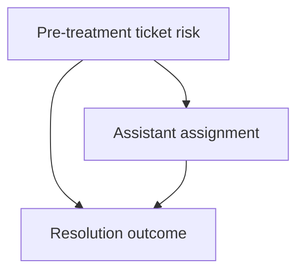

Backdoor adjustment estimates an intervention's effect by comparing treated and untreated outcomes within suitable pre-treatment covariate groups, then averaging those comparisons over a declared target population. The adjustment set must block noncausal paths that enter the treatment through common causes without opening new biasing paths or conditioning on treatment descendants.

## Block a common cause before comparing outcomes

The adjustment formula is $E[Y\mid do(T=t)]=\sum_z E[Y\mid T=t,Z=z]P(Z=z)$ when the required identification conditions hold. Those conditions include an appropriate measured adjustment set, overlap between treatment choices in relevant groups, consistent treatment and outcome definitions, and no unresolved confounding. The observational formula is not automatically justified just because a variable appears in a database.

## Example

Suppose the assistant's observed advantage is ten percentage points among both low-risk and high-risk tickets. For a target population containing 70% low-risk and 30% high-risk tickets, standardization yields $0.7(0.10)+0.3(0.10)=0.10$. This is a causal effect estimate only if pre-treatment risk blocks the relevant confounding paths and the remaining identification assumptions hold.

## Why it matters here

AI assistants often receive harder or riskier cases than baseline workflows. Comparing raw aggregates can penalize the assistant for its assignment mix. Backdoor adjustment explains when a fairer observational comparison is possible and when missing covariates or absent control examples prevent identification.

## Related terms

- [Confounder](glossary://confounder)
- [Propensity score](glossary://propensity-score)
- [Potential outcome](glossary://potential-outcome)
- [Average treatment effect](glossary://average-treatment-effect)
