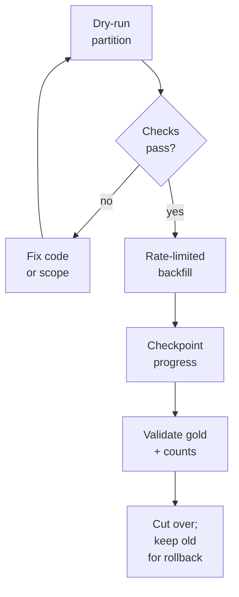

A **backfill** retroactively recomputes historical derived records through a pipeline that normally only processes new or incremental data. Live writers keep appending today's rows; a backfill repairs (or initializes) the past after a bug fix, schema change, feature definition change, new model artifact, or recovered outage. Without it, evals, indexes, dashboards, and features permanently encode the old bug for every historical partition.

A full load describes how much data is loaded; a backfill describes historical processing. They can overlap when initializing a new asset over its entire history. A backfill names a time range or partition set and runs the transformation to fill gaps or replace older results. Airflow, for example, creates runs for past logical dates according to a reprocessing policy.

At scale, backfills are high risk. They can overwrite good rows, race live writers, starve serving capacity, burn embedding or LLM provider quota, leave mixed code versions if they stop halfway, or leak future data into training rows if event time and availability time are confused. Treat a backfill like a production release: scope it, rate-limit it, version every output, and prove you can resume and roll back.

## Intuition

Incremental pipelines keep new records current while older history remains under yesterday's code and source quality. When either changes, reprocess the affected past. Partitions (day, hour, shard) make that work deliberate: each partition is an atomic unit built by a known code version from a known input window, so you can say "this day is missing," "this day used parser `p_1.7`," or "this day is already on `p_1.8`."

## How it works

1. **Scope.** Name assets (tables, indexes, feature views, model artifacts), partitions or date range, and every downstream dependent that must stay consistent with the rewrite.
2. **schema.** Fix input range, output sink, idempotency key or overwrite policy, checkpoint cadence, write rate, conflict policy with live writers, validation sample, and rollback path.
3. **Dry-run.** Process one small partition. Compare row counts, checksums, sampled diffs, and task metrics (recall, feature distributions, embedding drift) before touching production traffic.
4. **Execute in shards.** Prefer day or hour batches with concurrency caps so a failure restarts from one shard checkpoint. Rate-limit external APIs and shared clusters.
5. **Version and cut over.** Write to a new namespace, table version, or feature materialization when possible. Flip readers after validation; keep the old artifact long enough to roll back.
6. **Propagate.** If `raw` was repaired, reprocess `chunks` → `embeddings` → `index` (or offline features → online materialization) for the same partitions so the graph does not mix old and new logic.

## Diagram



## Example

In an invented example, a PDF parser dropped table captions for six weeks, affecting about $1.2$ million chunks. You ship parser `p_1.8.0` and backfill by day. Counts, quality gains, and retention below are illustrative choices:

1. Dry-run one day ($40$k docs): compare checksums, sample $200$ diffs, measure embedding cosine drift against the old vectors.
2. Write to a new index namespace `chunks_v18` with fields `parser_version`, `embedded_at`, and partition date. Live ingestion for new docs can dual-write or cut over independently of the historical job.
3. Cap embedding QPS so the backfill does not exhaust provider [quota](glossary://quota) shared with online traffic.
4. Flip retrieval after recall@20 on a $500$-query golden set rises from $0.61$ to $0.74$.
5. Keep the old namespace for $72$ hours for [rollback](glossary://rollback).

If the job is not [idempotent](glossary://idempotency), a retry can double-write or leave half the day on `p_1.7`. Checkpoint progress by date shard so a crash resumes from the last complete day.

```text
partition 2026-01-12: status=done  parser=p_1.8.0  chunks=40213  failed=0
partition 2026-01-13: status=running  last_doc_id=...
partition 2026-01-14: status=pending
```

## Run schema

| Field | What to pin |
| --- | --- |
| Input range | Event-time window or explicit partition list |
| Code / model version | Parser, feature transform, embedder, prompt |
| Output sink | Table, namespace, or feature view (prefer a new version) |
| Idempotency | Partition overwrite, MERGE by key, or deterministic write path |
| Checkpoint | Per-partition completion records alongside job status |
| Rate limits | Cluster concurrency, API QPS, queue priority vs live traffic |
| Conflict policy | Block live writers, dual-write, or write-only-new-namespace |
| Validation | Counts, checksums, golden queries, distribution checks |
| Rollback | Prior artifact pointer + retention window |
| Metrics | changed / unchanged / skipped / failed (separate counters) |

## Feature and training traps

Feature-store and warehouse backfills have an extra failure mode beyond RAG re-index. Correcting history with facts that were not available at prediction time makes offline training look better than production. For each source, compare event time, availability (ingestion) time, prediction timestamp, and backfill time. A feature can describe the past and still be illegal for a historical label if it arrived after the decision. Use [point-in-time joins](glossary://point-in-time-join) and record [lineage](glossary://provenance) so a repaired partition stays attributable to code and data versions.

## Why it matters here

AI systems accumulate derived state: chunks, embeddings, feature tables, eval snapshots, and indexes. Incremental pipelines keep new records current. Backfills repair older state and initialize new features or indexes from history so models and retrieval can be trained and measured against the full record.

## Related terms

- [Workflow checkpoint](glossary://workflow-checkpoint)
- [Idempotency](glossary://idempotency)
- [lineage](glossary://provenance)
- [Point-in-time join](glossary://point-in-time-join)
- [Rollback](glossary://rollback)
