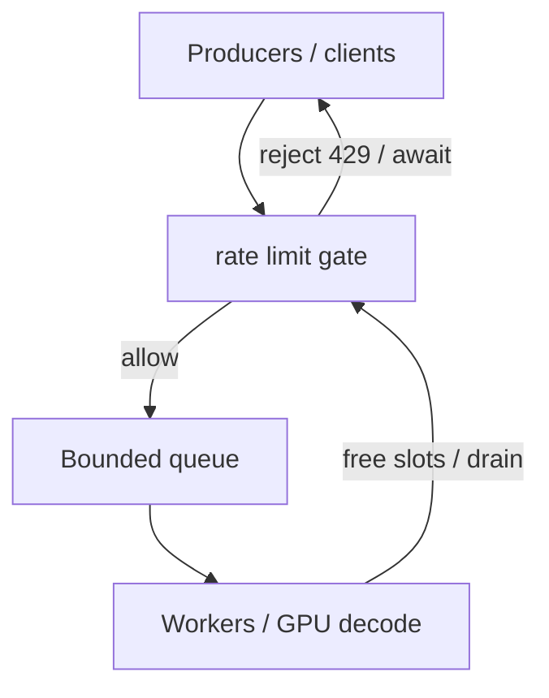

Backpressure is flow control that slows, pauses, or rejects *new* work when a downstream stage cannot keep up. The consumer (or a gate in front of it) signals limited capacity so producers stop dumping unbounded work into memory, queues, or GPU slots.

Without it, a fast producer and a slow consumer create an ever-growing buffer. Latency climbs, timeouts fire, clients retry, and the system looks broken even when the workers that still run would be fine at a lower request gating rate. Strong backpressure fails or delays some work early so *allowed* work still finishes under an SLO.

In AI serving that usually means bounded queues, concurrent-decode caps, KV-cache rate limiting, gateway `429`/`503` with `Retry-After`, cancellation of abandoned streams, and client-side await on full queues. Reactive Streams formalizes the same idea as non-blocking demand: a subscriber `request(n)` before the publisher may emit more items, so mediating queues stay bounded.

## Diagram



## Intuition

When allowed arrival rate exceeds sustainable service rate, queued work grows until the system applies one of four controls:

| Strategy | What happens | Typical place |
|---|---|---|
| **Block / await** | Producer waits until capacity frees | `asyncio.Queue(maxsize=N)`, thread `queue.Queue` |
| **Pull demand** | Consumer asks for $n$ items | Reactive Streams `request(n)`, pull streams |
| **Bound + shed** | Buffer to a fixed size, then reject or drop | HTTP gateway, broker max depth |
| **Slow with rate** | Smooth request gating over time | token bucket, provider RPM/TPM |

Buffering alone is not backpressure. An unbounded buffer only hides the mismatch until RAM or disk fails. Backpressure is the *signal and the limit* that stops inflow from exceeding what the system can absorb.

Little's law makes the latency cost concrete. In a stationary system,

$$
L = \lambda W
$$

where $L$ is average in-flight work, $\lambda$ is the allowed arrival rate, and $W$ is average time in system under stable long-run conditions. A queue cap bounds buffered count, not worst-case wait: a stalled or arbitrarily long job can still block allowed work. Deadlines, cancellation, and bounded service assumptions are needed for a time guarantee.

## How it works in LLM stacks

LLM requests are long-lived and uneven: prefill burns a burst of compute, decode holds a slot and KV memory for many steps. Continuous batching packs many sequences per GPU iteration, but memory and decode slots are still finite. Engines such as vLLM expose knobs like `max_num_seqs` (active sequences) and rely on KV-cache headroom for true concurrency. When those bounds are hit, new work must wait or be refused.

Useful layers, outer to inner:

1. **Client / SDK:** respect `Retry-After`, backoff with jitter, cancel when the user leaves.
2. **API gateway:** concurrent request limits, queue-age budgets, tenant fairness, `429`/`503`.
3. **Serving engine:** max concurrent sequences, max batched tokens, KV free blocks before allow.
4. **In-process queues:** `asyncio.Queue(maxsize=...)` so producers await instead of allocating forever.

Rate limits and quotas are *policy* caps (per identity, per minute, spend). Backpressure is *capacity* signaling (this path is full *right now*). Circuit breakers handle *dependency failure*, including when local capacity is healthy. You usually need all three: limits for fairness and cost, breakers for sick providers, backpressure for local saturation.

## Example

A decode pool holds $32$ concurrent sequences. Mean end-to-end service time is about $8$ s under that load, so allowed throughput sits near

$$
\lambda \approx \frac{L}{W} = \frac{32}{8} = 4\ \mathrm{req/s}.
$$

Arrivals spike to $20$ req/s for $30$ s.

**No backpressure.** The gateway accepts everything. Queue depth grows by roughly $(20-4)\times 30 = 480$ requests. At $4$ req/s drain, the last of those waits about $480/4 = 120$ s; clients that time out at $30$ s retry, so effective arrival rises further. Healthy workers still finish work, but almost no request meets the interactive latency SLO.

**With backpressure.** Cap waiting work at $16$ (about $4$ s of queue at $4$ req/s) and reject beyond that with `429` and `Retry-After: 5`. Peak in-system work stays near $32+16=48$. allowed traffic keeps roughly $W \approx 8$ to $12$ s. Rejected callers wait, apply jittered backoff, and retry with idempotency keys instead of doubling load.

```python title="bounded-request gating.py"
import asyncio
from dataclasses import dataclass, field

@dataclass
class Gate:
    max_in_flight: int
    in_flight: int = 0
    _lock: asyncio.Lock = field(default_factory=asyncio.Lock)

    def __post_init__(self) -> None:
        if self.max_in_flight < 1:
            raise ValueError("max_in_flight must be positive")

    async def acquire(self) -> bool:
        async with self._lock:
            if self.in_flight >= self.max_in_flight:
                return False  # caller maps this to 429 + Retry-After
            self.in_flight += 1
            return True

    async def release(self) -> None:
        async with self._lock:
            if self.in_flight == 0:
                raise RuntimeError("release without an acquired slot")
            self.in_flight -= 1
```

In process, prefer `await queue.put(...)` on a bounded queue when the producer is under your control. Across the network, prefer an explicit reject or delay signal so remote clients can back off instead of holding open connections forever.

## Signals

Watch **queue age** (often more honest than length when jobs are long), rejection rate, retry volume, in-flight concurrency, GPU/KV-cache utilization, TTFT and end-to-end p95, and caller timeout rates. Rising retries with stable worker throughput is a classic missing-backpressure signature.

## Why it matters here

LLM serving is expensive, bursty, and slow per request. Unbounded queues turn short spikes into multi-minute latency and self-inflicted retry storms. Backpressure turns overload into a clear schema: some work waits or fails fast so allowed generations still stream predictably.

## Related terms

- [Rate limit](glossary://rate-limit)
- [Circuit breaker](glossary://circuit-breaker)
- [Retry backoff](glossary://retry-backoff)
- [Continuous batching](glossary://continuous-batching)
- [asyncio.Queue](glossary://asyncio-queue)
