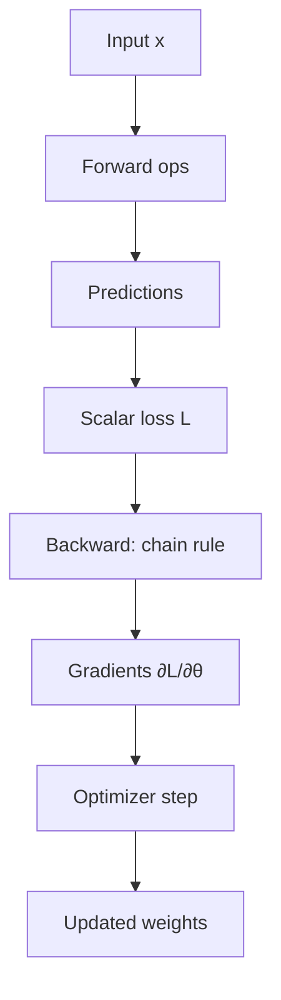

Backpropagation applies the chain rule backward through a differentiable computation graph to calculate derivatives of a scalar loss with respect to connected trainable parameters. A forward pass builds predictions and loss; backward propagates upstream derivatives through relevant operations. Unused or detached parameters do not need to receive gradients, and frameworks don't necessarily retain intermediate gradients after use.

In practice you almost never write those derivatives by hand. Frameworks use reverse-mode automatic differentiation (autograd): they record the forward ops, then run local vector-Jacobian products so one backward pass yields gradients for millions or billions of parameters. Optimizers then step those parameters using the stored gradients.

## Diagram



## Intuition

The loss is one number. Parameters are a huge vector. Backprop's job is to turn "the model was wrong by this much" into a separate nudge for each weight. It does that by reusing local derivatives at every op instead of differentiating the whole network as one giant expression.

Think of each layer as a local map $h = f(x; W)$. Once you know how the loss cares about $h$ (the *upstream* gradient), the chain rule tells you how it cares about $x$ and $W$. That upstream signal is the same "error message" flowing from the loss toward the input, rewritten at every step.

## Formula

**Chain rule.** If $x$ affects $h$ and $h$ affects loss $L$:

$$
\frac{\partial L}{\partial x} = \frac{\partial L}{\partial h}\cdot\frac{\partial h}{\partial x}
$$

Reverse-mode autodiff never materializes full Jacobians when it can avoid them. For each op it computes a vector-Jacobian product: given upstream $\frac{\partial L}{\partial h}$, return $\frac{\partial L}{\partial x}$ (and parameter gradients) in time comparable to the forward op. That is why training stays feasible when there are far more parameters than scalar losses.

**Linear layer.** For $h = Wx$ (column vector $x$) and upstream gradient $g = \partial L / \partial h$:

$$
\frac{\partial L}{\partial W} = g\, x^{\top}, \qquad \frac{\partial L}{\partial x} = W^{\top} g
$$

PyTorch `nn.Linear` uses row-batch layout $h = xW^{\top}$ (plus bias); then $\partial L/\partial W = g^{\top} x$ / outer-product forms match that transpose convention. Batch dimensions accumulate the same outer-product pattern over examples.

**Softmax + cross-entropy.** With logits $z$, probabilities $p = \mathrm{softmax}(z)$, one-hot target $y$, and $\mathcal{L} = -\sum_i y_i \log p_i$, the combined gradient collapses to:

$$
\frac{\partial \mathcal{L}}{\partial z} = p - y
$$

That simple form is why classification and next-token training stacks fuse softmax and cross-entropy rather than materializing $p$ then taking $\log$ (which is easy to under/overflow). Numerically stable softmax uses [log-sum-exp](glossary://log-sum-exp) (subtract $\max_i z_i$ before the exp sum); fused CE losses keep that path inside one kernel so neither $p$ nor $\log p$ is written out in full precision risk.

## Worked numbers

Three-class logits $z = [2.0,\, 1.0,\, 0.1]$, true class index $0$ so $y = [1,\, 0,\, 0]$. After stable softmax:

$$
p \approx [0.659,\, 0.242,\, 0.099]
$$

Cross-entropy is $\mathcal{L} = -\log 0.659 \approx 0.417$. The gradient into the logits is:

$$
\frac{\partial \mathcal{L}}{\partial z} = p - y \approx [-0.341,\, 0.242,\, 0.099]
$$

Interpretation: push the correct logit up (negative gradient if descent subtracts $\eta \nabla$), and push the incorrect logits down. That vector is the upstream signal for the final projection layer; outer products with the layer input then become $\partial \mathcal{L}/\partial W$ for that matrix.

## Example

A language model predicts the next token. Softmax puts probability $0.01$ on the correct token; cross-entropy is high (about $4.6$). Calling `loss.backward()` in PyTorch walks the autograd graph from $L$ through the LM head, residual blocks, attention, and embeddings. Each parameter $\theta$ gets $\partial L/\partial \theta$ in `.grad`. An optimizer (for example AdamW with learning rate $10^{-3}$) then updates $\theta$.

If you discarded activations during the forward pass to save memory, backward must recompute them (activation checkpointing), because local Jacobians depend on those intermediates. If you froze most of the base model for LoRA fine-tuning, only adapter (and any unfrozen) tensors get `.grad` filled and stepped; frozen weights can still sit in the forward path (and in VJPs that feed trainable layers), but they are not updated.

```python
loss = criterion(logits, targets)  # scalar
optimizer.zero_grad(set_to_none=True)
loss.backward()                    # fills each param's .grad via reverse-mode AD
torch.nn.utils.clip_grad_norm_(model.parameters(), max_norm=1.0)
optimizer.step()
```

## Memory and production

Saved activations usually dominate training memory on long sequences, not the parameter tensors alone. Mixed precision, activation checkpointing, and sharded optimizers (FSDP/ZeRO) all exist so reverse-mode AD stays feasible under GPU limits.

Gradient quality is separate from memory. Vanishing gradients weaken learning signals; exploding gradients can lead to nonfinite values. Residual connections and normalization can improve gradient flow, while clipping limits gradient norm. Loss scaling addresses low-precision underflow; diagnose divergence with additional checks. Inspect per-layer gradients as well as scalar loss.

## Why it matters here

Backpropagation is the mechanism that turns a training objective into weight updates. Fine-tuning, LoRA, pretraining, RLHF-style preference losses, gradient clipping, checkpointing, and most failed-training debug stories all sit on this path. If you can reason about chain rule through softmax+cross-entropy, residual blocks, and frozen vs trainable parameters, you can read training code and diagnose runs instead of treating `loss.backward()` as a black box.

## Related terms

- [Cross-entropy](glossary://cross-entropy)
- [Gradient](glossary://gradient)
- [Optimizer](glossary://optimizer)
- [Activation checkpointing](glossary://activation-checkpointing)
- [Softmax](glossary://softmax)
- [Log-sum-exp](glossary://log-sum-exp)
