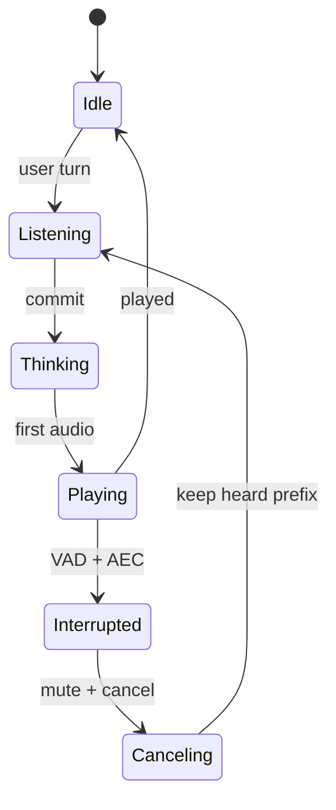

Barge-in is the voice-agent capability that lets a user interrupt the assistant mid-utterance and have the system stop speaking, treat the new speech as the next user turn, and continue. Humans overlap and redirect mid-sentence; a half-duplex "wait for the prompt" bot cannot. Product barge-in relies on a low-latency orchestration loop across mic capture, [voice activity detection](glossary://voice-activity-detection), [echo cancellation](glossary://echo-cancellation), playback mute, cancellation of in-flight LLM/[TTS](glossary://text-to-speech) work, streaming [speech-to-text](glossary://speech-to-text), and conversation-state repair so only audio the user actually heard stays in history.

Without barge-in, callers who already know the answer or want a different path must sit through the rest of a monologue. With a broken barge-in stack, the agent talks over the user, answers its own echo, or later "remembers" sentences that never left the speaker buffer.

## How it works

A production path looks like this while the agent is playing audio:

1. **Listen continuously.** Mic frames keep flowing even during TTS. Local VAD (or a fast server-side detector) watches for user speech onset, not for a full finished turn.
2. **Reject self-echo.** [Echo cancellation](glossary://echo-cancellation) (AEC) removes the agent's own playback from the mic so VAD does not fire on the loudspeaker. Double-talk (user and agent speaking at once) is the hard acoustic case; residual echo is a common false barge-in source.
3. **Confirm, then mute.** A short minimum speech duration or energy gate reduces noise pops and backchannel "mm-hmm" cuts. Once confirmed, stop playout immediately (often a client-local mute before the server round trip).
4. **Cancel generation.** Abort in-flight TTS and, when appropriate, the LLM stream so you stop spending tokens and stop filling speaker queues that will never be heard.
5. **Recognize the interrupt.** Streaming STT transcribes the user's utterance; [endpointing](glossary://endpointing) decides when that new turn is complete.
6. **Reconcile history.** Keep assistant text that was actually played. Drop or quarantine text and audio that were generated but never heard. The next model call must not act as if the user heard the truncated tail.

Measure user-speech-onset to stopped playout separately from recognition and response latency. Treat a 100ms p95 mute target as a product-specific example and set the service objective for your use case. Playback acknowledgments estimate what reached the speaker; assess user comprehension separately.

## Diagram

On interruption, mute playback, abort in-flight LLM/TTS work and truncate history to the heard prefix before listening for the next turn.

Treat races as first-class: late cancel acks, buffered audio still in the jitter queue, and partial transcripts that arrive after mute must not reopen stale speech.

## Example

The assistant starts a long answer that would take about $40$s of audio. At $t = 3.20$s the user says "skip to pricing."

| Event | Time |
|---|---|
| User speech onset | $t = 3.20$s |
| Local VAD fires (AEC-cleaned mic) | $t = 3.25$s |
| Client mutes speakers | $t = 3.30$s |
| Cancel reaches TTS/LLM | $t = 3.45$s |
| Streaming STT partial: "skip to..." | $t \approx 3.6$s |
| Endpoint commits full interrupt turn | $t \approx 4.1$s |

Suppose synthesis had already produced the full string `"Incident is open because the database failover is still running."` but only `"Incident is open"` had crossed the speaker by the interrupt. History for the next model call should keep the heard prefix and discard the unheard suffix. If you keep the full generated string, the model may skip pricing because it believes it already explained the database failure.

Failures to watch on the same timeline: echo triggers false barge-in while no human spoke; old chunks keep playing after cancel because a client buffer was not flushed; the next turn still contains the cancelled tail; backchannel noise cuts the agent every few words because the min-speech gate is too aggressive.

## Heard vs generated

Barge-in correctness depends on the **playback boundary**. Jitter buffers, packet loss, and underruns separate generated audio from audio that reached the speaker. Map playout timestamps (or chunk end times) to text spans, truncate assistant history to the last fully played span, and cancel anything still queued. Model interruption as a [state machine](glossary://state-machine) with explicit cancel and reconcile steps. A single boolean `interrupted` cannot represent these states.

## Tuning and production pressure

Sensitivity versus stability is the main dial:

- **Too sensitive:** background noise, keyboard clicks, TV speech, or brief acknowledgments stop the agent mid-sentence. False barge-in rate climbs in cars, open offices, and speakerphone rooms.
- **Too sluggish:** users must shout or wait; the product feels half-duplex again. Missed barge-in rate and "talked over user" complaints climb.
- **Missing AEC:** the agent hears itself, VAD fires on its own voice, STT may transcribe the prompt, and the loop looks like an LLM bug if you only inspect the final transcript.

Tune VAD energy, minimum speech duration before confirm, mute delay, and whether backchannels should interrupt. Measure mute latency, false barge-in rate, missed barge-in rate, residual-echo false triggers, cancel lag, and how often unheard text leaks into the next prompt. Test across real devices and rooms alongside clean-headset demos.

## Why it matters here

Barge-in is a defining quality bar for real-time voice agents: it separates a responsive conversation from a scripted monologue. On LeetLLM it sits next to VAD, endpointing, echo cancellation, and TTS in the voice stack. Engineers must reason about model quality, cancellation, playout-confirmed history, and low-latency orchestration under double-talk.

## Related terms

- [Voice activity detection](glossary://voice-activity-detection)
- [Echo cancellation](glossary://echo-cancellation)
- [Text-to-speech](glossary://text-to-speech)
- [Endpointing](glossary://endpointing)
- [State machine](glossary://state-machine)
