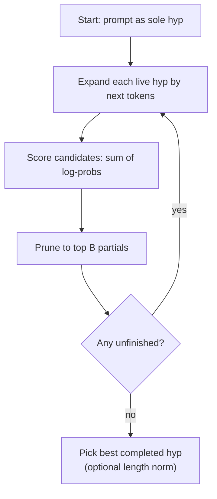

Beam search is a pruned breadth-first decoding algorithm. Instead of committing to one next token (greedy), it keeps the $B$ highest-scoring partial sequences (the *beam*) at every step, expands each by candidate next tokens, scores the full set of candidates, and prunes back to width $B$. When hypotheses finish (usually by emitting EOS), the decoder returns the completed sequence with the best score, often after length normalization.

Beam search is a heuristic: pruning can discard the path that would yield the globally most likely full string under the model. Compared with pure maximum a posteriori (MAP) search, moderate beam widths often produce *better* text on translation-style tasks because they avoid pathological high-likelihood modes (empty or ultra-short strings) that exact search can prefer on poorly calibrated neural generators.

## How it works

At step $0$, the beam holds the prompt (or BOS). At each later step:

1. For every live partial hypothesis $y_{<t}$, run the model once and get next-token log-probs.
2. Form candidates by appending tokens; cumulative score is usually the sum of token log-probs.
3. Rank all candidates and keep the top $B$.
4. Move finished hypotheses (EOS) to a completed pool; continue until max length or early stop.

In log space, the joint probability of a full string factors as:

$$
\log P(y \mid x) = \sum_{t=1}^{|y|} \log P(y_t \mid x, y_{<t})
$$

Beam search approximates $\arg\max_y \log P(y \mid x)$ under a width-$B$ prune. $B=1$ is greedy decoding. Hugging Face enables this with `num_beams > 1` and `do_sample=False`; vLLM exposes a dedicated `beam_search` path with a `beam_width`.

## Diagram



## Length bias and scoring

Because every extra token multiplies probability by a value less than $1$, unnormalized sequence log-prob trends more negative as length grows. Raw scores therefore favor short, safe endings unless you correct for length.

A common length penalty from Google's Neural Machine Translation (GNMT) system is:

$$
s(Y, X) = \frac{\log P(Y \mid X)}{lp(Y)}, \quad lp(Y) = \frac{(5 + |Y|)^\alpha}{(5 + 1)^\alpha}
$$

With $\alpha = 0$ there is no correction. Values near $0.6$ to $0.7$ were often strong on GNMT development sets; choose $\alpha$ on *your* metric because its useful value depends on the task. Encoder-decoder systems sometimes add a coverage term that rewards attending to the full source. Without length handling, wide beams still clip summaries and translations early.

## Example

Suppose the prompt is `"The"` and $B = 2$. After one expand step the beam might hold (toy log-prob sums):

| Partial | Cumulative log-prob |
|---|---|
| `"The cat"` | $-0.9$ |
| `"The dog"` | $-1.1$ |

Next step, expand both. Candidates include `"The cat sat"` ($-1.4$), `"The cat ran"` ($-1.6$), `"The dog sat"` ($-1.5$), `"The dog barked"` ($-1.8$). Prune back to $B=2$: keep `"The cat sat"` and `"The dog sat"`. Greedy would have locked `"cat"` after step 1 and never re-ranked a path that started slightly worse.

Worked length-normalized ranking (GNMT-style, $\alpha = 0.6$):

| Hypothesis | $\log P$ | $\|Y\|$ | Raw winner? | Normalized score |
|---|---|---|---|---|
| short: `"late"` | $-1.00$ | 2 | yes | $-1.00 / ((5+2)/6)^{0.6} \approx -0.91$ |
| full: `"needs review"` | $-1.08$ | 5 | no | $-1.08 / ((5+5)/6)^{0.6} \approx -0.79$ |

Raw log-prob prefers the short string; length normalization prefers the complete one.

In libraries:

```python
# Hugging Face: deterministic beam search
outputs = model.generate(
    **inputs,
    num_beams=5,
    do_sample=False,
    early_stopping=True,
    length_penalty=0.6,  # HF uses length^λ, a distinct form with a similar role to GNMT α
    max_new_tokens=64,
)
```

Compare beam widths on a fixed task set because BLEU, ROUGE, and user utility can rise or fall with width. Live branches increase work and KV storage, with sharing and batching affecting the actual cost. Full-sequence probability includes the ending token, and length penalties change the search objective. The table uses hypothetical token counts; run the tokenizer to count the visible words.

## Trade-offs

| Setting | Behavior |
|---|---|
| Small $B$ (2-5) | Cheap-ish search; often best quality for NMT-style tasks |
| Large $B$ (20+) | Closer to MAP; can *hurt* BLEU/ROUGE and increase blandness |
| Beam + open-ended chat | High-likelihood, repetitive, "safe" phrasing |
| Beam + MT / ASR / captioning | Good fit: one grounded target meaning |

Search cost scales with beam width: each step scores up to $B \times V$ candidates in the naive view (practice keeps top tokens per beam and batches the $B$ forwards). Serving engines may share prompt KV blocks across beams via copy-on-write, but decode FLOPs and memory still grow with live branches. Beam search is poorly matched to continuous-batching chat traffic that expects diverse samples and streaming single paths.

## Why it matters here

Beam search sits next to greedy, top-k, top-p, and temperature as a first-class decoding policy. The curriculum uses it to teach that sequence likelihood and human quality measure different things, that length scoring is load-bearing, and that production systems pay real latency and KV-cache cost for multi-hypothesis search. Prefer beam for tightly grounded generation. Prefer truncated sampling for open-ended assistants.

## Related terms

- [Autoregressive decoding](glossary://autoregressive-decoding)
- [Length penalty](glossary://length-penalty)
- [Logprob](glossary://logprob)
- [Top-p](glossary://top-p)
- [KV cache](glossary://kv-cache)
