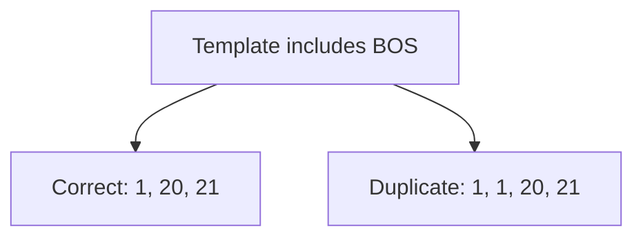

A beginning-of-sequence (BOS) token is a special token used by some language-model formats to mark the start of an input sequence. It supplies an explicit starting context for predicting the first ordinary token. Not every model requires BOS, and its presence doesn't imply that every chat message starts with another copy.

## Let the model format own the boundary

The tokenizer and chat template determine whether BOS belongs in an input. A template may insert it already. Encoding that formatted text with another automatic special-token insertion can duplicate it. Conversely, removing a required BOS changes the first prediction's context even if the visible user text is unchanged.

Inspect final token IDs alongside the displayed text. Different tokenizers assign their own IDs and visible spellings, so a control-token-looking string can differ from the configured special token.

## Example

For a toy vocabulary, let BOS be 1 and the words "hello world" encode as `[20, 21]`. A model trained on `[1, 20, 21]` predicts "hello" after BOS. Feeding `[1, 1, 20, 21]` duplicates the start marker; feeding `[20, 21]` removes it. Neither input is identical to the intended training sequence.

## Why it matters here

Tokenization, perplexity, instruction tuning, and checkpoint comparisons all depend on consistent starting context. A one-token prefix mismatch shifts positions and can create misleading likelihood differences. Follow the checkpoint's documented formatting path and save a small token-level fixture before comparing models or runtimes.

## Related terms

- [Tokenization](glossary://tokenization)
- [End-of-sequence token](glossary://end-of-sequence-token)
- [Chat template](glossary://chat-template)
- [Perplexity](glossary://perplexity)
