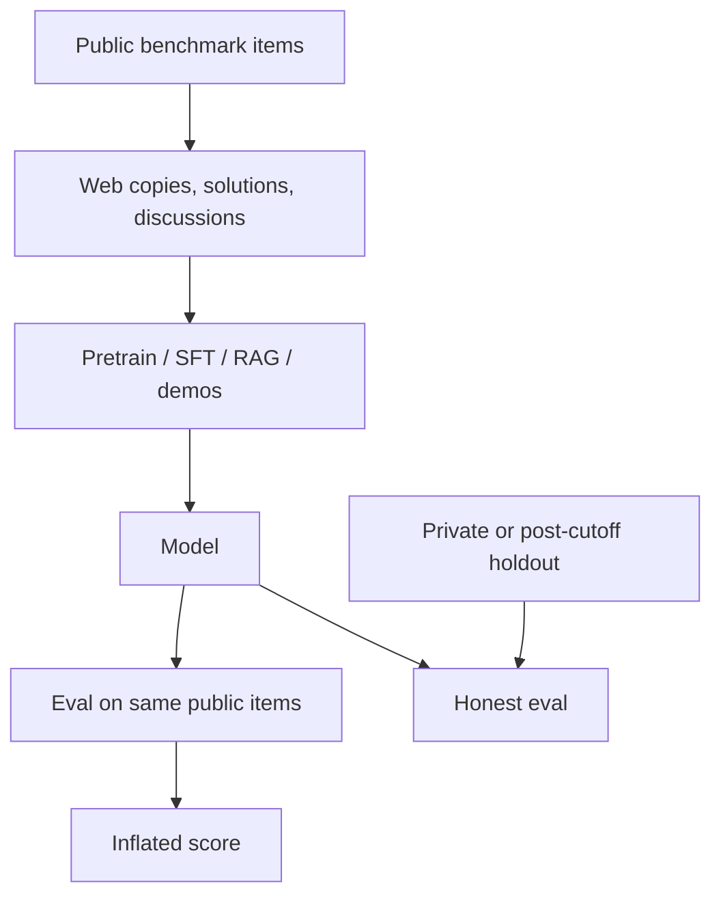

Benchmark contamination happens when evaluation tasks, answers, or task-specific hints appear in a model's training, fine-tuning, retrieval, or prompt-demo data. The reported score then mixes memorization of those items with genuine skill on the task class.

An evaluation measures generalization to held-out items. If gold answers, task IDs, near-duplicate prompts, solution writeups, or even unlabeled stems appear in pretraining crawls or later adaptation data, high accuracy can reflect prior exposure as well as problem-solving ability. That is a form of [feature leakage](glossary://feature-leakage) at the corpus and evaluation-design level: the test signal is available before evaluation time.

Training on different items from the same domain is ordinary learning. Contamination involves exposure to evaluation content, ranging from exact unlabeled stems and partial snippets to full input-and-label leakage. Its effect depends on how the material was used; exposure can inflate scores even when individual items were not memorized.

## Example

In a hypothetical comparison, a model scores 92% on public repair tasks and 61% on private variants. The gap warrants investigation. Difficulty, formatting, available context, and harness differences can also change scores, so seek task-specific exposure evidence and controlled comparisons before attributing it to leaked-patch recall.

A second pattern shows up in closed models you cannot inspect: performance is strong on problems published before a stated training cutoff and weak on carefully matched problems published after it. That chronological gap raises contamination risk; validate exposure at the item level before making ship decisions from a public leaderboard.

## How contamination enters

| Path | What leaks | Typical surface |
| --- | --- | --- |
| Pretraining crawl | Stems, labels, tutorials | GitHub, blogs, papers, forums, mirror sites |
| Fine-tune / SFT mix | Near-duplicates of eval rows | Instruction dumps, synthetic data from strong models |
| Few-shot demos | Exact or rephrased test prompts | Prompt libraries, notebooks, chat logs |
| Retrieval index | Gold docs or solutions | RAG corpora built from internal docs plus public dumps |
| Eval harness itself | Labels in prompts or grader hints | Shared fixtures, leaderboard discussions, CI artifacts |

Risk rises the longer a benchmark is public, the more often solutions are crawlable, and the more often synthetic data is generated by models that may have seen the same tasks. Synthetic instruction data is not automatically clean: a teacher model can rephrase contaminated items into training text that n-gram filters miss.

## Detection

Combine corpus-side and model-side evidence when you can. Each check catches different leakage paths.

**Corpus / string checks (when training data is accessible)**

- **n-gram overlap.** Classic decontamination (for example GPT-3-style 13-gram overlap, or character-span rules used in later reports) flags near-verbatim copies. Cheap, misses paraphrase and reordering.
- **Normalized exact match.** After lowercasing, whitespace, and punctuation normalization, look for full-stem or full-solution copies.
- **Embedding / LLM decontaminators.** Retrieve near-neighbors of each eval item in the training corpus, then judge semantic equivalence. Catches rewrites that n-grams miss; costs more and needs a strong judge.

**Model-side signals (when the corpus is closed)**

- **Membership-style probes.** Canary strings, name-cloze, partial-option guessing, or guided reconstruction: if the model recovers withheld fields of a public item far above chance, treat that item as suspect.
- **Public-vs-private or clean-vs-dirty gaps.** Same task family, held-out IDs. A large drop on private or post-cutoff items is the operational red flag.
- **Chronological splits.** Score items by publication date relative to the training cutoff or your fine-tune snapshot.

Sketch of a minimal n-gram overlap filter over a training shard:

```python
def contaminated(eval_text: str, train_text: str, n: int = 13) -> bool:
    if n < 1:
        raise ValueError("n must be positive")
    def grams(s: str) -> set[str]:
        toks = s.lower().split()
        return {" ".join(toks[i : i + n]) for i in range(len(toks) - n + 1)}

    return bool(grams(eval_text) & grams(train_text))
```

A match raises contamination risk. A clean n-gram pass leaves paraphrase, translation, and solution-blog leakage for additional checks.

## Mitigation

Prefer designs that reduce dependence on a single static public set:

1. **Decontaminate training data** against known evals before pretrain/SFT, and re-run when you add new public benchmarks.
2. **Freeze a private [golden dataset](glossary://golden-dataset)** that never enters training, demos, RAG, or hyperparameter search. Version it when product behavior changes.
3. **Use time-split and rotating tasks.** Keep older public items as regression fixtures; score generalization on items authored after the tuning snapshot (LiveBench-style refresh, LiveCodeBench-style post-cutoff coding tasks).
4. **Rewrite or regenerate variants** of public stems when you need a comparable public suite, knowing rewrites only reduce risk; they do not eliminate semantic leakage.
5. **Report the protocol.** Decontamination method, cutoff date, private holdout policy, and harness version belong next to the score. A number without that context is not decision-grade.

For ship decisions, prefer private holdouts and refreshed variants over a single public leaderboard. Public scores still help for rough ranking and regression tracking; they should not be the only gate.

## Diagram



## Why it matters here

Public LLM benchmark scores carry contamination risk. Leaderboard jumps can reflect memorization, format familiarity, or real capability gains. Production selection needs internal golden sets, time-aware holdouts, and an [eval harness](glossary://eval-harness) that records decontamination and split policy. That discipline helps distinguish benchmark performance from success on novel tickets in your product.

## Related terms

- [Golden dataset](glossary://golden-dataset)
- [Train, validation, and test split](glossary://train-validation-test-split)
- [Feature leakage](glossary://feature-leakage)
- [Eval harness](glossary://eval-harness)
- [Offline evaluation](glossary://offline-evaluation)
