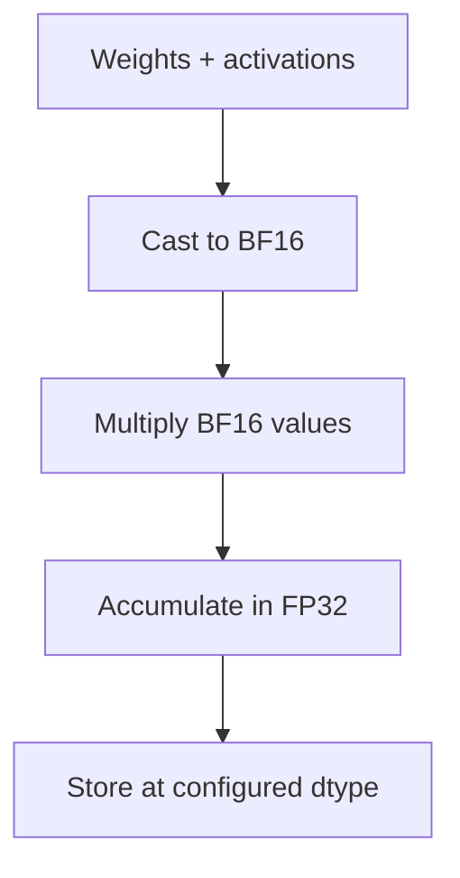

BF16 (bfloat16, "Brain floating point") is a 16-bit floating-point format with $1$ sign bit, $8$ exponent bits (bias $127$), and $7$ fraction bits. It is essentially the top half of an IEEE 754 FP32 word: same exponent field, truncated mantissa. Dynamic range therefore matches FP32 (finite magnitudes up to about $3.4 \times 10^{38}$), while relative precision falls to roughly $2^{-7}$ (about two to three decimal digits). Google Brain designed it for TPU matrix units; modern GPUs, CPUs, and accelerators now train and often serve large models in BF16.

Neural nets tolerate coarse mantissas far better than narrow exponents. That is the design bet: keep overflow and underflow behavior close to FP32 so mixed-precision training needs less hyperparameter retuning than IEEE FP16, which uses only $5$ exponent bits and tops out near $65504$.

## Bit layout

| Format | Bits | Sign | Exponent | Fraction | Approx. max finite |
|---|---|---|---|---|---|
| FP32 | 32 | 1 | 8 (bias 127) | 23 | $\approx 3.4 \times 10^{38}$ |
| BF16 | 16 | 1 | 8 (bias 127) | 7 | $\approx 3.39 \times 10^{38}$ |
| FP16 | 16 | 1 | 5 (bias 15) | 10 | $\approx 6.55 \times 10^{4}$ |

Normalized values follow the same style of encoding as binary32:

$$
(-1)^{s} \times 2^{E-127} \times \bigl(1 + m \cdot 2^{-7}\bigr)
\quad\text{for } E \in [1, 254].
$$

FP32 $\to$ BF16 conversion keeps the sign and exponent and rounds or truncates the lower $16$ significand bits. Early storage-only paths often truncated (round toward zero); TPU and NVIDIA conversion typically use round-to-nearest-even. BF16 $\to$ FP32 pads $16$ zero mantissa bits, so every BF16 value is exactly representable in FP32.

## Diagram



The nearby bit-layout table shows why BF16 keeps FP32's range while using fewer fraction bits than FP16. This path shows the common mixed-precision calculation: BF16 products build a wider FP32 sum before the output is stored.

## Intuition

Think of BF16 as "FP32 range, half the bytes, much coarser spacing." Adjacent BF16 values around $1$ are $2^{-7} = 0.0078125$ apart in the significand sense, so $\pi$ rounds to $3.140625$ and $1/3$ to $0.333984375$. That is enough for most matmuls and activations when accumulators stay wider. Long-running exact sums, sensitive reductions, and tiny parameter updates need careful higher-precision handling, especially when master weights use BF16.

Hardware multiplies often run in BF16 while accumulations stay in FP32 (the classic TPU MXU pattern). That mixed path is why training can look almost like FP32 even though tensors in memory are half as wide.

## Example

A $7$B-parameter checkpoint alone is about $28$ GB in FP32 and about $14$ GB in BF16 ($7 \times 10^9 \times 4$ vs $\times 2$ bytes). Optimizer state is separate and often dominates: Adam-style recipes commonly keep FP32 master weights plus moment estimates even when forward and backward matmuls use BF16.

In PyTorch mixed precision, BF16 autocast typically does **not** need a `GradScaler`, unlike FP16:

```python
# BF16 mixed precision on supported hardware (Ampere+ GPU, recent CPU, TPU, ...)
with torch.autocast(device_type="cuda", dtype=torch.bfloat16):
    logits = model(batch)
    loss = criterion(logits, labels)
loss.backward()
optimizer.step()
```

A gradient of $10^{-5}$ is normal in BF16/FP32 but subnormal in FP16, whose minimum normal value is about $6.1\times10^{-5}$. It isn't necessarily zero: FP16 supports subnormals down to about $5.96\times10^{-8}$, though hardware paths may flush them. Loss scaling can lift small intermediate gradients into a better-resolved range. BF16's wider exponent range helps, but coarse rounding can still erase small parameter updates.

A BF16 training run served in FP16 can shift evaluation metrics. Include dtype conversion in the serving contract and measure the cast's effect.

## How it works in training

Typical BF16 mixed-precision flow:

1. Keep master weights (and often optimizer state) in FP32.
2. Cast weights and activations to BF16 for large matmuls and convolutions.
3. Accumulate products in FP32 (or another wide type) inside the kernel when hardware supports it.
4. Store operation outputs at the policy's selected dtype. Gradients accumulated into FP32 parameters are normally FP32; autocast doesn't make all gradients BF16.
5. Update parameters with the optimizer's actual storage and arithmetic policy.

You can also store compute weights themselves in BF16 for more memory savings; that is more aggressive and needs a quality baseline. Hardware without native BF16 tensor cores may emulate slowly, so "BF16" on paper is not free speed everywhere.

## Trade-offs

| | BF16 | FP16 |
|---|---|---|
| Dynamic range | Matches FP32 | Narrow; easy overflow/underflow |
| Mantissa precision | $7$ bits | $10$ bits |
| Loss scaling | Usually unnecessary | Often required in training |
| Failure mode | Rounding / precision loss | Range + scaling bugs |
| Hardware | TPUs, Ampere+ GPUs, many modern CPUs | Broad GPU half-precision support |

BF16 preserves FP32's exponent range while reducing mantissa precision. Softmax, layer norm, large reductions, and very small learning-rate updates can still need FP32 paths. Subnormal handling also varies by stack: flush-to-zero (FTZ) and platform-dependent denormal behavior can make tiny intermediates vanish. TPU conversion is one documented example. Keep a short FP32 or carefully configured BF16 baseline and compare task evaluations alongside training loss.

## Why it matters here

BF16 is the default 16-bit training format on much of modern LLM hardware. It explains why large-model runs can drop activation and weight memory without a loss-scaling firefight, why hardware choice shapes the mixed-precision recipe, and how BF16 and FP16 trade range and precision differently in production.

## Related terms

- [FP16](glossary://fp16)
- [Mixed precision](glossary://mixed-precision)
- [Loss scaling](glossary://loss-scaling)
- [GPU](glossary://gpu)
- [Quantization](glossary://quantization)
