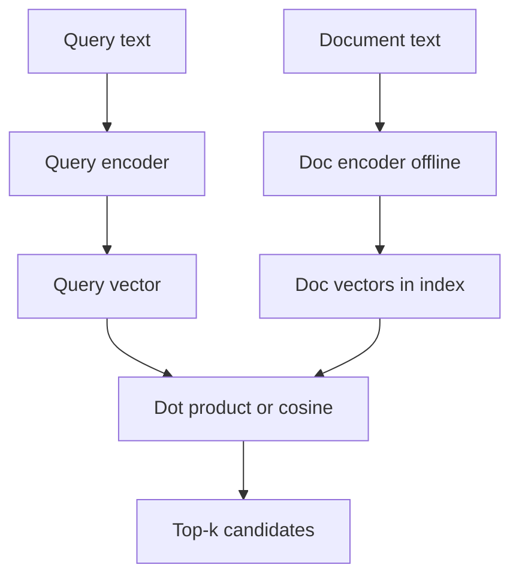

A bi-encoder (also dual-encoder or two-tower model) maps a query and a document through separate forward passes into fixed-size vectors, then scores the pair with a decomposable similarity such as a dot product or cosine. Because each side is encoded alone, document vectors can be computed offline, stored in a vector index, and reused for every query. At request time you only embed the query and run exact or approximate nearest-neighbor search.

Independent document encoding enables dense indexing. A cross-encoder scores a query-document pair jointly, so its pair score can't be precomputed for arbitrary future queries. It can rerank a shortlist. Late-interaction models can also retrieve directly over precomputed token vectors; they aren't restricted to reranking.

## Diagram

## How it works

Two encoder towers $E_Q$ and $E_P$ (often the same architecture, sometimes shared weights, sometimes specialized) map a query $q$ and a passage $p$ independently. Common pooling choices are the `[CLS]` token (as in DPR) or mean pooling over token states (as in many Sentence-BERT setups). The score must factor so the passage vector does not depend on the query:

$$
\mathrm{sim}(q, p) = E_Q(q)^\top E_P(p)
$$

After L2-normalizing both embeddings, this is cosine similarity (inner product of unit vectors). Decomposability is the whole point: build $E_P(p)$ once per passage, index with FAISS/HNSW/IVF, embed each live query once, then run MIPS or ANN over the index. **Train-time similarity must match serve-time search:** if you train with L2-normalized cosine but index with unnormalized inner product (or the reverse), ANN neighbors and recall@k silently degrade even when the encoder is fine.

Shared-weight Siamese bi-encoders (Sentence-BERT / SBERT) push similar sentences together under cosine after fine-tuning. Asymmetric dual encoders (DPR) keep separate question and passage BERT towers so each side can specialize while still training with a contrastive ranking objective.

## Formula

Dense Passage Retrieval trains with negative log-likelihood over one positive passage and a set of negatives (in-batch negatives: other queries' gold passages in the mini-batch, plus often BM25 hard negatives):

$$
\mathcal{L}(q_i, p_i^+, \{p_{i,j}^-\}) = -\log \frac{e^{\mathrm{sim}(q_i, p_i^+)}}{e^{\mathrm{sim}(q_i, p_i^+)} + \sum_j e^{\mathrm{sim}(q_i, p_{i,j}^-)}}
$$

With $B$ queries and $B$ passages, the score matrix contains $B^2$ pair scores from $2B$ encoded examples, typically processed in two batched encoder passes. Explicit extra negatives change those counts. InfoNCE-style variants can include a temperature $\tau$.

## Example

In a hypothetical design, five million 768-dimensional passage vectors feed HNSW. One query encoding produces 200 candidates, and a cross-encoder reranks to eight prompt chunks. Measure recall and latency on the actual corpus; neither a 10ms encoding nor 0.89 recall is guaranteed. Exhaustive cross-encoding would score five million pairs per query, which is usually impractical for an interactive budget.

The same stack can still miss fine constraints. Query: "staging service accounts cannot write to production." A bi-encoder may retrieve a generic "service account overview" that is topically close but wrong on the negation and environment boundary. A cross-encoder reading the pair often demotes that miss. Stage-two reranking exists for exactly those cases. SBERT quantified the scaling gap: comparing all pairs among $10{,}000$ sentences with a BERT cross-encoder needs $\approx 50$M inferences (~$65$ hours on a V100); encoding once per sentence with a bi-encoder takes seconds, then a cheap cosine matrix finishes the comparisons.

## Training signal

You need positives that match real retrieval intent, hard negatives that look similar but fail the query, and eval rows that measure first-stage recall@k alongside end-to-end answer quality. Easy random negatives teach broad topic separation and then stop helping. In-batch negatives are free compute. BM25 or ANN-mined hard negatives sharpen decision boundaries. Watch for false negatives (valid answers treated as negatives), domain shift after corpus updates, and anisotropy if random pairs still score high. After any encoder upgrade, re-embed the corpus. Mixed embedding versions silently break ranking.

## Trade-offs

| Concern | Bi-encoder | Cross-encoder |
| --- | --- | --- |
| Offline index | Yes (one vector per doc) | No |
| Query cost | One encode + ANN | One encode per candidate pair |
| Token interaction | Compressed into pooled vectors | Full cross-attention |
| Typical role | First-stage retrieval | Rerank top tens/hundreds |

Late-interaction models (ColBERT) sit between these poles: independent encoding of token vectors, then MaxSim at query time. Use bi-encoders when you need sub-second search over large corpora; add hybrid BM25, rerankers, or late interaction when recall or fine ranking is the bottleneck.

## Why it matters here

Bi-encoders explain why dense retrieval scales in RAG: precomputed passage vectors plus ANN candidate generation, then optional cross-encoder polish. When answers miss evidence, ask whether the gold chunk never entered the bi-encoder top-$k$ before blaming the generator.

## Related terms

- [Cross-encoder](glossary://cross-encoder)
- [Dense retrieval](glossary://dense-retrieval)
- [Candidate generation](glossary://candidate-generation)
- [Siamese network](glossary://siamese-network)
- [InfoNCE](glossary://infonce)
