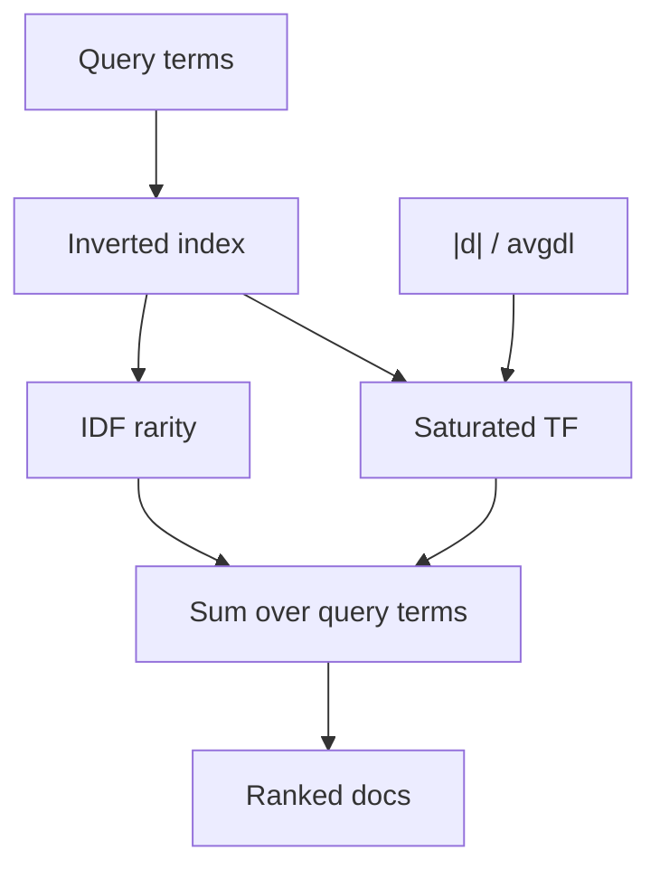

BM25 (Okapi BM25) is a bag-of-words ranking function that scores how well a document matches a query from term frequencies, term rarity across the corpus, and document length. "BM" means *best matching*; "25" is the label of one successful model in the Okapi IR family developed by Stephen Robertson, Steve Walker, and collaborators at City University London, and studied extensively at TREC. Lucene, Elasticsearch, Solr, and OpenSearch use BM25 (or close variants) as the default lexical scorer.

Unlike plain TF-IDF, BM25 *saturates* term frequency: the second and third hit of a word still help, but the tenth hit barely moves the score. It also softens long-document bias with a tunable length normalizer. In RAG and hybrid search, BM25 is the branch that keeps rare exact tokens alive: error codes, SKUs, CVE IDs, function names, and quoted phrases that embeddings often blur.

## Intuition

Think of three independent ideas glued into one sum over query terms:

1. **Rare terms matter more.** A hit on `ERR_TLS_CERT_ALTNAME_INVALID` should outweigh a hit on `error` or `the`.
2. **Repeating a term has diminishing returns.** One clear mention of a rare ID is strong evidence; stuffing the page with that ID should not win forever.
3. **Length is relative.** A short runbook that mentions the query once is often more on-topic than a 40-page dump that mentions it once by accident.

BM25 implements (1) with an IDF-style weight, (2) with a saturating TF curve controlled by $k_1$, and (3) by stretching that curve with document length over average length, controlled by $b$.

## Diagram



## Formula

For query $Q = \{q_1,\ldots,q_n\}$ and document $d$, a standard Okapi BM25 score is:

$$
\mathrm{score}(d,Q)=\sum_{q_i\in Q}\mathrm{IDF}(q_i)\cdot\frac{f(q_i,d)\,(k_1+1)}{f(q_i,d)+k_1\bigl(1-b+b\frac{|d|}{\mathrm{avgdl}}\bigr)}
$$

| Symbol | Meaning |
|--------|---------|
| $f(q_i,d)$ | Term frequency of $q_i$ in $d$ |
| $\|d\|$ | Document length in tokens |
| $\mathrm{avgdl}$ | Mean document length in the corpus |
| $k_1$ | TF saturation; typical default $1.2$ (Elasticsearch/Lucene), often tuned in $[1.2, 2.0]$ |
| $b$ | Length normalization strength in $[0,1]$; default $0.75$ |
| $N$ | Number of documents |
| $n(q_i)$ | Number of documents that contain $q_i$ |

A widely used non-negative IDF form (Lucene-style, with the outer $+1$) is:

$$
\mathrm{IDF}(q_i)=\ln\left(\frac{N-n(q_i)+0.5}{n(q_i)+0.5}+1\right)
$$

Special cases: $b=0$ disables length norm (sometimes called BM15 behavior); $b=1$ applies full length normalization (BM11-style). Variants such as BM25F weight fields (title vs body vs anchors); BM25+ adds a lower bound so long matching docs are not over-penalized relative to short non-matches.

As $f\to\infty$ for a fixed document, the TF fraction approaches $k_1+1$. For an average-length document, $k_1$ is roughly the frequency at which a term reaches half of its asymptotic contribution.

## Worked numbers

Corpus: $N=1000$, $\mathrm{avgdl}=100$, $k_1=1.2$, $b=0.75$. Query term $t=$ `ERR_TLS_CERT`, present in $n(t)=3$ documents.

$$
\mathrm{IDF}(t)=\ln\left(\frac{1000-3+0.5}{3+0.5}+1\right)=\ln(286)\approx 5.656
$$

**Short runbook** ($|d|=50$, $f=1$):

$$
B=1-b+b\frac{|d|}{\mathrm{avgdl}}=0.25+0.75\cdot 0.5=0.625
$$

$$
\frac{f(k_1+1)}{f+k_1 B}=\frac{1\cdot 2.2}{1+1.2\cdot 0.625}=\frac{2.2}{1.75}\approx 1.257
\quad\Rightarrow\quad \mathrm{score}\approx 5.656\times 1.257\approx 7.11
$$

**Long wiki page** ($|d|=400$, $f=1$):

$$
B=0.25+0.75\cdot 4=3.25,\quad
\frac{2.2}{1+1.2\cdot 3.25}=\frac{2.2}{4.9}\approx 0.449
\quad\Rightarrow\quad \mathrm{score}\approx 2.54
$$

Same single occurrence, but the short doc scores nearly $3\times$ higher because length norm stretches the denominator. If $f=5$ on the short runbook, the TF fraction only rises to about $1.91$ (still under the asymptote $2.2$), so stuffing helps a little and then stops.

A common term with $n=950$ gets $\mathrm{IDF}\approx\ln(1.053)\approx 0.05$: almost free of score. That is why rare IDs dominate BM25 ranking when they appear.

## Example

Query: `ERR_TLS_CERT_ALTNAME_INVALID`. The ops runbook that contains that exact string should rank highly even if a dense retriever prefers a soft neighbor about "certificate host mismatch." In hybrid RAG:

1. BM25 (sparse inverted index) returns the top ~$100$–$200$ lexical hits.
2. Dense ANN returns the top ~$100$–$200$ embedding neighbors.
3. [Reciprocal Rank Fusion](glossary://reciprocal-rank-fusion) (or another fusion) merges lists without forcing score calibration.
4. A cross-encoder or LLM reranker scores the fused pool.

Compare lexical, dense, and hybrid recall on held-out queries to identify the strongest path for your workload. Identifier hits depend on preserving the identifier in analysis. Use positional phrase queries for exact phrases and keyed lookup for authoritative ID retrieval. BM25 ranks documents from term evidence.

Minimal Python sketch (tokenized corpus; production systems use a real inverted index):

```python
from rank_bm25 import BM25Okapi

docs = [
    "err_tls_cert_altname_invalid on node edge-3".split(),
    "certificate host mismatch during handshake".split(),
    "rotate expired tls certificates in the edge fleet".split(),
]
bm25 = BM25Okapi(docs)  # defaults k1=1.5, b=0.75 in rank_bm25
scores = bm25.get_scores("err_tls_cert_altname_invalid".split())
# highest score -> doc 0
```

Tokenizer choice is part of the model: case folding, stemming, subwords, and whether `ERR_TLS_CERT` stays one token decide whether exact match even exists in the index.

## How it works in systems

At query time BM25 does not scan every document. An inverted index maps each term to posting lists of documents (and usually positions or frequencies). The scorer walks the query terms' postings, accumulates the formula above, and returns top-$k$. That is why lexical search stays fast at multi-million doc scale on CPU.

Production knobs that matter more than re-deriving the formula:

- **Same analyzer at index and query time.** Mismatched tokenization is a silent recall killer.
- **Chunking.** BM25 scores *whatever unit you indexed*. Oversized chunks dilute length-normalized TF; tiny chunks fragment multi-term queries.
- **Field boosts / BM25F.** Titles, headings, and code symbols often deserve higher weight than footer boilerplate.
- **Stopwords and rare tokens.** Over-aggressive stop lists can drop meaningful short tokens; under-aggressive ones waste postings on noise.
- **$k_1$ and $b$.** Defaults ($k_1\approx 1.2$, $b\approx 0.75$ in Elasticsearch) are strong baselines. Tune only with labeled queries; Elastic's Practical BM25 series recommends treating large jumps as experiments, not folklore.
- **Score fusion.** Normalize BM25 and cosine scores or fuse ranks before combining them because their scales differ by corpus and engine.

BM25 scores term overlap. Synonymy requires expansion, phrase order requires positional logic, and intent-level relevance requires semantic ranking. These limits motivate hybrid search and rerankers, which add evidence while retaining lexical retrieval.

## Why it matters here

BM25 complements embedding quality with lexical recall. It is the concrete sparse ranker behind most hybrid RAG designs in the curriculum, teaching exact-match retrieval, inverted-index mechanics, and why identifier-heavy queries need a lexical path alongside dense ANN.

## Related terms

- [Sparse retrieval](glossary://sparse-retrieval)
- [Hybrid search](glossary://hybrid-search)
- [Dense retrieval](glossary://dense-retrieval)
- [Reciprocal Rank Fusion](glossary://reciprocal-rank-fusion)
- [Reranker](glossary://reranker)
