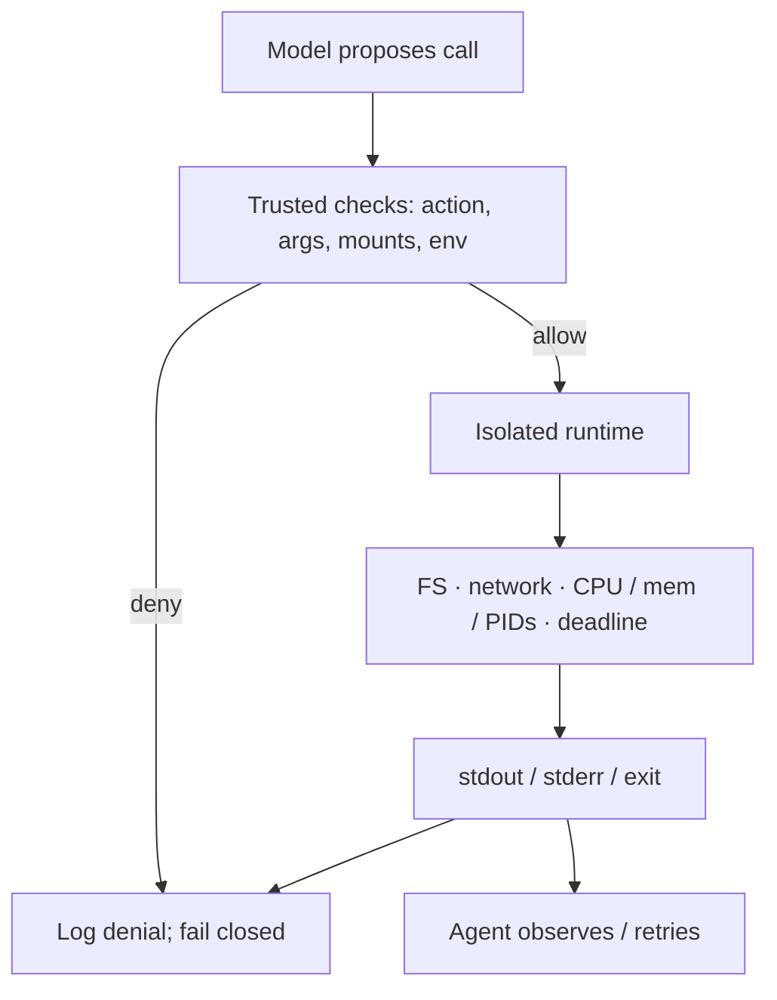

A bounded execution environment is a runtime that enforces hard limits on what untrusted code or agent tools can do: which files they can touch, which networks they can reach, which credentials they hold, how much CPU/memory/PIDs they may use, and how long they may run. The bounds live in the supervisor and kernel, not in the model prompt. If a clever request, a jailbreak, or buggy generated code can still expand source of truth, the environment was never bounded in practice.

Verify the enforced bounds behind a "sandbox" label. Logs reveal breaches after they happen. A perimeter must block unauthorized actions before execution. A container that mounts the host Docker socket, inherits a broad cloud token, or has no wall-clock kill timer is a disposable shell with a false sense of safety. Bounds must be independently enforceable and fail closed when a check cannot run.

## Intuition

A strong default is an ephemeral workspace with a clean checkout or scratch disk, no production credentials, restricted network access, explicit CPU and memory quotas, and a hard wall-clock deadline. The model may request more capability. Trusted code decides what the runtime exposes.

| Bound | What it limits | Typical mechanism |
| --- | --- | --- |
| Identity / capability | Actions and credentials | Action allowlist, short-lived scoped tokens, dropped Linux capabilities |
| Filesystem | Paths readable/writable | Read-only root, tmpfs scratch, chroot/mount namespaces |
| Network | Egress and peer reach | `network_mode=none`, egress allowlists, no host namespace |
| Resources | CPU, RAM, PIDs, disk | cgroups (`cpu.max`, `memory.max`, `pids.max`) |
| Time | Run duration | Supervisor wall-clock deadline plus process-tree kill |
| Observability | What you can prove later | Captured stdout/stderr, exit code, audit of denials |

Missing one row often defeats the others. Resource caps without a timeout still leave hung jobs. A timeout without egress policy still allows data exfiltration. Strong isolation with an ambient `AWS_SECRET_ACCESS_KEY` still grants cloud source of truth.

## How it works

Enforcement is layered. Application policy decides *what jobs are allowed*; the OS or hypervisor enforces *what allowed jobs can do*.

1. **allow the job in trusted code.** Check tool name, args, mounts, network mode, and environment against policy before launch. Deny unknown actions and ambient secrets by default.
2. **Isolate the process.** Namespaces give a private view of mounts, PIDs, network, and user IDs. Seccomp and capability drops shrink the syscall and privilege surface.
3. **Cap resources.** Cgroup controllers stop one job from starving the host (CPU shares/quotas, hard memory limits, PID caps against fork bombs).
4. **Time-box and clean up.** A supervisor wall-clock timer kills the process tree and removes the workspace. API wait timeouts (for example Docker's `wait(timeout=...)`) are *not* workload deadlines by themselves.
5. **Capture evidence.** Stdout, stderr, exit code, duration, and policy denials feed the agent loop and the audit trail.

Stronger isolation runtimes sit further from the host kernel when the workload is hostile multi-tenant code:

- **Standard containers** share the host kernel; they package namespaces + cgroups + optional seccomp well for controlled CI and trusted agent work.
- **gVisor** (`runsc`) interposes a userspace application kernel (Sentry) that intercepts syscalls instead of handing them straight to the host.
- **Firecracker microVMs** place each session behind a guest kernel and KVM virtualization perimeter, with a jailer for extra host-side containment. Vendor-reported cold starts are order-of-milliseconds with low MiB-scale overhead in minimal configs, based on paper-era microbenchmarks. Measure against your host image.
- **WASM/WASI** grants only explicit host capabilities (memory, fuel, preopened paths), at the cost of full Linux compatibility.

Managed agent sandboxes (for example Firecracker- or gVisor-backed hosts) still need the same *policy* inventory: mounts, egress, secrets, quotas, and timeouts. Operators must define allowlists when they rent a stronger runtime.

## Diagram



## Example

A coding agent must fix a failing test suite. Each attempt runs in a container with:

- Image: `python:3.11-slim` resolved to an immutable image digest (the tag alone isn't pinned)
- Writable: only `/scratch/job-42` (repo checkout or patch workspace); root filesystem read-only
- Network: none (tests use local test cases; package install happens at image build time)
- Resources: `memory.max = 256 MiB`, CPU quota $50\%$ of one core (`cpu_quota=50000` with `cpu_period=100000`), `pids.max = 64`
- Time: supervisor deadline $T = 120$ s; on expiry kill the container and mark the attempt timed out
- Secrets: no cloud keys; env limited to `TASK_ID`, `FIXTURE_PATH`
- Capture: full stdout/stderr and exit code returned to the scaffold

A read-only root controls writes; reads still depend on the container's identity and permissions. Keep `/etc/shadow` inside the container rather than exposing the host's sensitive file. A network-isolated container can still access local resources. Verify those partitions with the configured identity and mounts. A PID cap bounds process count; only the supervisor deadline kills work after a polling timeout.

**Escape theater:** the same limits with `/var/run/docker.sock` mounted mean the agent can start privileged containers on the host. Inventory mounts and credentials before trusting the other knobs.

This sketch covers partial request gating. String prefixes can allow traversal paths such as `/scratch/../../etc`; a production policy must validate canonical paths and mount sources, symlinks, identity, capabilities, resource limits, and deadline. A chroot provides limited isolation and needs additional controls.

```python
def allow(spec) -> list[str]:
    problems = []
    if spec.network_mode != "none":
        problems.append("egress")
    if not spec.read_only_root:
        problems.append("writable_root")
    if any(not m.startswith("/scratch/") for m in spec.writable_mounts):
        problems.append("host_mount")
    if not set(spec.environment) <= {"TASK_ID", "FIXTURE_PATH"}:
        problems.append("ambient_secret")
    return problems  # empty => launch; else fail closed
```

## Why it matters here

Tool-using agents need shells, browsers, and file ops to be useful. Bounded execution is the practical line between "agent automation" and "unscoped control over your laptop or cluster." Curriculum work on code-generation agents, computer-use, guardrails, and scaffolds all assume this perimeter: generate-execute-debug loops only stay safe when each execute step runs under inventoryable limits that the model cannot negotiate away.

## Related terms

- [Sandbox](glossary://sandbox)
- [Fail closed](glossary://fail-closed)
- [Least privilege](glossary://least-privilege)
- [Action allowlist](glossary://action-allowlist)
- [Agent scaffold](glossary://agent-scaffold)
