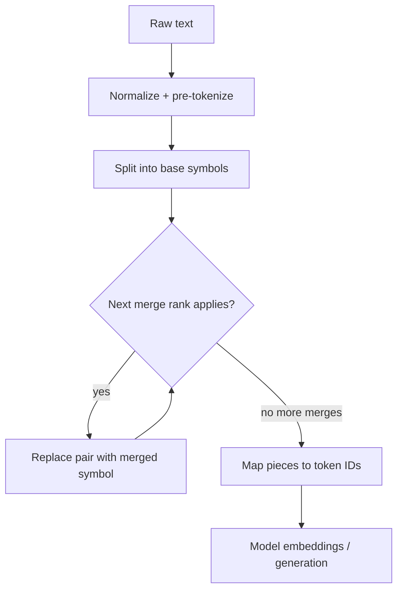

Byte pair encoding (BPE) is a subword tokenization algorithm that starts from small units (characters or UTF-8 bytes) and repeatedly merges the most frequent adjacent pair into a new vocabulary item. Common fragments become single tokens; rare strings stay sequences of smaller pieces. Philip Gage introduced BPE as a data-compression scheme in 1994. Sennrich, Haddow, and Birch adapted it for open-vocabulary neural machine translation (ACL 2016). GPT-2 and most modern LLM tokenizers use a **byte-level** variant: the base alphabet is the full $256$ byte values so any UTF-8 string is representable without an `[UNK]` trap.

Token count isn't word count. Code, IDs, scripts, and whitespace can tokenize differently at the same character length. Pin vocabulary, merges, pre-tokenizer, and special tokens with the model. Changing merges changes segmentation; changing the vocabulary's ID mapping changes which embedding rows those pieces select. Neither change necessarily affects every token.

## How it works

**Training** builds a merge table from a corpus (usually after normalization and a pre-tokenizer that splits on spaces, punctuation, or a regex):

1. Represent each training unit as a sequence of base symbols (characters, or bytes $0..255$).
2. Count every adjacent pair of symbols, weighted by how often each word or span appears.
3. Merge the most frequent pair into one new symbol and add it to the vocabulary.
4. Repeat until you hit a target vocabulary size (or a fixed merge count).

Final vocab size is roughly:

$$
|\mathcal{V}| \approx |\mathcal{V}_0| + M + S
$$

where $|\mathcal{V}_0|$ is the base alphabet size ($256$ for byte-level BPE), $M$ is the number of learned merges, and $S$ counts special tokens (BOS, EOS, pad, and so on). GPT-2 is the classic example: $256$ bytes + $50{,}000$ merges + $1$ end-of-text token $= 50{,}257$.

Sennrich-style training often works on a frequency-weighted dictionary and does not merge across word boundaries, so pair statistics stay inside pre-tokenized units. That keeps the algorithm tractable and leaves whitespace/punctuation handling to the pre-tokenizer.

**Encoding** (inference) is deterministic given the ordered merge list:

1. Normalize and pre-tokenize the input the same way training did.
2. Split each unit into base symbols.
3. Apply the learned merges **in training order** (rank order), repeatedly replacing each pair until no further merge applies.
4. Map the resulting pieces to integer IDs via the vocabulary.

BPE greedily applies a fixed merge-priority list at encode time. WordPiece often uses longest-match lookup; Unigram scores multiple segmentations. BPE's runtime path is "play back the merge ranks."

## Intuition

Think of BPE as learned compression aimed at language, not archives. Frequent co-occurrences get short codes (single tokens). Rare combinations stay long (many tokens). The model then learns embeddings for those reusable pieces, so `unhappiness` can reuse `un` and `happiness` without a dedicated row for every possible word. The trade-off is uneven: English prose compresses well; random IDs, minified code, and undertrained scripts expand.

## Example

Toy dictionary after character split (frequencies in parentheses), following the Hugging Face teaching example:

| Word | Count | Symbols |
|---|---:|---|
| hug | 10 | `h` `u` `g` |
| pug | 5 | `p` `u` `g` |
| pun | 12 | `p` `u` `n` |
| bun | 4 | `b` `u` `n` |
| hugs | 5 | `h` `u` `g` `s` |

Pair counts put `("u","g")` first ($10+5+5=20$). Merge rule:

$$
(\texttt{u},\texttt{g}) \rightarrow \texttt{ug}
$$

After that merge, `("u","n")` wins ($12+4=16$), then `("h","ug")` ($10+5=15$). Encode-time playback on new words:

| Input | After merges |
|---|---|
| `bug` | `b` `ug` |
| `hug` | `hug` |
| `thug` (if `t` not in base vocab) | often `[UNK]` + `hug` under **character** BPE |

With **byte-level** BPE, `t` is always a base byte, so `thug` never needs `[UNK]`; it just may fail to form the long merges if those ranks never fire.

Production scale: after training on a large web corpus, `" lower"` (leading space included) might be one token while a rare SKU `XJ-7Q9-ZZ` splits into many pieces. Suppose a customer message is $800$ characters. English prose might tokenize to roughly $180$ tokens; the same length of stack traces and UUIDs might exceed $400$ tokens and burn context budget twice as fast. When cost or copy behavior surprises you, run the real tokenizer on the exact string.

```python
# Sketch only: real systems use tiktoken, tokenizers, or SentencePiece.
# Merges are applied in rank order, not by re-counting at encode time.
merges = [("u", "g"), ("u", "n"), ("h", "ug")]  # learned order
symbols = list("hug")
for a, b in merges:
    i, out = 0, []
    while i < len(symbols):
        if i + 1 < len(symbols) and symbols[i] == a and symbols[i + 1] == b:
            out.append(a + b)
            i += 2
        else:
            out.append(symbols[i])
            i += 1
    symbols = out
# symbols == ["hug"]
```

## Diagram



## Byte-level vs character BPE vs byte fallback

| Scheme | Base units | Unknown chars | Typical systems |
|---|---|---|---|
| Character BPE | Unicode chars in training alphabet | Can emit `[UNK]` | Early NMT subword setups |
| Byte-level BPE | All $256$ UTF-8 bytes | None by construction | GPT-2/3/4-family, RoBERTa, many chat models |
| Char/subword + byte fallback | Learned pieces first | Spell with byte pieces only when missing | SentencePiece `byte_fallback` (Llama 1/2-style) |

Byte-level BPE and byte fallback both aim at full Unicode coverage. They differ in **when** bytes enter the sequence: from the first merge step (byte-level) versus only after a character fails the alphabet (fallback). See [byte fallback](glossary://byte-fallback).

## Trade-offs

- **Vocab size vs sequence length:** Larger $M$ shortens typical sequences and shrinks attention/KV cost per request, but grows the embedding matrix and can overfit rare merges.
- **Domain skew:** A general web BPE fragments domain jargon, code identifiers, and product IDs. Domain-trained merges reverse that, and can bloat general English.
- **Pre-tokenizer rules matter as much as merges:** Leading-space tokens (`Ġword` style), digit splitting, and regex boundaries change counts even when the merge file is fixed.
- **Deterministic but not "optimal":** Greedy rank playback need not yield the globally shortest segmentation. That is acceptable for a stable training/serving contract.
- **Artifact coupling:** Fine-tunes, evals, and serving must share the same vocab and merge ranks. Swapping tokenizers silently remaps every ID.

## Why it matters here

BPE is the dominant subword family behind modern LLMs, sitting next to WordPiece and Unigram in the tokenization curriculum. It links preprocessing to context budgets, billed tokens, KV-cache length, multilingual behavior, and long-tail terminology. In production you debug BPE by printing IDs on real traffic (logs, SKUs, CJK, emoji, tool JSON), never by guessing from word counts. Pin the [tokenizer artifact](glossary://tokenizer-artifact) with the checkpoint; count tokens with the same encoder the model uses.

## Related terms

- [Byte fallback](glossary://byte-fallback)
- [Tokenization](glossary://tokenization)
- [Subword tokenization](glossary://subword-tokenization)
- [WordPiece](glossary://wordpiece)
- [Tokenizer artifact](glossary://tokenizer-artifact)
