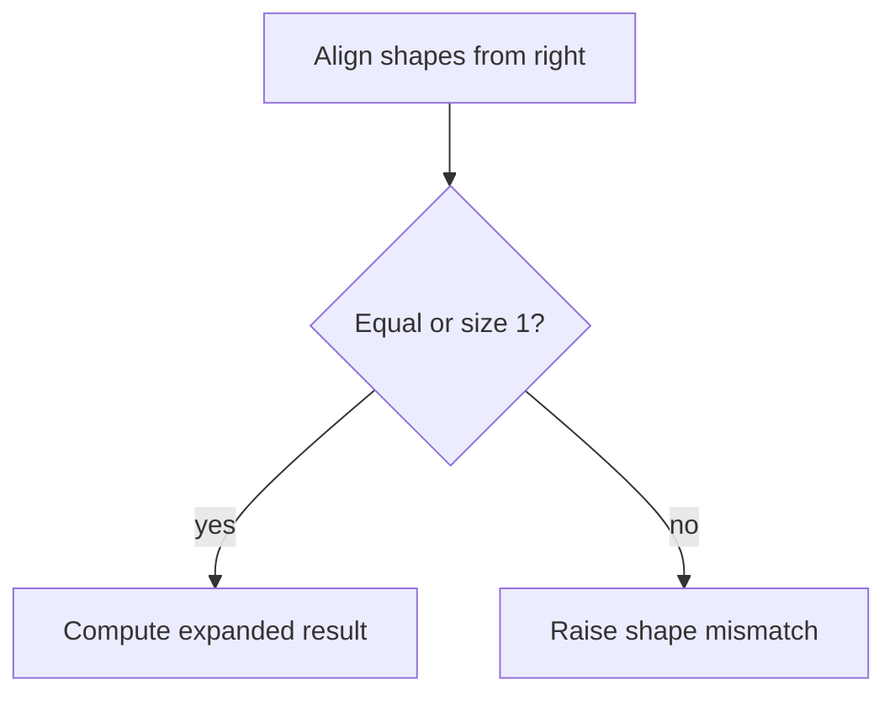

**Broadcasting** lets array operations combine compatible shapes without manually writing a loop for every repeated position. NumPy aligns operand shapes from their trailing axes toward their leading axes. Two aligned dimensions are compatible when their sizes match or one size is `1`; absent leading dimensions behave like size `1`.

A compatible smaller array is repeated conceptually across the larger array's unmatched positions. NumPy can reuse its values without materializing a fully expanded input buffer. The operation still performs its calculation over the resulting shape, with output storage determined by that operation.

## Name the axis before trusting the shape

For token features shaped `(batch, tokens, features) = (2, 3, 4)`, a feature bias shaped `(4,)` aligns with the final feature axis. A token bias requires `(3, 1)` so its three values align with the token axis and its trailing size-one axis expands across features. A bare `(3,)` collides with the final size `4` and fails.



## Example

```python
import numpy as np

x = np.arange(24).reshape(2, 3, 4)
bias = np.array([100, 200, 300, 400])
assert (x + bias).shape == (2, 3, 4)
```

Every token receives the same four feature offsets. The bias has no batch or token axis of its own, so those axes are conceptually expanded.

## Why it matters here

Bias addition, normalization, attention masks, image preprocessing, and loss weights all depend on correct axis alignment. A broadcast can succeed numerically while applying values to the wrong conceptual axis, so check both shape and meaning.

## Related terms

- [NumPy array](glossary://numpy-array)
- [Tensor shape](glossary://tensor-shape)
- [Tensor](glossary://tensor)
- [Matrix](glossary://matrix)
