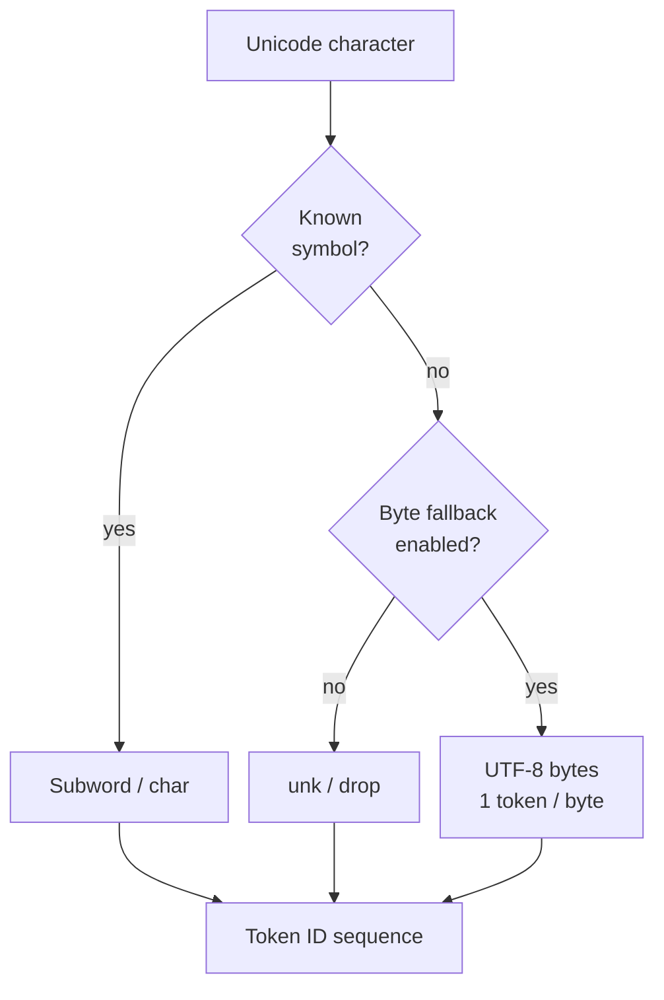

Byte fallback is a tokenizer policy that decomposes an unsupported character into its UTF-8 bytes and emits one vocabulary token per byte, instead of collapsing the character to a single `<unk>` or dropping it. The string stays representable and round-trippable; compactness can get worse because one visible character may become two to four byte tokens.

**Byte-level BPE** and byte fallback provide byte coverage through different workflows. GPT-2-style byte-level BPE starts from the full 256-byte alphabet and learns merges over bytes from the beginning. Byte fallback (as in SentencePiece with `byte_fallback=true` on many SP-era open models such as Llama 1/2-style tokenizers, though family rosters evolve) trains ordinary character or subword pieces first, then uses byte pieces when a code point is outside the learned alphabet. Both preserve coverage while introducing bytes at different stages.

## How it works

1. Encode the input under the tokenizer's normal alphabet and merge rules.
2. If a character is missing from the alphabet (often pruned by `character_coverage`, or never seen in training), do not emit `<unk>`.
3. UTF-8-encode that character and emit one **BYTE** piece per byte, typically named like `<0xE9>`, `<0x96>`, `<0xA2>`.
4. Decode by reversing those byte pieces into a byte stream and decoding UTF-8.

SentencePiece reserves 256 such BYTE pieces when fallback is enabled. They sit beside NORMAL and CONTROL pieces in the model. Hugging Face's BPE `byte_fallback` option follows the same idea, but the vocabulary must contain the corresponding byte pieces and the decoder must reconstruct them. Enabling the flag alone does not create missing vocabulary entries.

Coverage is lossless only if preprocessing does not rewrite the string first. NFC vs NFKC, stripped control chars, or a lossy PDF extract can change bytes before the tokenizer ever runs.

## Example

The CJK character `関` is U+95A2. Its UTF-8 encoding is three bytes:

| Hex | Decimal |
|---|---:|
| `E9` | 233 |
| `96` | 150 |
| `A2` | 162 |

If the vocab has no learned piece for `関`, a fallback tokenizer emits three byte tokens instead of `<unk>`. The curriculum string `関数✨` is nine UTF-8 bytes total (`関` 3 + `数` 3 + `✨` 3), so a pure fallback path costs nine tokens for three visible characters.

```python
s = "関数✨"
byte_ids = list(s.encode("utf-8"))
assert byte_ids == [233, 150, 162, 230, 149, 176, 226, 156, 168]
assert bytes(byte_ids).decode("utf-8") == s
# Each byte selects a BYTE piece with its own vocabulary token id.
# Raw byte values above are not necessarily those vocabulary ids.
```

A short Japanese name that humans count as a few characters can consume on the order of $12$ to $30$ tokens when most of it falls to bytes. That inflates prompt length, KV-cache size, and billed tokens without changing the human-visible text.

Debug clue: one short path, emoji sequence, or rare name burns a surprising token budget. Inspect pieces; many single-byte tokens mean fallback is spelling the string out. Always `tokenize` then `decode` the exact production string before blaming generation.

## Diagram



## Why it matters here

For a tokenizer configured with complete byte fallback, unsupported Unicode characters remain representable after preprocessing. Measure tokenization efficiency and generation accuracy separately. It sits next to BPE, SentencePiece, and Unicode normalization in the curriculum because multilingual, emoji-heavy, or long-tail text can consume many tokens even when coverage is complete.

In production it explains:

- **Budget surprises** for CJK, emoji, rare scripts, and log paths that look short to humans.
- **Weaker exact-match behavior** when retrieval or tools compare strings the model only ever saw as byte spells.
- **Generation risk** on undertrained models: the model must emit valid UTF-8 byte sequences while producing fluent language.
- **Artifact coupling**: `byte_fallback`, alphabet, and normalization must match between train, eval, and serve, or ids and detokenization diverge.

## Related terms

- [BPE](glossary://bpe)
- [SentencePiece](glossary://sentencepiece)
- [Tokenization](glossary://tokenization)
- [Unicode normalization](glossary://unicode-normalization)
- [Tokenizer artifact](glossary://tokenizer-artifact)
