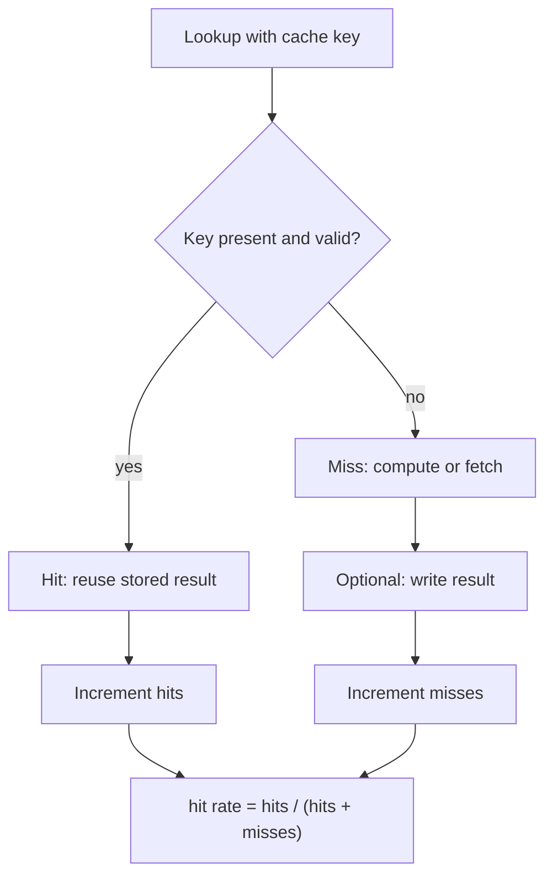

**Cache hit rate** (also called **cache hit ratio**) is the fraction of lookups that find a usable stored result instead of computing or fetching it again:

$$
\text{hit rate} = \frac{\text{hits}}{\text{hits}+\text{misses}}
= 1 - \text{miss rate}
$$

A **hit** means the cache returned a usable value for the key you asked for, satisfying freshness, version, and authorization checks. A **miss** means it did not, so the system falls through to a slower path (model prefill, origin store, embedding call, full generation). Classic systems texts turn the same idea into an average cost model: $\text{AMAT} = H + MR \cdot AMP$, where $H$ is hit time, $MR$ is miss rate, and $AMP$ is average miss penalty. LLM serving uses the same logic with different units: tokens, prefills, and dollars instead of CPU cycles.

A high rate is useful when the key includes every input that should change the result and each hit avoids expensive work such as long prefills, hot tenants, or large embeddings.

## Intuition

Hit rate measures how often the cache avoids a slow path. Key quality and avoided work determine whether those hits are safe and useful. Two requests can share a dashboard hit rate of $0.80$ and produce totally different outcomes:

- One reuses 8,000 tokens of system+doc KV and drops TTFT.
- One reuses a 5 ms config blob and barely moves latency.

In LLM stacks you usually measure more than one hit rate at once:

| Layer | What a "hit" usually means | Typical unit |
|---|---|---|
| Response / exact cache | Same key → same answer bytes | requests |
| Semantic cache | Nearby query reuses an answer | requests |
| Provider prompt cache | Matching prompt prefix → `cached_tokens` | tokens |
| Engine prefix / KV cache | Matching token blocks reuse K/V | tokens or blocks |
| Embedding / tool cache | Same text or tool args reuse work | requests |

Mixing those into one global percentage hides which layer is helping.

## Formula

**Request-level** (classic CDN / Redis style):

$$
HR_{\text{req}} = \frac{N_{\text{hit}}}{N_{\text{hit}}+N_{\text{miss}}}
$$

**Token-level** (prompt / prefix caching):

$$
HR_{\text{tok}} = \frac{\sum \text{cached tokens}}{\sum \text{prompt tokens}}
$$

OpenAI Responses exposes the numerator as `usage.input_tokens_details.cached_tokens`, with `usage.input_tokens` as the denominator; Chat Completions uses `usage.prompt_tokens_details.cached_tokens` and `usage.prompt_tokens`. Check the endpoint's usage schema rather than mixing these fields. Self-hosted engines (for example vLLM Automatic Prefix Caching) report prefix-cache hit metrics over KV blocks or tokens reused during prefill.

**Expected cost or latency** for a single cache layer:

$$
\mathbb{E}[T] \approx HR \cdot T_{\text{hit}} + (1-HR) \cdot T_{\text{miss}}
$$

$$
\mathbb{E}[\text{cost}] \approx HR \cdot C_{\text{hit}} + (1-HR) \cdot C_{\text{miss}}
$$

If $T_{\text{hit}} \approx T_{\text{miss}}$, raising $HR$ does almost nothing. Optimize where miss penalty is large.

## Example

**Prefix cache, request view.** Over $1{,}000$ lookups, $800$ reuse existing KV blocks:

$$
HR_{\text{req}} = \frac{800}{1000} = 0.80
$$

If each hit saves $1.2\,\mathrm{s}$ of prefill versus a full miss, the cache removes about $800 \times 1.2 = 960\,\mathrm{s}$ of prefill work per $1{,}000$ requests. A $0.95$ hit rate on $5\,\mathrm{ms}$ config reads saves almost nothing by comparison.

**Token view on one request.** Prompt is $8{,}000$ tokens; the first $6{,}400$ match a warm prefix and the last $1{,}600$ are user-specific:

$$
HR_{\text{tok}} = \frac{6400}{8000} = 0.80
$$

This is a partial prefix hit: the unique suffix still needs prefill, and output still needs decoding. Provider eligibility, minimum prefix length, cache-write charges, and retention depend on model and caching mode. Use the [current provider contract](https://developers.openai.com/api/docs/guides/prompt-caching) and actual usage fields rather than treating a historical minimum as universal.

**Worked savings.** In a hypothetical pricing model with no extra cache-write charge, suppose uncached input costs \$3.00/M tokens and cached input costs \$0.30/M tokens, with $10$ M prompt tokens/day and $HR_{\text{tok}}=0.70$:

$$
\text{cost} \approx 10\,\mathrm{M} \times \bigl(0.70 \times 0.30 + 0.30 \times 3.00\bigr) / 1\,\mathrm{M}
= 11.10\,\mathrm{USD/day}
$$

versus \$30/day with no cache. Log both $HR$ and dollars; a high rate on a low-volume route can still be a rounding error.

```python
def hit_rate(hits: int, misses: int) -> float:
    if hits < 0 or misses < 0:
        raise ValueError("counts must be nonnegative")
    total = hits + misses
    if total == 0:
        return float("nan")
    return hits / total

def token_hit_rate(cached_tokens: int, prompt_tokens: int) -> float:
    if not 0 <= cached_tokens <= prompt_tokens:
        raise ValueError("cached tokens must be within the prompt count")
    if prompt_tokens == 0:
        return float("nan")
    return cached_tokens / prompt_tokens

def expected_cost(hr: float, cost_hit: float, cost_miss: float) -> float:
    if not 0.0 <= hr <= 1.0 or min(cost_hit, cost_miss) < 0:
        raise ValueError("rate and costs must be valid")
    return hr * cost_hit + (1.0 - hr) * cost_miss
```

## Diagram



## How to read it in production

Slice before you celebrate:

- **By route / product surface.** Code-assistant with a stable repo guide should beat free-form chat.
- **By tenant and document.** One hot tenant can inflate a global rate while cold tenants always miss.
- **By cache layer.** Keep response-cache, semantic-cache, prefix/KV-cache, and embedding-cache metrics separate.
- **Eligible vs actual.** After a prompt version bump, many misses are correct invalidations; track "eligible for reuse" separately from "hit."
- **Partial hits.** Token or block hit rate can be high while request-level "full answer reuse" is low.

For unexpected **misses**, log key parts (hashed), eviction reason, TTL, entry size, router affinity, and model/tokenizer version. For unexpected **hits**, diff the key and check authorization so tenant A never reads tenant B's cached answer. For semantic caches, measure the wrong-hit rate on paraphrases that should not share an answer alongside overall $HR$.

Routing matters for prefix caches: if identical long prefixes fan out round-robin across replicas, each worker rebuilds its own KV and hit rate collapses even when the prompts look cacheable. Cache-aware routing (or provider `prompt_cache_key`-style affinity) keeps reuse local to warm workers.

## Why it matters here

Cache hit rate connects cache design to serving cost, TTFT, and capacity. Curriculum lessons on prefix caching, semantic caching, and LLM ops all ask the same follow-up: what does a hit mean here, what does a miss cost, and is the key safe?

## Related terms

- [Prefix cache](glossary://prefix-cache)
- [KV cache](glossary://kv-cache)
- [Semantic cache](glossary://semantic-cache)
- [Prefill](glossary://prefill)
- [TTFT](glossary://ttft)
