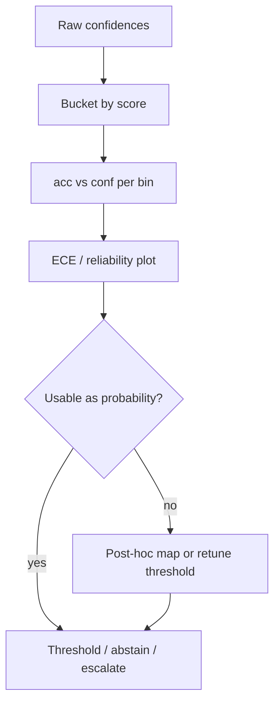

Calibration is the match between a model's stated confidence and the long-run frequency of being correct. If a system marks many cases as "about $80\%$ confident," roughly eight in ten of those cases should actually be correct when the score is calibrated. A single prediction can be right or wrong at any confidence; the property is about aggregates of similar scores, not one lucky sample.

Ranking quality and calibration are different. A model can order positives above negatives (strong ROC-AUC) and still be miscalibrated. A threshold can be tuned empirically on any useful score, but interpreting that score as a probability or deriving a decision from expected costs requires calibration. Measure the accepted-set risk separately for abstention and escalation policies.

## Intuition

A score of $0.70$ is calibrated only if roughly $70\%$ of cases receiving similar scores are correct. Softmax outputs live in $[0,1]$, but that range alone does not make them probabilities you can trust. Capacity, batch norm, limited weight decay, class imbalance, distribution shift, and label noise can all pull reported confidence away from observed frequencies.

In multiclass settings the common operational notion is **confidence calibration**: among examples whose top-class probability is $c$, the top class is correct with frequency $c$:

$$
\mathbb{P}\big(Y = \arg\max \hat{p}(X) \mid \max \hat{p}(X) = c\big) = c
\quad \forall\, c \in [0,1].
$$

Stronger notions ask that the full probability vector match class frequencies (multi-class calibration), or that each class probability match on its own (class-wise). Production gates usually start with confidence calibration because the product acts on the top score.

## Formula

A **reliability diagram** buckets predictions by confidence and plots mean confidence against empirical accuracy in each bucket. Perfect calibration sits on the diagonal. Overconfidence lies below the diagonal (confidence higher than accuracy); underconfidence lies above it.

**Expected calibration error (ECE)** summarizes the gaps. Split $n$ examples into $M$ bins $B_1,\ldots,B_M$ (often equal-width on $[0,1]$). Let $\hat{p}_i = \max_k \hat{p}_k(x_i)$ be the confidence of the predicted class, and let correctness be $1\{\hat{y}_i = y_i\}$. Then:

$$
\mathrm{acc}(B_m) = \frac{1}{|B_m|}\sum_{i \in B_m} 1\{\hat{y}_i = y_i\},
\qquad
\mathrm{conf}(B_m) = \frac{1}{|B_m|}\sum_{i \in B_m} \hat{p}_i,
$$

$$
\mathrm{ECE} = \sum_{m=1}^{M} \frac{|B_m|}{n}\,\lvert \mathrm{acc}(B_m) - \mathrm{conf}(B_m)\rvert.
$$

Lower is better. A value of $0$ means the observed bin averages agree. Scores can still be miscalibrated within those bins. Finite-sample ECE also has estimation uncertainty. Maximum calibration error (MCE) is the largest bin gap, while ECE computes a weighted average. ECE is sensitive to bin count and uses only top-class confidence, so report the reliability diagram and slice-level ECE alongside the global value. Pair ECE with a proper scoring rule such as Brier score or log loss when you care about both calibration and discrimination.

## Example

A moderation classifier marks $1{,}000$ comments with score $0.90$. If $900$ of them are truly abusive, that bucket is well calibrated. If only $700$ are abusive, the model is overconfident at $0.90$: auto-actions at that threshold will create a flood of false positives even when overall accuracy looks fine.

Worked ECE on a tiny holdout ($n = 10$, $M = 4$ equal-width bins of width $0.25$):

| $i$ | confidence $\hat{p}_i$ | correct? |
| --- | ---: | --- |
| 1–4 | $0.55$, $0.58$, $0.62$, $0.65$ | 1, 0, 1, 1 |
| 5–10 | $0.82$, $0.85$, $0.88$, $0.90$, $0.93$, $0.95$ | 1, 0, 1, 0, 1, 0 |

- Bins $[0, 0.25)$ and $[0.25, 0.5)$ are empty (contribute $0$ to ECE).
- Bin $[0.5, 0.75)$: $|B|=4$, $\mathrm{conf}=0.60$, $\mathrm{acc}=0.75$, gap $=0.15$.
- Bin $[0.75, 1]$: $|B|=6$, $\mathrm{conf}=0.888$, $\mathrm{acc}=0.50$, gap $=0.388$.
- $\mathrm{ECE} = (4/10)(0.15) + (6/10)(0.388) \approx 0.293$.

The high-confidence bucket is badly overconfident. That is exactly where auto-block and auto-escalate policies hurt users if you trust the raw score.

After a prompt or model change, re-check calibration by slice (language, class, tenant, traffic age). A global curve can look fine while a rare harm class is overconfident.

## How it works

1. **Collect a labeled holdout** that matches production traffic as closely as you can and is separate from the training set. Keep labels and score versions frozen.
2. **Define confidence.** For classifiers: top softmax probability or a calibrated head. For LLM tasks, forced-choice probabilities, answer-span logprobs, vote shares, and verbal confidence are candidate scores. A token or sequence likelihood is not automatically the probability that an answer is correct. Validate the chosen score against task labels before using it in policy.
3. **Bucket and plot.** Equal-width bins are standard for ECE; equal-mass (quantile) bins can reduce empty high-confidence bins when models pile up near $1.0$.
4. **Act on the diagram.** If high-confidence bins are overconfident, either raise action thresholds, route more traffic to review, or fit a post-hoc calibration map on held-out data before rewriting policy text.
5. **Recalibrate after shift.** Prompt changes, model swaps, temperature changes, fine-tunes, and traffic drift all stale the map. Treat calibration as part of the offline eval gate.

### Post-hoc maps (when ranking is already good)

If order is useful but absolute scores are wrong, fit a map on held-out data disjoint from training:

- **Temperature scaling** (Guo et al.): learn a single $T > 0$ and replace logits $z$ with $z/T$ before softmax. Argmax (and accuracy) stay fixed; confidence softens or sharpens. Often strong for modern nets with little data. This calibration $T$ is not the same knob as sampling temperature for open-ended generation: one remaps class confidences after scoring; the other reshapes the next-token distribution during decode.
- **Platt scaling:** fit $p = \sigma(A f + B)$ on scores $f$ (logistic / sigmoid map).
- **Isotonic regression:** fit a monotone step function from score to frequency; flexible, needs more data, can overfit small calibration sets.

Fit the map on rows held out from base-model training, then assess it on a separate evaluation set. Reporting calibration on the same rows used to fit the map overstates its generalization. Recalibration cannot invent discrimination the base score lacks.

## Diagram

## Why it matters here

Calibration connects classifiers, model judges, safety systems, and agent routing to operational decisions: act, review, or abstain. "0.9 confidence" becomes a useful risk budget when the score is calibrated on the slices you ship. Uncalibrated judges over-promote bad candidates. Uncalibrated safety scores either block too much or miss harm. Uncalibrated agent confidence triggers tool calls that should have waited for a human. In the curriculum it sits next to decision thresholds, selective prediction, and offline evaluation. Base shipping decisions on a risk curve measured from calibrated scores.

## Related terms

- [Probability calibration](glossary://probability-calibration)
- [Decision threshold](glossary://decision-threshold)
- [Abstention](glossary://abstention)
- [Model judge](glossary://model-judge)
- [Temperature](glossary://temperature)
