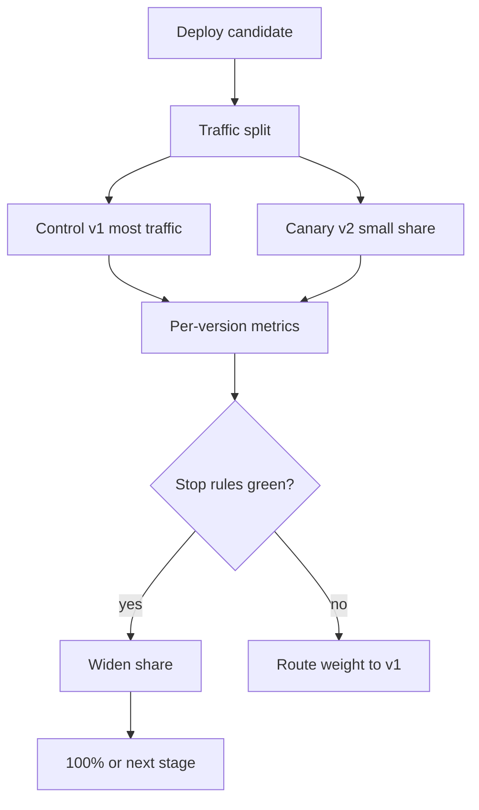

A **canary rollout** is a partial, time-limited exposure of a change to a small slice of real production traffic (the **canary**) while the rest of traffic stays on the current version (the **control**). You watch predeclared metrics and stop rules on that small cohort, then expand the share only if the canary stays healthy. Reversing routing limits new exposure, but shared-backend failures and irreversible side effects can affect more than the routed fraction.

The name comes from coal-mine canaries: a sensitive early warning before the whole crew is affected. In software, the canary is usually a much smaller subset of production or of the user base than the control. Google SRE defines canarying as that partial, time-limited deployment plus evaluation that decides whether to proceed with the rollout.

Unlike [shadow traffic](glossary://shadow-traffic), canary traffic is **user-visible**: answers, tools, and side effects are real. Unlike a pure [A/B test](glossary://ab-testing), a canary is primarily a **safety and regression gate** (errors, latency, cost, safety, SLOs), sized to finish in minutes to hours when possible. Product-hypothesis experiments often need days of data; canaries should not wait on that bar unless you have deliberately merged the two goals.

## Diagram

## How it works

1. **Ship the candidate beside control.** New binary, model route, prompt template, retriever index, or policy config must be deployable without taking all traffic. Feature flags and gateway weights are common knobs.
2. **Pick a canary population.** Start small (often $1\%$-$5\%$ of eligible traffic, or one cell: region, tenant, dogfood). Match the first cohort to the risk with realistic permissions, long-tail queries, prompt lengths, multi-turn sessions, and adversarial edges for safety changes. Include routine happy-path traffic too.
3. **Hold for a window.** Duration should cover enough requests to see rare failures and should match metric aggregation windows (a 30-minute canary cannot be judged on a one-hour rollup alone). High QPS needs less wall-clock time; heterogeneous LLM traffic needs more.
4. **Compare canary vs control on the same slices.** Metrics must be **version-attributable** (tags for code version, model, prompt, retriever, flag). Whole-fleet averages hide a bad canary when the share is small.
5. **Expand or reverse.** Step shares only while stop rules stay green: for example $1\% \to 5\% \to 25\% \to 50\% \to 100\%$. Rollback must be one operation that restores control routing without rebuilding models or re-indexing.

Prefer concurrent canary-vs-control over pure before/after time windows. Time of day, load, and traffic mix confound before/after comparisons.

## Blast radius

If a defect fails a fraction $e$ of canary requests and the canary gets fraction $f$ of traffic, the contribution to the fleet error rate is about

$$
\text{fleet error from canary} \approx f \cdot e.
$$

Example: a canary with $20\%$ request errors at $f = 0.05$ contributes about one percentage point to fleet errors. Its **incremental** contribution relative to control error rate $e_0$ is $f(e-e_0)$, assuming no spillover. Detection and rollback still take wall-clock time, so keep $f$ small until metrics and ops readiness justify more. A route flip does not undo completed writes or necessarily cancel in-flight work.

## Metrics that earn a stop rule

Stack-rank signals by how clearly they map to user harm, then keep the set small enough that operators trust it.

| Class | Examples for LLM / RAG systems |
|---|---|
| Reliability | HTTP/RPC error rate, timeout rate, tool-call failure rate |
| Latency | p95/p99 end-to-end, [TTFT](glossary://ttft), decode lag |
| Cost | Tokens per request, dollars per 1k requests, provider overage |
| Quality | Citation presence, acceptance, judge score on sampled turns |
| Safety | Policy failures, jailbreak pass rate, wrong-tool writes |
| Fallback | Rate of silent downgrade to older model or empty retrieval |

Resource metrics (CPU, GPU util) are secondary: they can move without user harm and cause noisy false stops. Prefer request-scoped SLIs. Aggregate over windows shorter than or equal to the canary hold so stale hours do not veto a clean half-hour.

## Example

Route $1\%$ of eligible support chats to a new cross-encoder reranker (sticky by conversation id so multi-turn memory stays on one version). Hold $45$ minutes through a peak half-hour.

Watch, per version and slice (locale, tenant tier, long-context vs FAQ):

- citation-present rate and human acceptance of the draft
- p95 end-to-end latency and p95 retrieval+rerank time
- fallback rate to the previous reranker
- cost per answered chat
- safety failures on access-control and PII policies

Tag every request with route, model, prompt template, retriever version, and canary stage.

Suppose control p95 is $1.8$s and canary p95 is $3.1$s, while acceptance is only slightly better. **Stop expansion** even if the quality signal looks mildly positive: latency is a guardrail for rollout decisions. If all guardrails stay inside predeclared bounds for the hold, step to $5\%$, then $25\%$, $50\%$, $100\%$, with a short hold at each stage.

Predeclare stop conditions before traffic moves: error-budget burn above plan, safety regression, cost spike, elevated fallback, retrieval quality drop, or a spike in support tickets tied to the canary cohort. For randomized splits, check sample-ratio mismatch using the assignment unit and eligible population; a deliberately selected tenant or region need not have the fleet's request proportions. Drill the traffic-weight or flag flip back to control and plan separately for side effects.

## Sizing the first stage

- **Risk of the change.** Prompt copy tweak vs new tool that can write tickets: write-capable agents need smaller $f$ and harder stop rules.
- **Traffic diversity.** Homogeneous FAQ traffic needs fewer samples; multi-tenant RAG with long context and tool use needs longer holds or larger absolute request counts.
- **Release cadence.** Daily deploys cannot run week-long canaries; continuous deploys need short holds and sharp metrics. Prefer one active canary at a time so signals do not contaminate each other.
- **Shared backends.** Canary and control often share vector stores, GPU pools, and caches. A canary can hurt control (or look better via shared cache). Check absolute fleet SLOs alongside relative canary-vs-control ratios.

## Canary vs nearby release tools

| Approach | User-visible? | Main question |
|---|---|---|
| Offline eval / [eval gate](glossary://eval-gate) | No | Does a frozen set still pass? |
| [Shadow traffic](glossary://shadow-traffic) | No | How does the candidate score on live inputs? |
| **Canary rollout** | Yes, small share | Is live user impact safe to expand? |
| [A/B test](glossary://ab-testing) | Yes, arms | Does treatment win the primary metric? |
| Full [rollout](glossary://rollout) | Yes, broad | Can the change stay at full exposure? |

[Traffic split](glossary://traffic-split) is the mechanism (percentages, stickiness, eligibility). The canary is the process: hold windows, stop rules, staged expansion, and one-step [rollback](glossary://rollback). Feature flags often implement the exposure knob; a [kill switch](glossary://kill-switch) is the emergency zeroing of that knob.

## Why it matters here

AI systems fail in production-specific ways: prompt length distributions, retrieval long tails, provider latency spikes, tool side effects, and safety edges that offline sets miss. A canary lets you learn from production-shaped load while limiting initial exposure for each model, prompt, or index launch. It sits on the evidence ladder after offline evals and shadow traffic, and before broad rollout, next to SLOs, traffic splits, and rollback drills.

## Related terms

- [Traffic split](glossary://traffic-split)
- [Shadow traffic](glossary://shadow-traffic)
- [Rollback](glossary://rollback)
- [SLO](glossary://slo)
- [A/B testing](glossary://ab-testing)
