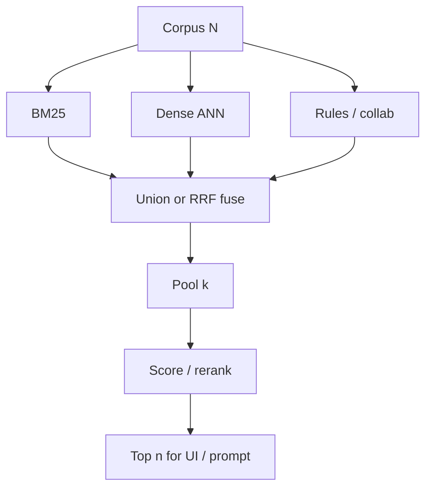

Candidate generation is the first stage of a multi-stage retrieval or recommendation stack. It turns a huge corpus into a shortlist the rest of the system is allowed to see: often tens to hundreds of items from millions or billions of documents, products, videos, or chunks.

The shortlist is a hard ceiling. Ranking, reranking, context packing, and generation only reorder or consume what this stage admits. If the gold item never enters the pool, no cross-encoder or LLM can recover it from retrieval alone. That is why offline eval separates **candidate recall** (did evidence enter the set?) from **final quality** (did the ranker or model use it well?).

In recommendation systems the same stage is often called **retrieval**. Google's standard funnel is candidate generation → scoring → re-ranking. The historical YouTube system described by Covington et al. (RecSys 2016) selected hundreds of candidates from millions of videos before ranking them.

## Intuition

Later stages are expensive per item. A cross-encoder scores query and document jointly; a generative model reads full text. You cannot afford that over the full corpus under interactive latency. Candidate generation uses cheap, highly parallel methods that maximize **inclusion** of useful items, not perfect ordering.

Candidate generation is a lossy set-reduction step. A first stage keeps a small, high-recall subset; later stages spend more compute ordering that subset. Any relevant item excluded from the candidate set is unrecoverable downstream, regardless of reranker quality.

Production systems often run **several generators in parallel** (lexical, dense, collaborative, rule-based) and union or fuse their hits. Diversity of generators is a recall lever: one model's blind spot can be another's strength.

## Diagram

## How it works

1. **Index offline.** Build sparse inverted indexes, dense ANN indexes, or item towers so request time avoids expensive joint scoring of the whole corpus. Lookup complexity and actual latency depend on the index, query, filters, and hardware.
2. **Encode the request.** Query text, user history, filters (tenant, ACL, locale, freshness), and optional query rewrite all shape the retrieval keys.
3. **Retrieve a large pool.** Typical $k$ is $50$ to $500$ for RAG and hundreds to a few thousand for recsys candidate gen, depending on latency budget and next-stage cost.
4. **Filter early.** Permission, document-state, and safety filters should drop ineligible items before they burn reranker capacity.
5. **Fuse multi-source hits.** Reciprocal rank fusion or weighted unions merge generators that use incompatible score scales.
6. **Hand off.** A lighter scorer or cross-encoder reorders the pool; RAG packs the top $n$ into the prompt; recsys may still apply diversity and policy re-ranking.

Two-tower (dual-encoder) models are a common neural generator: a query/user tower and an item tower map both sides into one embedding space; item vectors are precomputed; online ANN returns nearest items under inner product or cosine. Sparse BM25 and hybrid fusion remain default companions when exact identifiers matter.

## Formula

For a query $q$ with relevant set $R$ and candidate set $S_k$ of size $k$:

$$
\mathrm{Recall@}k = \frac{|R \cap S_k|}{|R|}
$$

When each query has one gold document, this is the fraction of queries whose gold item appears in $S_k$. For a fixed ranked list, raising $k$ cannot reduce recall; with a different approximate-search run or fusion configuration, the candidate sets may not be nested. It usually raises downstream work when every candidate is scored. Plot recall@k and measured cost before freezing the budget.

If generators $A$ and $B$ produce sets $S_A$ and $S_B$, multi-source recall uses the fused set, e.g. $S_k = \mathrm{Top}_k(S_A \cup S_B)$ after fusion and filters. Log per-generator hit rates so you know which source is carrying recall.

## Example

Support-document RAG over $2 \times 10^6$ chunks:

| Stage | Method | Size |
| --- | --- | --- |
| Dense generator | bi-encoder + HNSW | top $100$ |
| Sparse generator | BM25 | top $100$ |
| Fusion | RRF, ACL filter | at most $200$ distinct eligible chunks |
| Rerank | cross-encoder | top $8$ in prompt |

In a hypothetical known-answer set of $500$ queries, the required gold chunk is in the candidate pool for $360$ queries → recall@$200 = 0.72$. If each query truly requires that unique chunk, accuracy based on the retrieved evidence cannot exceed that share. Alternative sufficient evidence, another retrieval call, or answers from model memory change that ceiling.

Split the $140$ misses before changing models:

| Miss bucket | Count | Fix direction |
| --- | --- | --- |
| Never ingested / bad chunking | $40$ | pipeline |
| Erroneous ACL or tenant metadata removed eligible evidence | $25$ | repair access metadata, preserve permission checks |
| Relevant chunk ranked below dense top $100$ and absent from sparse top $100$ | $30$ | inspect embedding / query and pool size |
| Relevant chunk ranked below sparse top $100$ and absent from dense top $100$ | $20$ | inspect analyzer / lexical query and pool size |
| Neither index contains the ingested chunk | $25$ | repair indexing / freshness |

These buckets assume the gold evidence is legitimately accessible to the caller. Exclusion of unauthorized evidence is correct and should not be counted as a retrieval failure. Dense-only and sparse-only hits inside the stated top-$100$ lists would already enter their union; log those as successful source contributions, not candidate misses.

Failure chain to walk: **ingested → ACL-eligible → in candidate set → reranked into prompt → used by the model.** Candidate generation owns the "in candidate set" step.

## Trade-offs

| Choice | Upside | Cost / risk |
| --- | --- | --- |
| Larger $k$ | Higher recall ceiling | Rerank latency, noise into the prompt |
| More generators | Coverage of lexical + semantic + collab | Fusion complexity, duplicate noise |
| ANN over exact | Millisecond scale | Approximate neighbor misses |
| Aggressive filters | Safety and tenancy | False exclusion looks like "bad retrieval" |
| Cheap first stage only | Throughput | Low ceiling if embedding/index quality is weak |

Measure **task recall@k** on labeled queries alongside ANN-vs-exact geometric recall when tuning $k$ and index fidelity. Weak embeddings can miss answerable documents even with a perfect index.

## Why it matters here

RAG, hybrid search, code search, and multi-stage recommenders all share this funnel. LeetLLM treats candidate generation as the earliest quality ceiling: measure recall@k, debug ingestion and filters before blaming the generator model, and only then spend budget on rerankers and prompts. If you cannot name your candidate set size and its recall, you are optimizing the wrong stage.

## Related terms

- [Recall@k](glossary://recall-at-k)
- [Hybrid search](glossary://hybrid-search)
- [Dense retrieval](glossary://dense-retrieval)
- [ANN search](glossary://ann-search)
- [Reranker](glossary://reranker)
