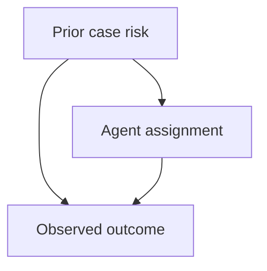

Causal inference estimates how outcomes would change under a deliberate system, policy, or treatment change. It separates intervention effects from associations in observed data, using an intervention, a defensible causal model, or explicit assumptions that make observational comparisons informative.

## Distinguish observed and intervened outcomes

The observational quantity $P(Y\mid T=1)$ describes outcomes among units that received treatment. The intervention quantity $P(Y\mid do(T=1))$ describes outcomes if treatment were assigned externally. These coincide only under appropriate assumptions. If account risk influences both whether an agent is enabled and whether a case fails, comparing enabled and disabled cases without accounting for risk attributes the preexisting difference to the agent.

## Example

Low-risk cases resolve successfully 90% of the time without an agent and 95% with one. High-risk cases resolve 40% without an agent and 45% with one. The agent improves both groups by five percentage points. If it is deployed mostly to high-risk cases, its overall observed success can nevertheless look lower than the control's. Standardizing both groups to the same risk distribution recovers the within-group improvement when risk is the relevant measured confounder.

## Why it matters here

Model launches, recommendation systems, retrieval changes, and human-in-the-loop policies all create selection effects. Researchers need causal assumptions and an identification strategy before claiming that a model change caused a production outcome.

## Related terms

- [A/B testing](glossary://ab-testing)
- [Feature leakage](glossary://feature-leakage)
- [Evaluation science](glossary://evaluation-science)
