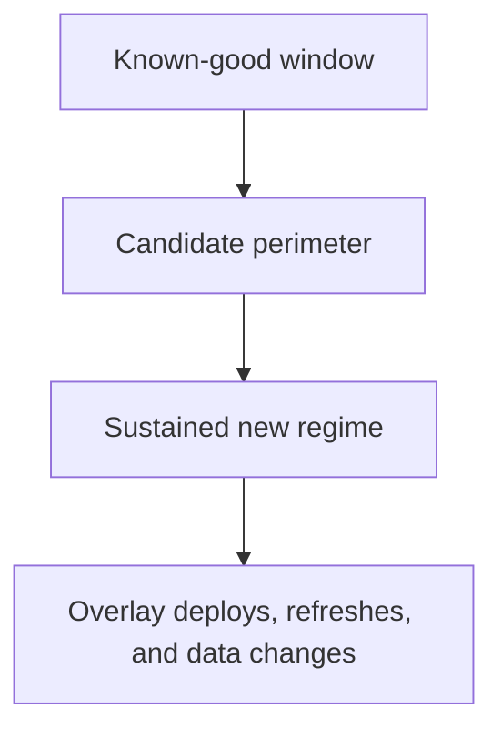

**Change-point detection** looks for time where data-generating process changes, such as shift in mean, variance, slope, or event rate. An anomaly may be one isolated point. A change point marks perimeter after which behavior stays different.

Simple operational analysis compares rolling windows before and after candidate perimeter. More formal methods include cumulative-sum tests, likelihood segmentation, and Bayesian online change-point models. Method must account for noise, seasonality, repeated testing, and metric definition changes.

## Investigation order

1. Find first sustained deviation, not largest endpoint.
2. Preserve raw points around perimeter.
3. Overlay checkpoints, weight refreshes, deploys, data changes, and incidents.
4. Test whether same perimeter appears in independent metrics.
5. Use controlled intervention before assigning cause.

## Example

Token entropy begins trending lower after a checkpoint, while tool errors jump for one batch and recover. The entropy series may have a change in slope; the tool errors show an isolated anomaly. A smooth decline alone does not prove a discrete perimeter, and neither pattern identifies its cause. Separate timelines stop a later rollout failure from being blamed for an earlier policy change.

## Why it matters here

Policy entropy can drift smoothly while tool errors spike in isolated batches. Treating both as one event confuses persistent model change with bursty rollout failure. Change-point analysis separates their timelines.

## Related terms

- [Anomaly](glossary://anomaly)
- [Concept drift](glossary://concept-drift)
- [Data drift](glossary://data-drift)
- [Falsification test](glossary://falsification-test)
