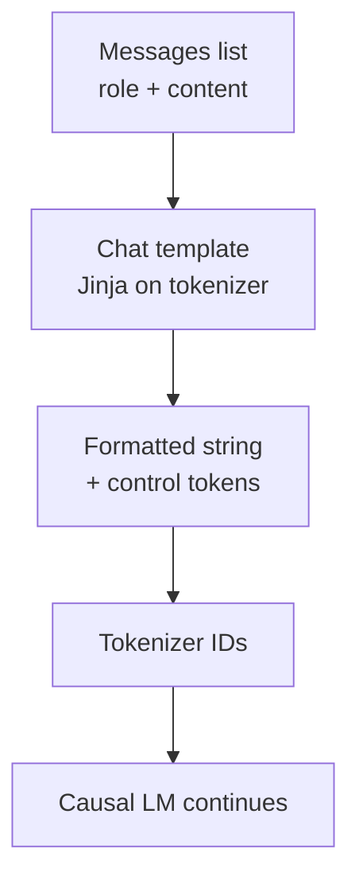

A chat template is the checkpoint-owned serialization rule that turns structured chat messages (`system`, `user`, `assistant`, `tool`, and optional tool-call fields) into the exact token sequence a chat model was trained to continue. Application code stores roles and strings; the model only ever sees tokens: role markers, whitespace, special delimiters, generation cues, and stop or end-of-turn IDs.

Two instruct checkpoints can share a base model family and still require different templates. Wrong template is a common reason local or self-hosted results diverge from a host API for the "same" weights.

## Diagram



## How it works

Chat fine-tuning teaches the model to continue a serialized conversation with role and control markers. The template defines that structure. In Hugging Face Transformers it usually lives on the tokenizer as a Jinja string (`tokenizer.chat_template`) and is applied with `apply_chat_template`. Common roles are `user`, `assistant`, and `system`; tool-capable models also render tool definitions, assistant `tool_calls`, and `tool` result messages in checkpoint-specific layouts.

Operational modes that change the end of the rendered string:

| Mode | Intent | Typical flag |
|---|---|---|
| Training transcript | Include the known assistant answer; no open generation cue | `add_generation_prompt=False` |
| Fresh generation | End after the user turn, then open an assistant turn | `add_generation_prompt=True` |
| Prefill / continuation | Leave the final assistant message open so the model continues it | `continue_final_message=True` |

`add_generation_prompt` and `continue_final_message` are mutually exclusive: one starts a new assistant message, the other continues an existing one. Not every template appends a visible assistant-start marker when generation is requested; some families only need the user turn closed.

For a checkpoint with separate reasoning and answer fields, current Transformers also supports a field name such as `continue_final_message="reasoning_content"`. That field must exist in the final message and be used by the template; continuing `content` can close the reasoning block instead. Check the checkpoint's field names and your installed library version. [Hugging Face chat-template guide](https://huggingface.co/docs/transformers/chat_templating)

If you render with `tokenize=False` and tokenize later, set `add_special_tokens=False` so BOS/EOS are not inserted twice. Prefer `tokenize=True` when the tokenizer owns the full contract.

## Example

Same incident-response conversation, three different shipped formats (illustrative of real family contracts from Hugging Face docs and Meta Llama 3 prompt formats). Each block ends ready for generation (`add_generation_prompt=True`):

**ChatML-style**
```text
<|im_start|>system
You are an incident-response assistant.<|im_end|>
<|im_start|>user
Why did deploy api-v17 fail?<|im_end|>
<|im_start|>assistant
```

**Mistral-7B-Instruct-v0.1 style**
```text
<s>[INST] Why did deploy api-v17 fail? [/INST]
```

(System handling and multi-turn spacing differ by Mistral revision; use the tokenizer that shipped with the checkpoint.)

**Llama 3 Instruct style**

```text
<|begin_of_text|><|start_header_id|>system<|end_header_id|>

You are an incident-response assistant.<|eot_id|><|start_header_id|>user<|end_header_id|>

Why did deploy api-v17 fail?<|eot_id|><|start_header_id|>assistant<|end_header_id|>

```

Feeding Model B through Model A's markers may still produce text, but you have changed the input distribution the weights learned. Symptoms include role confusion, ignored system instructions, broken tool-call JSON, repeated headers, early stops, or large quality gaps versus the vendor API.

Do not hand-roll those strings. Call `apply_chat_template` on the tokenizer that shipped with the checkpoint you load (Zephyr here; its rendered markers differ from pure ChatML):

```python
from transformers import AutoTokenizer

tokenizer = AutoTokenizer.from_pretrained("HuggingFaceH4/zephyr-7b-beta")
messages = [
    {"role": "system", "content": "You are an incident-response assistant."},
    {"role": "user", "content": "Why did deploy api-v17 fail?"},
]
prompt_inputs = tokenizer.apply_chat_template(
    messages,
    tokenize=True,
    add_generation_prompt=True,
    return_tensors="pt",
    return_dict=True,
)
```

## Why it matters here

Chat templates sit between product message objects and token-level behavior. They are required for correct SFT and preference training (so loss and labels align with the same role boundaries serving will use), for tool calling and structured prefills, and for fair evaluation against hosted models. After a serving stack, library, or GGUF conversion change, template drift is a frequent root cause of "the model got worse" with unchanged weights. Pin template, tokenizer artifact, special-token IDs, stop sequences, and tool schema format together; regression-test a golden multi-turn chat that includes a tool turn.

## Related terms

- [Tokenizer artifact](glossary://tokenizer-artifact)
- [Tokenization](glossary://tokenization)
- [Tool calling](glossary://tool-calling)
- [Supervised fine-tuning](glossary://supervised-fine-tuning)
- [Hugging Face Transformers](glossary://hugging-face-transformers)
