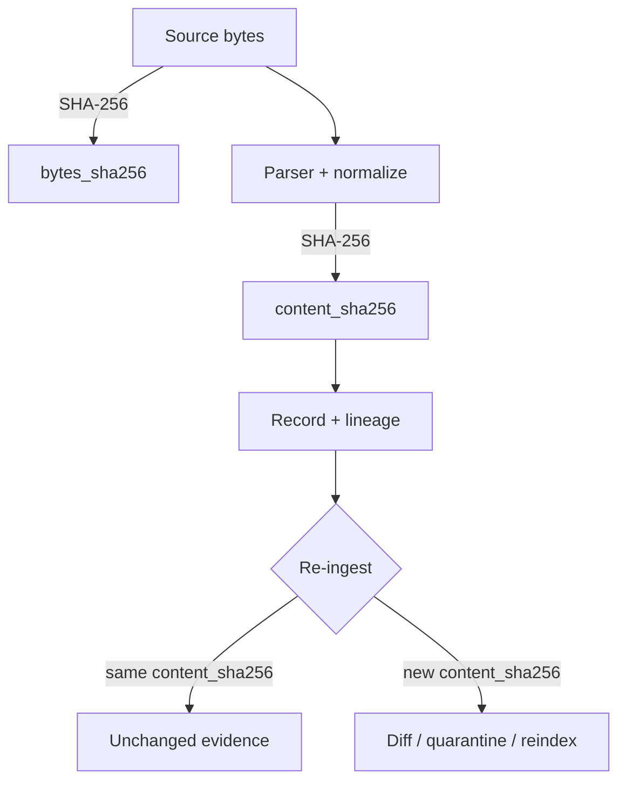

A **checksum** is a fixed-length value computed from a data object so a later recomputation can detect whether the object changed. NIST and Internet security glossaries define it as a content-dependent value stored or transmitted with the object to catch error or manipulation. The procedure that produces it is a checksum algorithm (simple modular sum, CRC, or a cryptographic hash used as a digest).

In AI systems the same idea answers a practical question: *is this the same bytes, the same normalized text, or the same artifact I indexed last week?* A bare hex string without algorithm and input recipe is not enough. Hash raw download bytes when transport integrity matters. Hash normalized text when the parser output is the evidence you retrieve and cite. Label which recipe each digest used.

## Intuition

Think of a fingerprint for a bag of bits. If any bit in the bag flips, a good algorithm almost always yields a different fingerprint. Agreement of fingerprints is strong evidence of identity; disagreement is certain evidence of difference. Short non-cryptographic checksums (parity, additive sums, many CRCs) are cheap detectors of *accidental* corruption. Cryptographic digests such as SHA-256 (FIPS 180-4) are the usual choice when you need resistance to deliberate collision crafting and a huge space of possible digests.

A plain checksum detects changes to a well-defined byte string. Anyone who can rewrite the file can recompute the checksum, so authenticity requires a MAC or digital signature over the digest.

## How it works

1. Choose the **input object** precisely: file bytes, UTF-8 of normalized text, dataset shard, weight file, or cache payload.
2. Choose the **algorithm**. SHA-256 is one standard cryptographic choice for content identity; a CRC serves a different accidental-error-detection purpose.
3. Compute $d = H(x)$ for input $x$. For SHA-256, $d$ is 256 bits (64 hex characters).
4. Store $d$ with metadata: algorithm id, what was hashed, normalization/parser version, source URI, and time.
5. On re-read or re-ingest, recompute $H(x')$ and compare. Equal digests are evidence of identical inputs under that recipe, subject to collisions; unequal digests mean the content (or recipe) changed. For exact deduplication where false matches are unacceptable, use the hash to find candidates and compare their bytes or normalized text.

For an ideal $n$-bit hash, the birthday bound says a collision among *some* pair is likely only after about $2^{n/2}$ independent digests. For SHA-256 ($n = 256$), that is roughly $2^{128}$ work, so accidental collisions at practical corpus sizes are negligible. That is why two equal SHA-256 digests of the same recipe are treated as the same content for dedup and audit.

## Example

A policy HTML file downloads with SHA-256 of the raw response body:

```text
bytes_sha256 = a3f1c9e2…   # full 64 hex chars in storage
```

After boilerplate stripping and Unicode normalization, the cleaned policy text hashes to a different digest:

```text
content_sha256 = 91bc44d0…
parser         = html-boilerplate@1.8
norm           = nfkc+strip_boilerplate_v3
source_uri     = https://intranet.example/runbook-v3.html
```

When a user disputes an answer dated 2026-03-01, resolve the citation's source-version hash and chunk locator against the retained snapshot active that day. A whole-document digest identifies that source version; a separately hashed chunk identifies its own text. A digest alone cannot reconstruct deleted evidence or establish when it was published. Deduping on `content_sha256` also collapses five mirror copies of the same parsed PDF while retaining their source lineage, so BM25 and dense scores are not flooded by identical evidence.

Minimal Python pattern used in ingestion lessons:

```python
from hashlib import sha256

policy_text = "Restart only after waiting 15 minutes."

def content_checksum(text: str) -> str:
    return sha256(text.encode("utf-8")).hexdigest()

record = {
    "source_id": "incident-runbook-v3.pdf",
    "locator": "page=7",
    "text": policy_text,
    "parser": "native-pdf",
    "quality": "ready",
    "checksum": content_checksum(policy_text),  # store full hex
}
```

Abbreviate digests only for logs and UI (`checksum[:12]`); keep the full digest in the record and manifest.

## Diagram



## Trade-offs

| Choice | Strength | Cost / risk |
|--------|----------|-------------|
| CRC / short checksum | Fast; good for accidental bit flips on links and disks | Easy to forge; many collisions; not an identity key |
| MD5 / SHA-1 | Still common in legacy tools | Cryptographically broken for collision resistance; avoid for new integrity IDs |
| SHA-256 | Standard integrity digest; tiny accidental-collision risk | Slightly slower than CRC; still not a signature by itself |
| Hash of raw bytes | Catches download/storage corruption | Misses "same document, different packaging" |
| Hash of normalized text | Stable identity for retrieval and eval | Silent recipe change (parser, NFKC, whitespace) looks like a content change |

## Why it matters here

LeetLLM ingestion, dataset, and eval material treat checksums as part of the evidence schema: detect re-ingestion drift, prove which text an answer cited, and deduplicate exact copies without erasing [lineage](glossary://provenance). Store algorithm, normalization recipe, source URI, parser version, and timestamp with every digest. That turns "the model cited something wrong" into a checkable path across parser output, chunk identity, and dataset snapshots.

## Related terms

- [lineage](glossary://provenance)
- [Dataset record](glossary://dataset-record)
- [Document parser](glossary://document-parser)
- [Dependency lockfile](glossary://dependency-lockfile)
- [Unicode normalization](glossary://unicode-normalization)
