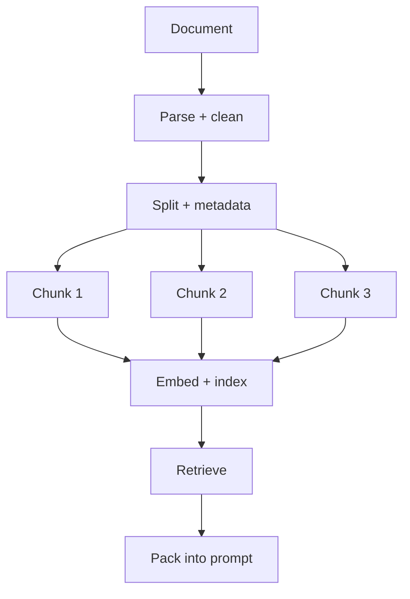

Chunking splits a larger document into smaller units that can be indexed, retrieved, embedded, cited, or packed into a model context. The chunk is the unit of evidence: it decides what gets a vector, what a citation points at, and how much surrounding text arrives with a hit.

A bad perimeter can separate an answer from the qualifier that makes it true. Size trades match locality (small, sharp chunks rank better for a narrow query) against self-contained context and embedding quality (too small, and vectors lack meaning; too large, and the hit mixes topics and burns prompt budget).

## Intuition

A chunked retrieval index searches the units you wrote into it. A system may also maintain a separate document-level index; distinguish which unit each retriever scores.

Three jobs share the same cut:

1. **Match.** The retriever (BM25, dense ANN, hybrid) scores the chunk text against the query.
2. **Evidence.** The generator and the citation UI show the same span (or a parent of it).
3. **Budget.** Each chunk costs tokens in the context window and storage in the vector store.

If those three disagree (retrieve a sentence, show a page, pack a section), you need an explicit parent/child design. If they are the same object, a bad cut remains in the index until it is rebuilt: a mid-table slice or a heading without its body can repeatedly lose the needed context.

## Diagram



## How it works

Pick a splitter, a size unit (prefer tokens for LLM pipelines), optional overlap, and the metadata every chunk must carry. Common strategies:

| Strategy | Strength | Failure mode |
|---|---|---|
| Fixed token windows | Simple, predictable size | Cuts mid-sentence, mid-table, mid-function |
| Recursive separators | Keeps paragraphs, then sentences, then words | Still length-blind to topic shifts |
| Heading-aware / structure | Preserves sections from HTML, Markdown, docs | Weak on flat PDFs and OCR soup |
| Semantic splits | Groups sentences by embedding similarity | Costly; unstable if re-embed changes partitions |
| Sentence window | Index a sentence; expand neighbors at serve time | Metadata bloat; needs post-processor |
| Parent / child (small-to-big) | Precise retrieval, rich generation context | Two stores; parent explosion if many children hit |

**Recursive splitting** (for example LangChain's `RecursiveCharacterTextSplitter`) tries separators in order, typically `["\n\n", "\n", " ", ""]`, so larger semantic units stay intact until a unit exceeds `chunk_size`. Measure length with a tokenizer when the consumer is a model, not with raw character `len`, unless you only care about storage layout.

**Overlap** copies a tail of chunk $i$ onto the head of chunk $i+1$. It helps when a definition ends on one side of the perimeter and its qualifier or usage starts on the other. Choose overlap from the lengths of evidence spans you need to preserve, then evaluate it. Overlap is not free: it increases storage, creates near-duplicate hits, and can dominate ranking with repeated boilerplate.

**Semantic chunking** embeds consecutive sentences (or short windows), then splits where similarity drops (threshold, percentile, or breakpoint statistics). It can raise answer completeness on topic-shifting prose, but every re-index may redraw partitions, so citation stability and diffs get harder.

**Parent/child (small-to-big)** decouples the retrieval unit from the generation unit: embed small children (for example $200$–$400$ tokens) so ANN and BM25 have sharp targets; when a child hits, return the parent section (or a sentence window) to the LLM. Sentence-window parsers do a special case of this: index one sentence, keep a neighborhood in metadata, replace the sentence with the window before generation.

**Structure first.** Tables, code, API specs, and multi-column PDFs need parsers and chunkers that respect those objects. A generic text splitter that bisects a Markdown table or a function body will retrieve garbage no embedding model can fix.

## Example

An incident-response runbook is cleaned of nav chrome, then split by heading, then by paragraph, with metadata:

```text
source_id: runbook-deploy-v3
section_title: Roll back a failed canary
heading_path: Deployments > Canary rollback
acl: engineering_oncall
parser_version: p_1.8
content_sha256: 91bc…
token_count: 312
```

A bare paragraph that only says `"wait 15 minutes"` may match a query well but mislead the model into applying a canary observation window to a full rollback unless `section_title` or neighboring sentences travel with the chunk.

Measure **span containment**: for each labeled gold span, is there at least one returned evidence unit that fully contains it? As a toy calculation, take a $60$-token document with answer spans at half-open token offsets $[5,12)$, $[18,23)$ and $[37,43)$. Nonoverlapping windows $[0,20)$, $[20,40)$ and $[40,60)$ fully contain only the first span, giving $1/3$. Windows $[0,20)$, $[16,36)$, $[32,52)$ and $[48,60)$ contain all three, giving $3/3$, while indexing $72$ token occurrences instead of $60$.

This calculation proves coverage for those three spans, not better ranking or answer quality. Evaluate retrieval recall and packed-context containment separately. For a parent/child design, report both child containment and parent containment so expanding the evidence unit does not hide a weak retrieval stage.

Raising average chunk size from $200$ to $800$ tokens often lifts containment and hurts embedding precision: the vector averages a whole section, and packing five large hits can exhaust the [token budget](glossary://token-budget) before the right clause appears.

Minimal recursive split sketch (character length for illustration; use a token length function in production):

```python
from langchain_text_splitters import RecursiveCharacterTextSplitter

cleaned_policy_html_text = "Rollback\n\nWait 15 minutes before assessing canary errors."

splitter = RecursiveCharacterTextSplitter(
    chunk_size=800,
    chunk_overlap=120,
    separators=["\n\n", "\n", ". ", " ", ""],
)
chunks = splitter.split_text(cleaned_policy_html_text)
```

After split, attach stable ids, section path, tenant ACL, source version, and checksum. Re-chunking without versioning makes citations and "why did this answer change?" unanswerable.

## Sizing and trade-offs

There is no universal best size. Size is a function of embedding training, query length, document genre, and how many chunks you pack.

- **Too small:** weak embeddings, fragmented multi-hop facts, BM25 multi-term queries split across units.
- **Too large:** diluted similarity, mixed topics, wasted prompt tokens, harder citations.
- **Measure tokens**, not characters, when the next consumer is an LLM or a token-limited embedding API.
- **Log size histograms** after each parser change; a long tail of 4k-token "chunks" often signals a failed split and warrants parser review.
- **Overlap** helps perimeter-straddling answers; prefer better partitions when you can measure them.
- **Index small, return large** when precision and context both matter and you can pay for parent lookup.
- **Re-index policy:** parser version, chunker version, and embedding model id belong on every record so a backfill can rebuild a namespace without guessing.

## Why it matters here

chunk delimiters often decide whether "the answer was in the corpus" becomes "the system could retrieve and cite it." In the curriculum and in production RAG, chunking sits between parsing and retrieval: it shapes dense and sparse indexes, recall@k ceilings, prompt packing, and audit trails. Tuning prompts cannot recover evidence that never formed a clean, self-sufficient unit in the index.

## Related terms

- [RAG](glossary://rag)
- [Embedding](glossary://embedding)
- [Dense retrieval](glossary://dense-retrieval)
- [Token budget](glossary://token-budget)
- [Candidate generation](glossary://candidate-generation)
