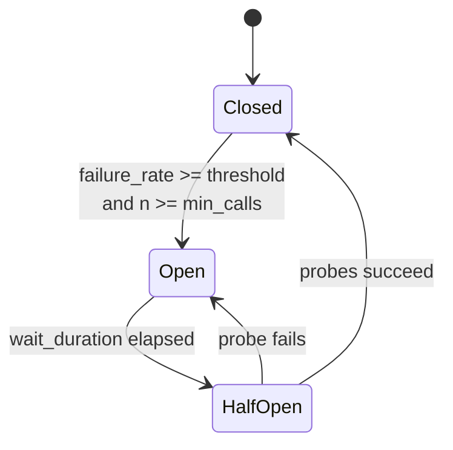

A circuit breaker is a proxy around a dependency call that **stops sending traffic** once recent failures show the dependency is sick, then **probes carefully** before restoring full load. While open, callers fail fast or take a declared fallback instead of stacking timeouts, threads, tokens, and retries on a path that is unlikely to succeed.

Michael Nygard popularized the pattern in *Release It!*; Martin Fowler's write-up documents the common three-state model (closed, open, half-open). Remote LLM APIs, embedding services, vector stores, and tool backends are exactly the kind of slow, hang-prone dependencies the pattern was built for: one unresponsive provider can exhaust client connection pools and cascade into unrelated routes.

## Intuition

An electrical breaker trips on excess current so the rest of the building stays up. The software version trips on excess *failure rate* (or consecutive failures) so the rest of the product stays responsive.

| Pattern | Question it answers | Typical action |
|---|---|---|
| **Retry backoff** | "Was this a blip?" | Wait longer, try again |
| **Backpressure** | "Is *our* capacity full?" | Admit less local work |
| **Rate limit / quota** | "Did this identity spend its budget?" | Reject or delay by policy |
| **Circuit breaker** | "Is *this dependency* unhealthy?" | Short-circuit calls to it |

Retries assume recovery is near. A breaker assumes recovery may take longer than your timeout budget and that continued probing is harmful. Combine them carefully: retry *through* a closed breaker for transient faults; stop retrying when the breaker opens.

## Diagram



## How it works

Most production breakers are a small state machine:

1. **Closed.** Traffic flows. Record success/failure (and optionally *slow* calls) in a sliding window.
2. **Open.** New calls are rejected immediately (or routed to fallback). A wait timer starts so the dependency can recover without a thundering herd.
3. **Half-open.** After the wait, permit a small number of probe calls. Success closes the breaker and resets metrics; failure reopens it and restarts the wait.

Two window styles are common (as in Resilience4j-style libraries):

- **Count-based:** last $N$ outcomes (for example last $100$ calls).
- **Time-based:** outcomes in the last $T$ seconds (for example last $30$s).

Trip when the estimated failure rate meets a threshold *and* the window has enough samples:

$$
\hat{p}_{\mathrm{fail}} = \frac{\#\ \mathrm{failures}}{\#\ \mathrm{calls}},\quad
\text{open if }\hat{p}_{\mathrm{fail}} \ge \theta\ \text{and}\ \#\ \mathrm{calls} \ge n_{\min}.
$$

Without $n_{\min}$, $2$ failures out of $3$ look like a $67\%$ outage and trip the breaker during cold start or low traffic. With $n_{\min}=50$ and $\theta=0.5$, you need real volume before short-circuiting.

Libraries also often track **slow-call rate**: a call that succeeds after $5$s can still hurt SLOs and overload a struggling provider. Resilience4j tracks this separately from failed calls and can open on either threshold; a slow success need not be reclassified as a failure. [Resilience4j circuit-breaker documentation](https://resilience4j.readme.io/docs/circuitbreaker)

### What to count as failure

Record as failures:

- Timeouts and connection errors
- Selected `5xx` / provider unavailable codes
- Explicit "dependency unhealthy" signals

Do **not** record as dependency failure:

- Client `4xx` validation and bad schemas (fix the request)
- Auth / permission errors (fix credentials or policy)
- Business refusals and safety blocks (product logic, not provider health)

Otherwise a spike of bad client prompts can open the breaker for a healthy model API.

Treat `429` separately from malformed requests: it can signal an exhausted caller quota or dependency overload. Decide its breaker scope and retry policy from the provider's documented meaning, and honor applicable retry delays. A blanket rule for all `4xx` responses would hide that distinction.

### Scope

One breaker per independently failing resource. Share a single breaker across providers or shards only if they truly fail together. A regional outage on provider A must not black-hole provider B; a sick vector index shard must not block healthy shards.

## Example

Chat traffic uses primary provider A, with provider B as a [fallback lane](glossary://fallback-lane). Configure a time-based window of $30$s, $\theta = 40\%$ failure rate, $n_{\min} = 50$, open wait $60$s, and $3$ half-open probes.

Over $30$s the gateway records $80$ attempts to A: $32$ timeouts, $48$ successes.

$$
\hat{p}_{\mathrm{fail}} = \frac{32}{80} = 0.40 \ge 0.40,\quad n=80 \ge 50
$$

The breaker **opens**. Eligible interactive traffic routes to B (or a cached / degraded answer) without waiting for A's timeout budget. After $60$s, half-open allows three probes to A. If all three succeed, the breaker **closes** and clears the failure window. If a probe times out, it **reopens** for another $60$s.

The sketch below counts **successful** half-open probes explicitly and assumes serialized calls in every state: each permitted call finishes and invokes `record` before another call starts. It is not thread-safe. If a gateway dispatches probes concurrently, a budget-only counter can close on the first success once permits are exhausted. Track successful completions separately from issued permits, and attach a state-generation identifier to each permit so late results from an earlier closed or half-open period cannot decide the current probe outcome.

```python title="circuit-breaker-sketch.py"
import time
from collections import deque
from dataclasses import dataclass, field

@dataclass
class CircuitBreaker:
    failure_threshold: float = 0.4   # 40%
    min_calls: int = 50
    window_s: float = 30.0
    open_wait_s: float = 60.0
    half_open_probes: int = 3
    state: str = "closed"
    opened_at: float = 0.0
    outcomes: deque = field(default_factory=deque)  # (ts, ok: bool)
    half_open_successes: int = 0
    probe_in_flight: bool = False

    def _prune(self, now: float) -> None:
        while self.outcomes and now - self.outcomes[0][0] > self.window_s:
            self.outcomes.popleft()

    def allow(self) -> bool:
        now = time.monotonic()
        if self.state == "open":
            if now - self.opened_at < self.open_wait_s:
                return False
            self.state = "half_open"
            self.half_open_successes = 0
            self.probe_in_flight = False
        if self.state == "half_open":
            # Single-flight: one probe until record() lands.
            if self.probe_in_flight:
                return False
            self.probe_in_flight = True
            return True
        return True  # closed

    def record(self, ok: bool) -> None:
        now = time.monotonic()
        self.outcomes.append((now, ok))
        self._prune(now)
        n = len(self.outcomes)
        fails = sum(1 for _, o in self.outcomes if not o)
        rate = fails / n if n else 0.0

        if self.state == "half_open":
            self.probe_in_flight = False
            if not ok:
                self.state, self.opened_at = "open", now
            else:
                self.half_open_successes += 1
                if self.half_open_successes >= self.half_open_probes:
                    self.state = "closed"
                    self.outcomes.clear()
            return

        if n >= self.min_calls and rate >= self.failure_threshold:
            self.state, self.opened_at = "open", now
```

If the breaker flaps (open → half-open → open repeatedly), lengthen `open_wait_s`, raise $n_{\min}$, separate timeout classes from application errors, or use distinct breakers per error type. Safety-sensitive tool calls may **forbid** silent model switching and hard-fail when open rather than invent a weaker path.

## Trade-offs

| Choice | Upside | Cost |
|---|---|---|
| Aggressive $\theta$ / short window | Faster isolation | More false opens under normal jitter |
| Conservative $\theta$ / long $n_{\min}$ | Fewer false trips | Longer timeout storms before open |
| On open → fallback lane | Availability holds | Quality, safety, or schema may change |
| On open → hard error | Honest failure | User-visible outage on that path |
| Many half-open probes | Stronger recovery signal | More load on a still-sick dependency |
| One probe only | Gentle recovery | Noisy probe can delay recovery |

Breakers do not replace timeouts, bulkheads (concurrency caps), or client backoff. They complement them: short client timeouts free resources; breakers stop the next wave of doomed calls; backoff and fallback decide what the *caller* does with the open signal.

## Why it matters here

LLM products chain expensive, multi-second remote calls: primary model, backup model, embeddings, search, tools, and sandbox APIs. Without breakers, every request independently discovers that provider A is timing out, burns token and connection budget on retries, and can take the whole agent loop with it. With breakers, one weak provider becomes a controlled open state: fail fast, use a declared [fallback lane](glossary://fallback-lane) or halt a stuck repair loop, probe recovery, and keep other routes inside their [SLO](glossary://slo).

## Related terms

- [Retry backoff](glossary://retry-backoff)
- [Fallback lane](glossary://fallback-lane)
- [Backpressure](glossary://backpressure)
- [Provider route](glossary://provider-route)
- [SLO](glossary://slo)
