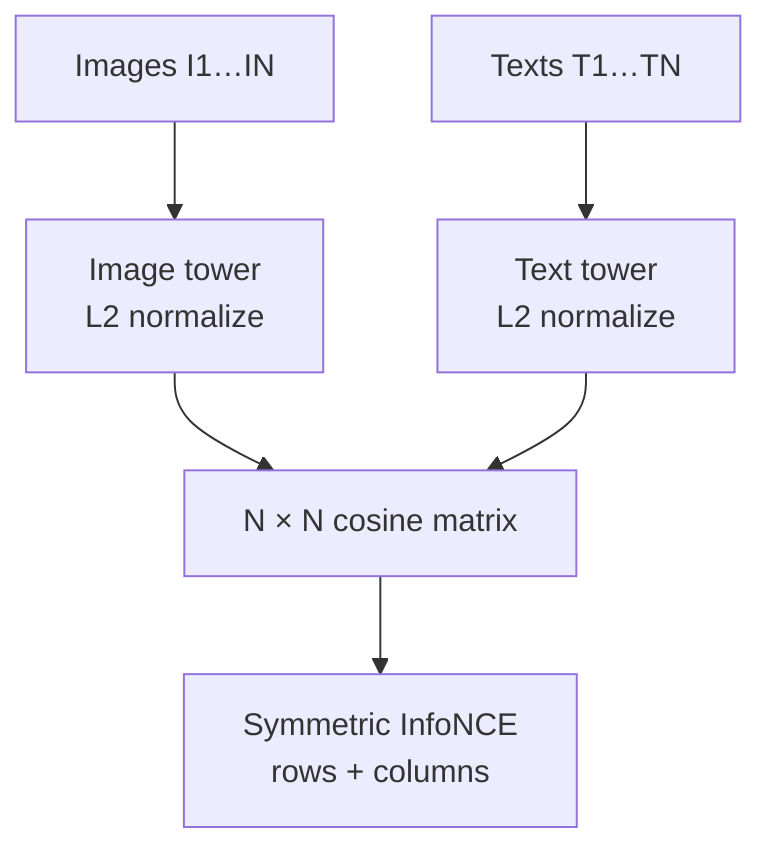
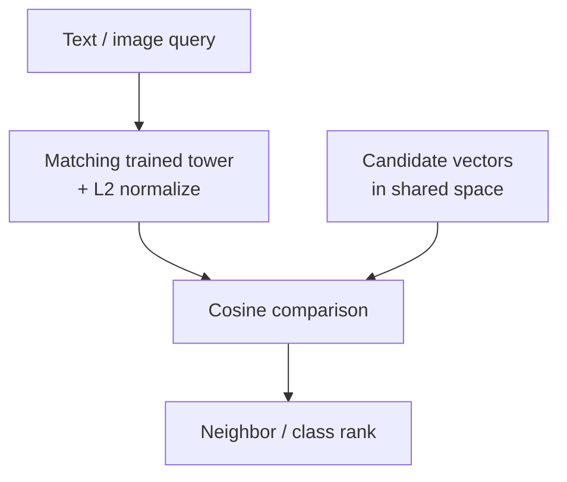

CLIP (Contrastive Language-Image Pre-training; Radford et al., 2021) is a dual-encoder vision-language model that maps images and text into one shared embedding space so matched pairs rank above mismatched pairs. After pre-training on large-scale internet (image, text) pairs, the same space supports open-vocabulary image search, text-to-image and image-to-image retrieval, and zero-shot classification by embedding class names as text instead of training a fixed classifier head.

## Intuition

Train two towers: an image encoder and a text encoder. In a batch of $N$ paired examples, every image is compared with every text. The $N$ true pairs should sit on the diagonal of the similarity matrix; the $N^2 - N$ wrong pairs are in-batch negatives. The loss is symmetric: each image must pick its text, and each text must pick its image. At inference, a free-form phrase like "red running shoes with white sole" becomes a text vector that ranks product photos without a shoes-specific classifier.

CLIP scores images against supplied text candidates and returns similarities or softmax probabilities over that set. Grounded caption generation uses a separate language head or captioner.

Those softmax values depend on the candidate set and temperature. A high value among two prompts indicates relative preference within that set; use separate calibration to estimate whether the image satisfies every word of the winning prompt. Adding another plausible class can change the probabilities without changing the image embedding.

## How it works

1. **Encode.** Image $I_i$ goes through a vision backbone (ResNet or Vision Transformer in the original work). Text $T_i$ goes through a transformer text encoder. Both towers project into a shared dimension $d$.
2. **Normalize.** Embeddings $v_i$ and $u_i$ are L2-normalized so cosine similarity reduces to a dot product.
3. **Score.** Build the $N \times N$ matrix of scaled similarities $\mathrm{sim}(v_i, u_j)/\tau$, where $\tau$ is a temperature. CLIP learns $\tau$ as a log-parameterized scalar rather than fixing it by hand.
4. **Contrast.** Apply cross-entropy over rows (image-to-text) and columns (text-to-image). Average the two directions.
5. **Use at inference.** Embed a query text, query image, or set of class prompts and rank by cosine similarity in the shared space.

Original CLIP was trained on about 400 million web image-text pairs with a minibatch of $32{,}768$, so each positive competed against tens of thousands of in-batch negatives. That scale is a major reason the geometry generalizes to many visual concepts without task-specific labels.

## Formula

With L2-normalized embeddings and cosine similarity $\mathrm{sim}(v,u) = v^\top u$, the image-to-text term is InfoNCE-style:

$$
\mathcal{L}_{i\to t} = -\frac{1}{N}\sum_{i=1}^{N}\log\frac{\exp(\mathrm{sim}(v_i,u_i)/\tau)}{\sum_{j=1}^{N}\exp(\mathrm{sim}(v_i,u_j)/\tau)}
$$

The text-to-image term $\mathcal{L}_{t\to i}$ swaps the roles of $v$ and $u$. The training objective is the symmetric average:

$$
\mathcal{L} = \frac{1}{2}\left(\mathcal{L}_{i\to t} + \mathcal{L}_{t\to i}\right)
$$

In code, libraries usually store a learnable `logit_scale` as $\log(1/\tau)$ and multiply similarities by $\exp(\mathrm{logit\_scale}) = 1/\tau$, so logits are `(1/\tau) * image_features @ text_features.T`.

## Diagram

Training aligns the two normalized towers in one shared space. Inference reuses the matching trained tower; the candidate vectors come from that same space.

## Example

**Zero-shot ranking (worked scores).** Suppose an inspection photo embeds to a normalized vector close to the prompt "a cracked equipment panel" and far from "a clean equipment panel":

| Candidate prompt | Cosine to image | Scaled by $1/\tau=5$ | Softmax |
|---|---:|---:|---:|
| a cracked equipment panel | $0.90$ | $4.50$ | $\approx 0.971$ |
| a clean equipment panel | $0.20$ | $1.00$ | $\approx 0.029$ |

The model never trained a binary cracked/clean head. It only compared image and text vectors. Changing the prompt wording (for example "a photo of a cracked panel" vs "equipment damage") can move the ranking; prompt templates matter in practice.

**Visual incident retrieval.** Embed dashboard screenshots once and index the vectors. A query such as "red error banner above a latency chart" embeds with the text tower and retrieves visually relevant incidents. The same index supports image-to-image lookup by embedding a new screenshot with the image tower. No separate classifier head is required for every interface state.

## Zero-shot classification recipe

1. List class names or short descriptions for the task.
2. Optionally wrap them in templates such as `"a photo of a {label}"` (the original paper found templates improve ImageNet-style transfer).
3. Embed and L2-normalize the prompts; if using several templates, average their embeddings per class and L2-normalize each resulting class vector again before cosine scoring.
4. Embed the image; score cosine similarities (optionally scale by the trained logit scale and softmax over classes).
5. Predict $\arg\max$ over class scores, or threshold when abstention is allowed.

This turns the text encoder into a dynamic linear classifier in embedding space: text embeddings serve as class weights, which can change with the supplied label set.

## Trade-offs

| Strength | Limit |
|---|---|
| Open-vocabulary search and tagging without a closed class menu | Weak on precise counting, fine spatial layout, and some abstract relations |
| Dual encoders: embed gallery offline, query online (cheap retrieval) | Similarity ranks alignment in the learned space; verify caption claims against image evidence |
| Strong backbone for many later VLMs and multimodal RAG systems | Fine-grained domains (car models, flower species, niche parts) often need fine-tuning or specialist models |
| Competitive zero-shot transfer on many public vision tasks | Prompt phrasing sensitivity; OCR and domain shift vary by image type |
| Large-batch contrastive training teaches broad visual-semantic concepts | Web pre-training inherits social bias and noisy supervision from internet pairs |

CLIP-style dual encoders also differ from generative VLMs: they excel at retrieval and scoring; they do not, by themselves, produce grounded multi-sentence answers or region-level citations.

## Why it matters here

CLIP is the practical bridge from contrastive representation learning to multimodal products: shared image-text geometry, open-vocabulary search, and the dual-encoder pattern reused in modern vision towers and VLM bridges. Curriculum topics on embeddings, InfoNCE, ViTs, and multimodal RAG all meet here. In production, treat CLIP (or a successor dual encoder) as a retrieval and scoring component with slice-level evals for query types, fine-grained distinctions, OCR-heavy images, and adversarial or biased prompts, not as a full multimodal reasoner.

## Related terms

- [Contrastive learning](glossary://contrastive-learning)
- [InfoNCE](glossary://infonce)
- [Image embedding](glossary://image-embedding)
- [Vision-language model](glossary://vision-language-model)
- [Open-vocabulary](glossary://open-vocabulary)
