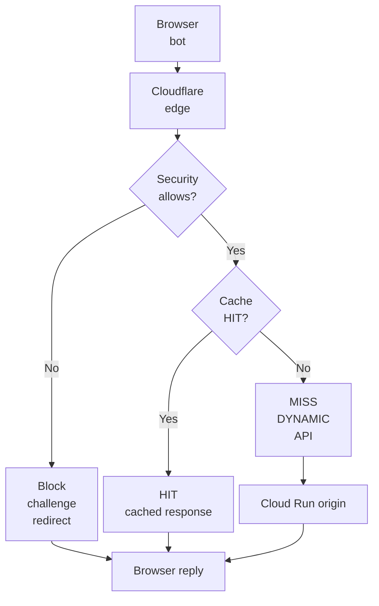

**Cloudflare** is a reverse-proxy edge network that sits between browsers (and bots) and your origin. For a proxied hostname it terminates TLS near the user, applies DNS and security policy (WAF, bot scoring, rate limits, redirects), optionally serves a cached response from a nearby PoP, and only then contacts the origin (for LeetLLM-style stacks, often [Google Cloud Run](glossary://google-cloud-run)).

Think of it as the first production hop you own in practice, even when the app lives elsewhere: many "bugs after deploy" are edge cache, rules, or DNS, not application code.

## Intuition

Users do not hit Cloud Run first. They hit the edge. The response may be:

- an edge-cached HTML or asset page (`CF-Cache-Status: HIT`)
- a redirect or HTTPS upgrade that never reaches origin
- a WAF block or bot challenge
- a cache miss that pulls a fresh origin response (`MISS`)
- a status that means "this path is not cache-eligible" (`DYNAMIC`)

Debug **from the edge inward**: headers and Cloudflare events before rewriting Next.js, container, or model code.

## How it works

1. **DNS points the apex/www at Cloudflare** (orange-cloud / proxied). Authoritative answers send visitors to Cloudflare anycast IPs, not directly to the Cloud Run URL.
2. **Edge TLS**: the client completes HTTPS with Cloudflare. Origin connection is a separate hop; encryption modes such as Full (strict) require a valid certificate on the origin.
3. **Security and rules**: WAF custom rules, bot management / Super Bot Fight Mode, rate limiting, and redirect rules can accept, challenge, block, or rewrite before cache or origin.
4. **Cache decision**: by default Cloudflare caches by **file extension** (CSS, JS, images, fonts, and similar), **not by MIME type**, and **does not cache HTML or JSON** unless you override with Cache Rules (or legacy Page Rules). Origin `Cache-Control` / `Expires` then set TTL unless an edge TTL rule overrides them.
5. **Origin fetch**: on miss or non-cacheable traffic, Cloudflare requests Cloud Run (or another origin), then may store the response at the edge for later HITs. Simultaneous misses for the same asset can collapse into one origin fetch per PoP (request collapsing).
6. **Response headers**: `CF-Cache-Status` reports what the edge did. `CF-RAY` identifies the request and includes a data-center code. Use separate host telemetry for edge-machine identity. `Age` (when present) reports the cached object's age.

### Default eligibility (why HTML is special)

| Content | Default edge behavior |
|---|---|
| `.css`, `.js`, `.png`, fonts, etc. | Cache-eligible by extension |
| HTML pages (`/learn/...`) | **Not** cached by default → often `DYNAMIC` until a Cache Rule says otherwise |
| JSON / API | Same: not default-cache; usually should stay uncached |
| `HEAD` | Can use a cached `GET` representation; on a cacheable miss Cloudflare can fetch `GET` from origin and return only headers |
| Methods other than `GET` / `HEAD` | Not cached by the default CDN behavior |

With Origin Cache Control enabled, origin `private` or `no-store` responses bypass storage unless a cache rule overrides those directives. `Set-Cookie` behavior depends on Origin Cache Control and explicit cache/TTL rules: some configurations strip that header and cache the body. A request carrying cookies does not automatically bypass the cache; use explicit rules and private-response headers for personalized routes. Free/Pro/Business plans run Origin Cache Control on by default: bare `max-age=0` or `no-cache` tend to store-and-revalidate rather than refuse storage entirely. [Cloudflare default cache behavior](https://developers.cloudflare.com/cache/concepts/default-cache-behavior/), [HEAD and Set-Cookie handling](https://developers.cloudflare.com/cache/concepts/cache-behavior/)

### `CF-Cache-Status` (read this first when debugging)

| Status | Meaning |
|---|---|
| `HIT` | Served from Cloudflare cache |
| `MISS` | Cacheable but not in this PoP's cache; fetched from origin and stored if eligible |
| `EXPIRED` | Was cached but TTL ended; origin was contacted (also what you often see when SWR is disabled) |
| `STALE` | Served expired cache because origin could not be reached |
| `UPDATING` | Served stale from cache while origin revalidates in the background (`stale-while-revalidate` path) |
| `REVALIDATED` | Origin confirmed cached object still valid (conditional request; synchronous validation) |
| `BYPASS` | Request was cache-eligible, but the response was not stored (for example origin `private` / `no-store`, applicable `Set-Cookie` handling, or authorization restrictions). With Origin Cache Control on, bare `max-age=0` / `no-cache` usually store-and-revalidate instead |
| `DYNAMIC` | Request was not considered cache-eligible under current settings, including an explicit Bypass cache rule or HTML without a caching rule |
| `NONE` / unknown | Edge answered before cache (redirect, WAF block, some Worker paths) |

## Diagram

These status distinctions follow [Cloudflare's cache-response documentation](https://developers.cloudflare.com/cache/concepts/cache-responses/). On an uncacheable response, an `Age` header can also originate upstream; its presence alone does not prove a Cloudflare hit.



Cache hits and many security actions never reach the origin. That is the point for static lessons and the risk for private or personalized responses.

## Example

**Public lesson page, LeetLLM-shaped headers.** Origin (Next.js on Cloud Run) sends roughly:

```http
Cache-Control: public, s-maxage=14400, stale-while-revalidate=3600, max-age=0
```

Interpretation for operators:

- **Browser** (`max-age=0`): treats a stored response as immediately stale and asks for validation when reusing it, subject to browser/cache configuration. The CDN can still return its fresh anonymous HTML; this directive alone does not update personalized auth chrome. Keep personalization outside shared HTML or bypass caching for it.
- **Shared cache** (`s-maxage=14400`): edge may keep the anonymous HTML for **4 hours** ($14400\,\mathrm{s}$). That is the number that drives "stale after deploy until purge."
- **`stale-while-revalidate=3600`**: looks like a 1-hour soft window, but on Cloudflare with Origin Cache Control (default on Free/Pro/Business), **`s-maxage` implies `proxy-revalidate` and disables serving stale during revalidation**. After the 4-hour edge TTL you should expect `EXPIRED` (request waits on origin), not `UPDATING`. If you need edge SWR with a short browser TTL, Cloudflare's recommended pattern is `max-age` + `stale-while-revalidate` on the origin and a separate **Edge Cache TTL** in Cache Rules, not `s-maxage` + SWR together.

Cloudflare still needs a **Cache Rule** (or equivalent) to treat HTML as cacheable; without it you often see `CF-Cache-Status: DYNAMIC` even when the origin sent friendly headers.

**Deploy + purge scenario.** You ship a glossary fix to Cloud Run revision `b`. Traffic moves to `b`, but a reader still sees the old HTML for up to the edge TTL until:

1. TTL expires and the next request is a `MISS`/`EXPIRED` path that stores the new body, or
2. you **purge** the zone (LeetLLM's `deploy.sh` calls Cloudflare `purge_cache` with `purge_everything` after traffic migration).

**Stale JS vs origin.** A content-hashed asset `/_next/static/chunks/app-abc123.js` is safe to cache hard: new deploys change the URL. An unversioned `/app.js` stays wrong at the edge until purge or TTL. Comparing:

```bash
curl -sI "https://example.com/learn/foo" | grep -i cf-cache-status
curl -sI "https://example.com/learn/foo?v=deploy-sha" | grep -i cf-cache-status
```

If the normal URL is `HIT` with old body and the query-busted URL is `MISS` with new body, the origin is fine; the edge is serving stale.

The `-I` commands inspect headers only. Fetch and compare `GET` bodies before drawing that conclusion. A changed query string creates a separate entry only when the configured cache key includes it. A client `Cache-Control: no-cache` request can still receive a Cloudflare cache response. Redirects and Workers can change the path.

**Load sketch.** Suppose a lesson gets $10{,}000$ anonymous views/day and the edge hit rate for that URL is $0.90$. About $9{,}000$ responses never touch Cloud Run. That reduces origin QPS, cold starts, and billable container time. Flip it: if a misconfigured rule caches a personalized or authed shell under a shared key, those $9{,}000$ "wins" become wrong content for everyone.

**Inference / API path.** `POST /api/...` and cookie-bearing dashboard routes should stay **uncacheable** and preferably rate-limited or bot-filtered at the edge so scrapers and token-burning loops die before they hit GPU or paid model backends.

## Debug path

Work edge → origin:

1. Confirm the hostname is **proxied** (not DNS-only) and DNS is not still pointing at an old origin.
2. Read `CF-Cache-Status`, `CF-RAY`, `Age`, `Cache-Control`, and any `cf-mitigated` / challenge indicators.
3. Compare `GET` bodies through Cloudflare with a known distinct cache key; confirm query-string handling before treating a query-busted URL as fresh. Use a controlled bypass rule or authorized origin request when a genuine origin comparison is required.
4. Check WAF / bot / rate-limit events if the client sees 403/429/challenge and Cloud Run logs show nothing.
5. Confirm purge completed after deploy; HTML can lag traffic migration by the full edge TTL.
6. Only then dig into Cloud Run revisions, Next.js rendering mode, and app logs.

For immutable static assets prefer content hashes so correctness does not depend on purge speed. For HTML, treat purge as part of the deploy contract when TTL is multi-hour.

## Why it matters here

LeetLLM's production path is **Visitor → Cloudflare → Cloud Run (Next.js) → Supabase**. Public learn/blog pages are intentionally CDN-cacheable (on the order of hours) so the curriculum stays fast and origin load stays low; API, auth, and dashboard stay dynamic. Deploys smoke-test a candidate revision, shift traffic, then **purge Cloudflare** so readers are not stuck on pre-deploy HTML for the full `s-maxage` window.

For AI product work more generally, the same edge layer:

- caches public docs and marketing while keeping private inference off the shared cache key space
- absorbs bot and scrape spikes that would otherwise cold-start containers or burn token budgets
- can hide a successful origin rollout behind a stale edge, or create "works for me after purge" incidents

If you only instrument the app and never read edge status, you will mis-attribute latency, "missing" deploys, and empty origin logs.

## Related terms

- [Google Cloud Run](glossary://google-cloud-run)
- [Cold start](glossary://cold-start)
- [Cache hit rate](glossary://cache-hit-rate)
- [Next.js](glossary://nextjs)
- [Rate limit](glossary://rate-limit)
