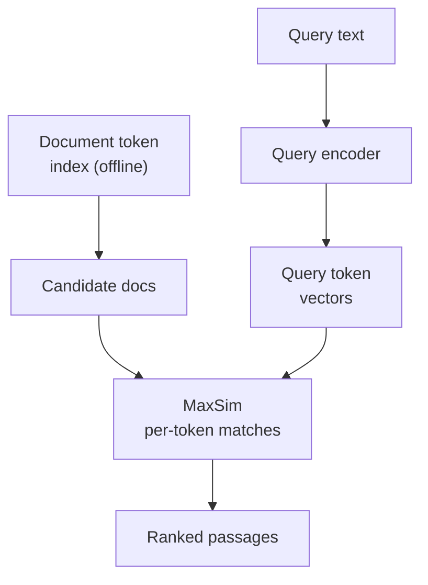

ColBERT (Contextualized Late Interaction over BERT; Khattab and Zaharia, SIGIR 2020) is a multi-vector retrieval model. It encodes the query and each document with BERT independently, keeps a contextual embedding per token (projected to a small dimension such as 128), and scores a pair with late interaction: each query token finds its best matching document token (MaxSim), then those maxima are summed. Documents are encoded offline; only the query encode and the MaxSim aggregation run online.

That design sits between a single-vector bi-encoder (one pooled embedding per passage, pure ANN) and a cross-encoder (joint query-document forward pass per candidate). You keep token-level matching without paying a full transformer over every corpus document at query time.

## Diagram

## How it works

**Encoders.** A shared BERT tower (with separate `[Q]` / `[D]` marker tokens) produces contextual states for each input token. A linear projection reduces BERT's hidden size (768 for base) to ColBERT dimension $m$ (commonly 128). Vectors are L2-normalized so a dot product equals cosine similarity. Document-side punctuation embeddings are dropped to shrink the bag. Query side pads short queries with `[MASK]` tokens up to a fixed length (classically $N_q = 32$), a soft query-augmentation trick that lets the model reweight or expand query signals without a separate expansion model.

**Late interaction (MaxSim).** Let $E_q = \{q_1,\ldots,q_{N}\}$ and $E_d = \{d_1,\ldots,d_{M}\}$ be the bags of L2-normalized token vectors. Relevance is the sum of per-query-token maximum similarities (cosine via dot product):

$$
S_{q,d} = \sum_{i=1}^{N} \max_{1 \le j \le M} q_i^\top d_j
$$

Each query token soft-searches the document for its best contextual match; partial evidence is summed. The interaction itself has no trainable parameters. Squared L2 was used for end-to-end FAISS retrieval in the original paper; production stacks usually keep normalized vectors and inner product.

**Serving modes.**

1. **Rerank.** Re-score a shortlist (for example BM25 or dense top-1000) by loading each candidate's token matrix and computing exact MaxSim on GPU. Query encoding runs once.
2. **End-to-end.** Index every document token embedding in a vector-similarity structure (original ColBERT used FAISS IVFPQ). At query time, each query vector retrieves near neighbors, candidate document IDs are unioned, then full MaxSim reranks that smaller set.

**ColBERTv2 and PLAID.** ColBERTv2 (Santhanam, Khattab, et al., NAACL 2022) keeps the same MaxSim architecture but adds residual compression and stronger supervision. Each token vector is stored as nearest-centroid id plus a residual quantized to 1 or 2 bits per dimension (roughly 20 or 36 bytes per vector versus 256 bytes at 16-bit for an uncompressed 128-dimensional vector). These counts exclude centroids, inverted lists and other index metadata; they do not predict a complete index's compression ratio. Supervision mixes hard negatives from a refreshed ColBERT index with KL distillation from a cross-encoder teacher. PLAID (CIKM 2022) is the search engine that exploits that residual layout for multi-vector candidate generation. [ColBERTv2 paper](https://arxiv.org/abs/2112.01488)

## Example

**Token-level recall vs pooled vectors.** Query: "API key rotation after leak." A runbook has separate sentences about "API credentials," "secret keys," and "quarterly rotation." A single bi-encoder vector may pull the passage toward generic password-reset neighbors. ColBERT lets `API`, `key`, `rotation`, and `leak` each MaxSim-match different document tokens, so multi-constraint evidence can accumulate even when no single sentence contains the full phrase.

That score indicates token-level matching. Verify the requested relationship in the passage: a quarterly-rotation page may score well without explaining what to do after a leak. Different query tokens can also choose the same document token. Inspect conjunctions, order, and negation to check every constraint.

**Worked MaxSim (toy numbers).** Two query tokens and three document tokens after normalization:

|  | $d_1$ | $d_2$ | $d_3$ | row max |
| --- | --- | --- | --- | --- |
| $q_1$ (rotation) | 0.22 | 0.91 | 0.40 | 0.91 |
| $q_2$ (API) | 0.88 | 0.15 | 0.55 | 0.88 |

$$
S = 0.91 + 0.88 = 1.79
$$

If a third query token (`policy`) only reaches max $0.18$, the total becomes $1.97$. MaxSim is a raw sum (not length-normalized), so even a weak positive maximum raises the score; a negative maximum would lower it. Compare document scores for the same encoded query. Debug misses by inspecting per-token maxima and passage text, not the aggregate alone: a low max for `policy` identifies a constraint to review in the passage.

**Cost shape.** ColBERT performs document transformer encoding offline, then query encoding and token-vector comparisons online. A cross-encoder instead runs joint transformer attention for each candidate. Compare latency and quality using a specified corpus, candidate count, sequence lengths, batching, device and retrieval settings; caching document encodings does not remove the online multi-vector search cost. [Original ColBERT paper](https://arxiv.org/abs/2004.12832)

## Sizing

Index size is roughly:

$$
\text{bytes} \approx N_{\text{docs}} \times \bar{M} \times b
$$

where $\bar{M}$ is mean kept tokens per passage and $b$ is bytes per token vector.

| Layout | $b$ (approx.) | 1M docs × 100 tokens |
| --- | --- | --- |
| fp16, $m=128$ (original style) | 256 B | ~25.6 GB |
| ColBERTv2 residual, 2-bit | ~36 B | ~3.6 GB |
| ColBERTv2 residual, 1-bit | ~20 B | ~2.0 GB |
| Single-vector 768-d float32 | 3072 B / doc | ~3.1 GB (one vector/doc) |

Late interaction still stores **many** vectors per document, so even compressed multi-vector indexes need disk, inverted lists (centroid → embedding ids), and a plan for rebuilds. PLAID-style IVF residual indexes are strong for batch search; frequent document churn may push you toward rebuilds rather than fine-grained deletes. Chunking still matters: long docs become many bags; prefer retrieval-sized passages consistent with training.

## Trade-offs

| Axis | Bi-encoder | ColBERT late interaction | Cross-encoder |
| --- | --- | --- | --- |
| Offline index | 1 vector / doc | Many token vectors / doc | No corpus index |
| Matching | Pooled similarity | Token MaxSim | Full joint attention |
| Query cost | 1 encode + ANN | 1 encode + multi-vector search + MaxSim | 1 forward per candidate |
| Typical role | First-stage recall | First-stage or mid-stage multi-vector | Rerank top tens/hundreds |
| Storage | Lowest | Higher; compression required at scale | N/A for full corpus |

Use ColBERT when fine-grained, multi-constraint queries lose under pooling and you can afford multi-vector storage and a specialized index. Keep hybrid BM25 + dense as a baseline; measure whether ColBERT lifts hard slices (identifiers, negation-adjacent policy language, multi-hop constraints) enough to justify ops cost. Many RAG stacks use ColBERT (or RAGatouille wrapping ColBERTv2) as a primary retriever on medium corpora, or as a strong mid-stage over a cheaper first stage.

## Why it matters here

ColBERT is the curriculum's concrete multi-vector system for RAG retrieval: late interaction, MaxSim, and the storage/latency tax that comes with token-level indexes. When single-vector recall plateaus on hard queries, ColBERT is the architecture that shows how to keep token evidence without full cross-encoder cost over the whole corpus.

## Related terms

- [Late interaction](glossary://late-interaction)
- [MaxSim](glossary://maxsim)
- [Bi-encoder](glossary://bi-encoder)
- [Dense retrieval](glossary://dense-retrieval)
- [Reranker](glossary://reranker)
