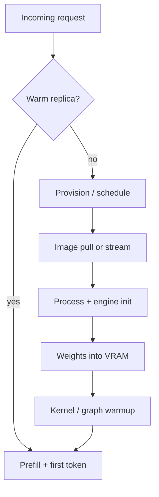

A cold start is the extra latency paid when a service instance must become ready before it can handle work: provision hardware, pull or stream an image, start the process, load model weights into GPU memory, compile or capture kernels, and open connections. A warm instance already has that stack resident, so the same request only pays queueing, prefill, and decode.

In LLM and AI serving this is an infrastructure concept (replica or function not yet ready). It is different from the recommender-systems "cold start" problem (new user or item with no history).

## Diagram



## Intuition

A cold replica has not completed provisioning, image startup, weight transfer, or runtime warmup. The user-visible symptom is a multi-second, and sometimes multi-minute, latency spike after scale-to-zero, a new autoscaled replica, a rolling deploy, or a node joining the pool. Later requests avoid those one-time costs while the replica stays warm.

For classical microservices, cold start is often process boot plus dependency import. For LLM serving the dominant costs usually shift to multi-gigabyte weight movement into HBM and engine warmup (CUDA context, `torch.compile`, CUDA graph capture). Image size and storage bandwidth matter as much as language runtime.

## Example

Consider a hypothetical measured trace in which image/process startup takes $8$ s, weight loading takes $12$ s, and prefill plus the first token takes $0.5$ s. If these phases run serially with no other delay, [TTFT](glossary://ttft) from request arrival is $20.5$ s. A warm request that avoids those setup phases still pays its own queueing and model work. The example shows how setup phases add to TTFT; measure a specific model and platform to estimate its latency.

Measure phase boundaries and p50/p95 for the actual checkpoint, image, loader, device and scale-up path. Platform GPU availability and application readiness are different milestones: an attached GPU does not mean weights are loaded or kernels warmed. Minimum instances reduce scale-from-zero exposure for baseline traffic, but replacement or additional instances can still start cold. [Cloud Run GPU configuration](https://cloud.google.com/run/docs/configuring/services/gpu), [minimum-instance behavior](https://cloud.google.com/run/docs/configuring/min-instances)

Rough lower bound on weight-load time when bandwidth is the bottleneck:

$$
t_{\mathrm{load}} \approx \frac{S}{B}
$$

where $S$ is weight bytes on the hot path and $B$ is sustained read throughput into GPU memory. A $15$ GB checkpoint at $1$ GB/s needs about $15$ s of pure transfer; slower object-store paths or sequential loaders stretch that further. Concurrent streamers that overlap storage reads with CPU→GPU copies cut wall time by saturating $B$.

```python
def weight_load_seconds(weight_gb: float, throughput_gb_s: float) -> float:
    """Lower-bound transfer time when bandwidth-limited."""
    return weight_gb / throughput_gb_s

# 15 GB safetensors @ 1 GB/s local SSD vs 0.25 GB/s remote pull
print(round(weight_load_seconds(15, 1.0), 1), "s local")
print(round(weight_load_seconds(15, 0.25), 1), "s remote")
```

## How it works

Cold time follows the startup critical path. Serial stages add, while overlapping image streaming, weight reads and transfers must not be counted twice. Fix the largest unhidden delay first; stacked small delays still look like one "slow API."

1. **Schedule and provision.** Control plane places a pod or instance. GPU node pools may need a new machine; that alone can dominate bursty scale-up.
2. **Filesystem ready.** Full image pull waits on every layer. Image streaming / lazy pull starts the process once critical blocks arrive, which helps large CUDA bases.
3. **Process and engine.** Python import graphs, tokenizer load, and server bind can be seconds. Readiness that only checks TCP will mark "up" before weights exist.
4. **Weights into VRAM.** Sequential loaders read storage → host RAM → device. Faster paths parallelize tensor reads and overlap host-to-device copies. Baking small models into the image, mounting local NVMe, or concurrent object-store download changes this phase more than micro-optimizing HTTP handlers.
5. **Warmup.** Engines may capture CUDA graphs for several batch shapes or run `torch.compile`. Skipping heavy compile (eager mode) can trade a bit of steady-state throughput for much shorter cold starts.
6. **First real request.** Prefill and first decode still run after the replica is "ready." If you measure TTFT from client send time, cold setup is inside the same number as model prefill unless you split metrics.

Autoscalers decide *that* a replica should exist long before the replica can accept traffic. Desired replica count going up is not capacity; **ready** capacity is. During the lag, admission control (`429` + `Retry-After`), queueing, or a warm buffer pool protects latency better than accepting work that will time out.

## Mitigation choices

| Lever | Effect | Cost |
|---|---|---|
| Min instances / warm pool | Avoid cold path for baseline traffic | Idle GPU and memory spend |
| Predictive pre-warm | Start the chain before a known spike | Needs traffic pattern + lead time ≥ measured ready time |
| Smaller / quantized weights | Shrink $S$ and often load time | Quality / precision trade-offs |
| Local or concurrent weight load | Raise effective $B$ | Storage design, mount policy |
| Image streaming, slimmer images | Cut pull phase | Build pipeline discipline |
| Readiness = model ready | Stop routing until VRAM load finishes | Longer startup probe windows |
| Higher concurrency per warm replica | Fewer scale-outs → fewer cold events | Must match engine batch limits and VRAM |
| Scale-down cooldown | Avoid thrashing warm GPUs on short lulls | Extra idle minutes after dips |

Provisioned concurrency and always-on min instances trade money for predictability. For latency-sensitive chat, one warm regional replica often beats many cold regional endpoints. For batch jobs, cold start is usually acceptable if backlog age SLOs allow it.

## Why it matters here

LLM services can have large warmup costs. Cold-start thinking explains why a demo feels fast after the first request while sporadic production traffic still suffers, why GPU autoscaling must account for provisioning and model startup, and why TTFT must be split into setup versus prefill. Curriculum work on deployment, Cloud Run, and GPU autoscaling treats cold start as a recurring capacity and SLO concern across deploys and scale events.

## Related terms

- [Container image](glossary://container-image)
- [TTFT](glossary://ttft)
- [Autoscaling](glossary://autoscaling)
- [Prefill](glossary://prefill)
- [Google Cloud Run](glossary://google-cloud-run)
