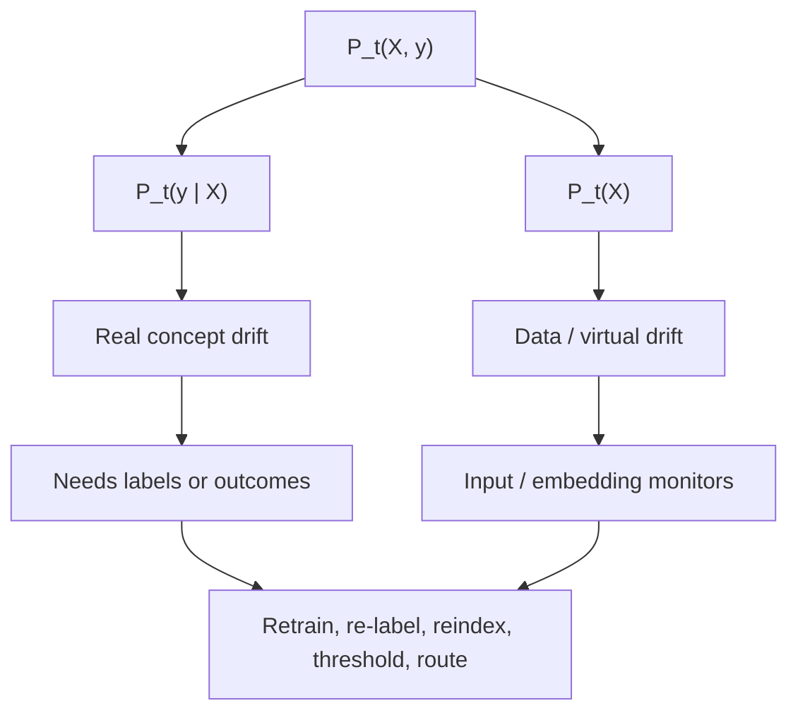

Concept drift is a change over time in the relationship between inputs and the correct target: the same features, tickets, or prompts now map to different right answers. In the supervised framing of Gama et al., **real** concept drift is a change in the conditional $P(y \mid X)$, while the input distribution $P(X)$ may stay the same. Virtual drift (often called [data drift](glossary://data-drift) or covariate shift) is a change in $P(X)$ with $P(y \mid X)$ fixed. Production failures often mix both.

A frozen model, prompt, or retrieval policy encodes yesterday's concept. When the concept moves and you don't update labels, thresholds, corpus, or weights, quality decays even if feature histograms look calm.

## Intuition

Data drift asks: "Did the inputs change shape?" Concept drift asks: "Did the correct output for those inputs change?" Feature histograms can look stable while labels flip: a security policy starts requiring human approval for production shell access, so the old answer becomes wrong even when request text looks familiar.

Temporal shapes matter for response design (Gama et al.):

- **Sudden / abrupt:** policy cutover, competitor launch, pandemic shock, API deprecation day.
- **Gradual or incremental:** fraudsters adapt, user taste drifts, language and products evolve.
- **Recurring / seasonal:** holiday demand, weekday vs weekend patterns (often modelable if you keep the cycle in features or route to a known seasonal model).

## Formula

Factor the joint over time $t$:

$$
P_t(X, y) = P_t(y \mid X)\, P_t(X).
$$

| Shift | What moves | What can stay fixed | Typical signal |
|---|---|---|---|
| Real concept drift | $P_t(y \mid X)$ | $P_t(X)$ often | Error, calibration, review outcomes |
| Virtual / data drift | $P_t(X)$ | $P_t(y \mid X)$ | Feature / embedding histograms |
| Label / prior shift | $P_t(y)$ (and usually $P_t(X)$); posterior moves | $P_t(X \mid y)$ in pure form | Class rates, target rates |

Bayes form makes the same split explicit:

$$
P_t(y \mid X) = \frac{P_t(y)\, P_t(X \mid y)}{P_t(X)}.
$$

Real concept drift is any move in the posterior $P_t(y \mid X)$. That can come from changed class-conditionals $P_t(X \mid y)$, from prior shift $P_t(y)$ (pure **label / prior shift** keeps $P(X \mid y)$ fixed but still shifts the posterior and usually $P(X)$), or from a decision policy that redefines $y$ for the same $X$ (new severity rubric, access rule, or release policy). Establishing a conditional change requires outcome-linked evidence or knowledge of the changed labeling rule; input-only monitors cannot detect it. Aggregate error changes alone are also insufficient because the input mix or label quality may have changed.

## Example

**Classical ML.** A capacity-risk model uses queue depth, GPU utilization, request rate, and scheduler state. A scheduler update can change how the same telemetry pattern maps to OOM risk. A decline in precision on a "low risk" band is a reason to investigate. Compare matched telemetry cohorts and reliable delayed incident labels before attributing it to a moved decision boundary; stable histograms of a few top features do not establish that the full input distribution is unchanged.

**LLM product.** An internal assistant's retrieved answers and golden evals still match last quarter's access policy. Security begins requiring human approval for production shell access. Request language barely changes, but correct answers flip. Offline F1 on the old golden set stays high while human overrides rise on the privileged-access slice. Respond by updating the corpus and citations, versioning the eval rows, retraining or re-prompting the policy path, and raising the review rate until the new concept is covered.

**Worked hypothetical cohort.** Relabel the exact same $2{,}000$ requests under both the old and new policy. If adjudicated target labels differ on $360$ requests, the changed-target fraction is $360/2000=18\%$. The known policy change and paired inputs support concept change on this slice. Merely finding nearby embeddings and unadjudicated human disagreements would not separate policy change from input differences or annotation error.

## Diagram



## How it works

1. **Define the concept.** What is $y$ today (policy version, severity rubric, accepted answer)? Version labels and eval fixtures with the policy they encode.
2. **Watch outcomes first.** Accuracy, error, calibration, human accept/reject, escalations, incidents, and slice-level quality are the direct concept signals. They require delayed or sampled labels.
3. **Use proxies when labels lag.** Prediction-rate shifts, score-distribution drift, rising abstention or fallback, correlation flips between key features and outcomes, and domain heuristics can fire early. Use them to triage; confirm drift with labeled outcomes or a design-matched evaluation.
4. **Separate causes.** Check training-serving skew, schema breaks, and pure data drift before concluding the concept moved. A broken join is not concept drift.
5. **Respond at the right layer.** Options include relabeling and retraining, threshold changes, refreshed RAG corpus, new routing, human-in-the-loop for the drifted slice, or pausing automation. Prefer the smallest change that matches the evidence.

```python
# Sketch: weekly concept check on a delayed-label slice
def concept_check(ref_errors, live_errors, max_abs_lift=0.05):
    """Compare nonempty error samples; return a triage alert, not a drift test."""
    ref = sum(ref_errors) / len(ref_errors)
    live = sum(live_errors) / len(live_errors)
    return {
        "ref_error": ref,
        "live_error": live,
        "abs_lift": live - ref,
        "alert": (live - ref) > max_abs_lift,
    }
```

This sketch does not account for sampling uncertainty, repeated monitoring or changed traffic mix. An alert triggers investigation; it does not identify which distribution changed.

## Why it matters here

Input monitoring alone cannot catch every failure. Concept drift is why production ML and LLM systems need feedback loops, delayed-label pipelines, policy-versioned evals, and retraining or reindexing triggers based on both outcomes and feature histograms. For AI products, evaluate labels, policies, tools, and the corpus alongside model weights.

## Related terms

- [Data drift](glossary://data-drift)
- [Training-serving skew](glossary://training-serving-skew)
- [Label noise](glossary://label-noise)
- [Evaluation slice](glossary://evaluation-slice)
- [Decision threshold](glossary://decision-threshold)
