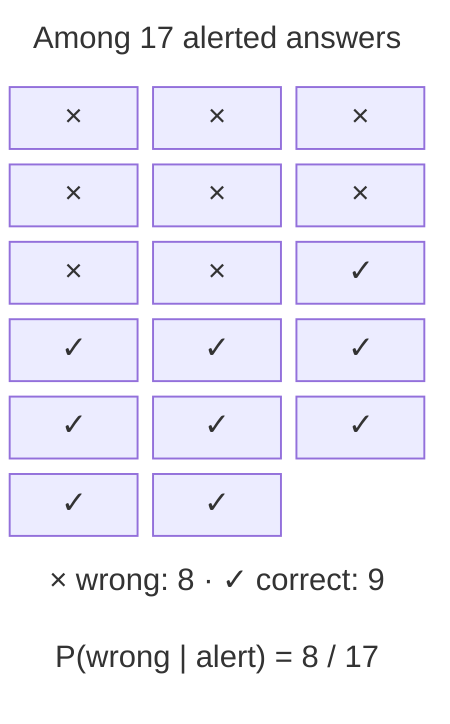

**Conditional probability** measures how likely an event is after restricting attention to cases where another event occurred. If `A` means an answer is wrong and `B` means a verifier raised an alert, `P(A | B)` asks what fraction of alerted answers are actually wrong. Its denominator is alerted answers, not every answer in the evaluation.

For `P(B) > 0`, the rule is $P(A \mid B) = P(A \cap B) / P(B)$. The numerator counts cases where both events happened. The denominator counts all cases satisfying the condition. Reversing the condition generally changes the answer: `P(alert | wrong)` and `P(wrong | alert)` answer different operational questions.

## Check the denominator first

Suppose 100 answers contain 10 real errors. A verifier alerts on eight errors and nine correct answers. There are 17 alerts altogether, so `P(wrong | alert) = 8 / 17`, while `P(alert | wrong) = 8 / 10`. The first describes alert trustworthiness; the second describes how many real errors the detector catches.



## Example

```python
alerted_errors = 8
false_alerts = 9
errors = 10

assert alerted_errors / (alerted_errors + false_alerts) == 8 / 17
assert alerted_errors / errors == 0.8
```

These values differ because their reference groups differ. The same raw events can support both calculations without contradiction.

## Why it matters here

Safety classifiers, retrieval filters, incident detectors, and model evaluations all change meaning when the denominator changes. Correctly identifying the conditioned population prevents base-rate mistakes and prepares readers for Bayes' theorem.

## Related terms

- [Precision and recall](glossary://precision-recall)
- [False negative](glossary://false-negative)
- [Decision threshold](glossary://decision-threshold)
- [Calibration](glossary://calibration)
