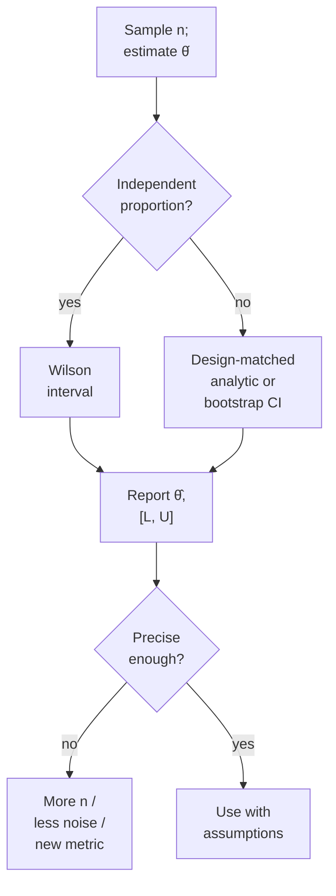

A confidence interval is a range computed from sample data that quantifies uncertainty around an estimate under a stated statistical procedure and its assumptions. A point estimate (for example, $78\%$ pass rate on $200$ eval rows) answers "what happened in this sample." The interval answers how tightly that sample pins the estimate down for decision-making.

Formally, a level-$(1-\alpha)$ confidence interval is a random interval $(L, U)$ built from data such that, under the model and assumptions of the procedure,

$$
P\big(L \le \theta \le U\big) \ge 1 - \alpha
$$

when sampling is repeated. Exact procedures meet this inequality; approximate procedures such as normal and Wilson intervals target nominal coverage and can deviate at finite sample sizes. A common engineering choice is $95\%$ ($z \approx 1.96$ for normal-based methods). The confidence level describes the **procedure** across repeated samples; a posterior probability for the realized interval comes from a Bayesian model.

## Intuition

Wide intervals indicate limited precision for this sample. Narrow intervals indicate repeated draws of the same design would usually land near the same estimate. Interpret either alongside metric choice, label quality, and population match. An interval summarizes sampling uncertainty under the design you actually ran.

## Formula

For a sample mean or proportion with estimated standard error $\widehat{\mathrm{SE}}$, the normal (Wald) interval is

$$
\hat\theta \pm z_{1-\alpha/2}\,\widehat{\mathrm{SE}}
$$

For a binomial pass rate $\hat{p} = s/n$ of independent binary outcomes,

$$
\widehat{\mathrm{SE}} = \sqrt{\frac{\hat{p}(1-\hat{p})}{n}}
$$

so a rough $95\%$ Wald interval is $\hat{p} \pm 1.96\,\widehat{\mathrm{SE}}$.

The Wald interval is a teaching tool and a large-sample approximation. It misbehaves when $n$ is small or $\hat{p}$ is near $0$ or $1$: when estimating a failure rate, zero failures give $\widehat{\mathrm{SE}} = 0$ and a nonsense interval $[0, 0]$ (the corresponding pass-rate interval is $[1,1]$). For proportions, the **Wilson score** interval often behaves better (Wilson, 1927; recommended by Brown, Cai, and DasGupta, 2001 for routine use):

$$
\text{center} = \frac{\hat{p} + z^2/(2n)}{1 + z^2/n}
$$

$$
\text{margin} = \frac{z}{1 + z^2/n}
\sqrt{\frac{\hat{p}(1-\hat{p})}{n} + \frac{z^2}{4n^2}}
$$

Report $\big[\text{center} - \text{margin},\; \text{center} + \text{margin}\big]$ (clipped to $[0, 1]$ if needed). Wilson stays inside the probability scale and does not collapse to certainty on all-pass or all-fail tiny samples.

When the statistic is nonlinear, paired, clustered, or lacks a clean closed form (win rate, recall@k, pass@k, judge scores), consider a design-matched analytic method or [bootstrap](glossary://bootstrap-resampling) on the **independent unit**. Ten all-pass rows produce all-pass percentile resamples and a degenerate interval, so choose the interval method to match sample size and outcome distribution. Rare events or tiny samples may require a suitable binomial method, more data or explicit modeling assumptions. [NIST proportion intervals](https://www.itl.nist.gov/div898/handbook/prc/section2/prc241.htm), [SciPy bootstrap documentation](https://docs.scipy.org/doc/scipy/reference/generated/scipy.stats.bootstrap.html)

## Example

An offline benchmark reports accuracy $\hat{p} = 0.78$ on $n = 200$ independent binary outcomes ($156$ correct).

**Wald (quick check):**

$$
\widehat{\mathrm{SE}} = \sqrt{0.78 \times 0.22 / 200} \approx 0.0293
\quad\Rightarrow\quad
0.78 \pm 1.96 \times 0.0293 \approx [0.723,\, 0.837]
$$

**Wilson (better default for proportions):** about $[0.718,\, 0.832]$.

This interval estimates one model's pass rate. It does not decide whether a second model's estimate of $0.79$ or $0.86$ is a significant lift; build an interval for their difference using the paired or independent sampling design.

Edge case that exposes Wald: $0$ failures on $n = 10$ gives Wald $[0, 0]$ but Wilson about $[0, 0.278]$. Ten clean fixtures do not prove a zero failure rate.

```python
from math import sqrt

def wilson_interval(successes: int, n: int, z: float = 1.96) -> tuple[float, float]:
    p = successes / n
    denom = 1 + z * z / n
    center = (p + z * z / (2 * n)) / denom
    margin = (z / denom) * sqrt(p * (1 - p) / n + z * z / (4 * n * n))
    return max(0.0, center - margin), min(1.0, center + margin)

print(wilson_interval(156, 200))  # ~ (0.718, 0.832)
print(wilson_interval(0, 10))     # ~ (0.000, 0.278)
```

## Target the decision quantity

Build the interval around the quantity that drives the decision, and choose its method for the sampling design.

| Decision question | Quantity to interval |
|---|---|
| How good is this model alone? | Pass rate, support rate, or mean score |
| How much better is B than A on the same tasks? | Paired lift $B - A$ |
| Is a safety slice still under threshold? | Slice rate with its own $n$ |
| Did the online change move the primary metric? | Experiment estimate (often CUPED-adjusted) |

Comparing two separate pass-rate intervals can hide pairing. On a $40$-task paired eval with $8$ B-only passes and $5$ A-only passes, the observed lift is $(8-5)/40=+7.5$ points. Resample the task pairs together or use a paired analytic interval: the $13$ discordant outcomes carry the comparison information, while the $27$ ties contribute zero paired difference. Report the resulting interval and whether it includes zero; the lift alone does not prove improvement.

Overlapping marginal intervals also do not prove "no difference." Use a comparison that matches the experiment design (paired difference, two-sample contrast, or sequential method if you peeked repeatedly).

## Sizing and dependence

Interval width for a proportion shrinks like $1/\sqrt{n}$ under independence. Roughly:

- $n = 100$ at $\hat{p} = 0.78$: Wilson width about $0.16$ ($[0.69, 0.85]$)
- $n = 200$: width about $0.11$ ($[0.72, 0.83]$)
- $n = 1{,}000$: width about $0.05$

If the interval is too wide for the product call, increase sample size, reduce label noise, use a lower-variance metric, or apply variance reduction (for example CUPED online). Hiding the interval does not create precision.

Resample or model the **independent unit**. Multiple turns per user, multiple rows per document, or multiple attempts per problem make naive i.i.d. intervals too narrow. Prefer cluster-aware methods or bootstrap whole users / documents / problems. For multi-sample metrics such as pass@k, keep all attempts for a problem together when resampling.

## Diagram



## Why it matters here

LLM and ML evaluations almost always rest on finite, noisy samples: golden sets, preference battles, retrieval slices, code benchmarks, and online experiments. Point estimates alone overstate certainty and invite shipping on luck. Confidence intervals force teams to state the procedure, the unit of independence, and whether a claimed lift is larger than sampling noise. They sit next to [statistical power](glossary://statistical-power) and [minimum detectable effect](glossary://minimum-detectable-effect) in experiment design, and next to [bootstrap resampling](glossary://bootstrap-resampling) when the metric is not a simple mean. Every offline report and A/B readout that recommends a model, prompt, or retrieval change should be able to show an interval for the decision quantity.

## Related terms

- [Variance](glossary://variance)
- [Statistical power](glossary://statistical-power)
- [Bootstrap resampling](glossary://bootstrap-resampling)
- [A/B testing](glossary://ab-testing)
- [Minimum detectable effect](glossary://minimum-detectable-effect)
