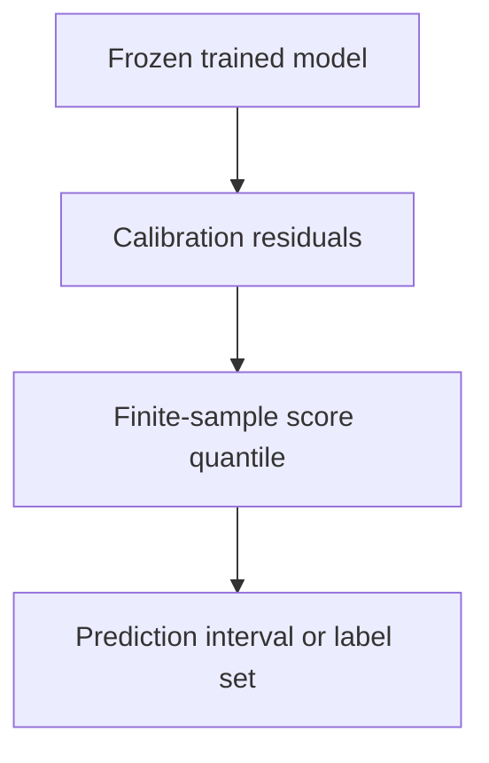

Conformal prediction converts a model's point predictions or class scores into sets or intervals with a specified finite-sample marginal coverage guarantee. Split conformal uses examples held out from model fitting to calibrate a nonconformity threshold. Its guarantee relies on exchangeability between calibration and future examples. The model may be miscalibrated or misspecified and still satisfy this condition.

## Marginal coverage across draws

For regression, calculate absolute residuals on an untouched calibration set and select the corrected quantile at rank $\lceil(n+1)(1-\alpha)\rceil$. Add and subtract that residual radius from a new prediction. Under exchangeability, the procedure covers the true outcome with probability at least $1-\alpha$ across draws. This is a marginal guarantee. Subgroup-conditional coverage and the probability that one specific interval contains its target are separate properties.

Ranks are one-based. If the corrected rank exceeds $n$, use an infinite threshold (the full outcome space). Clamping to the largest observed residual changes the guarantee. Fix the model and score rule independently of calibration outcomes because repeated tuning consumes that holdout. The marginal guarantee averages over calibration and future-example draws. A guarantee conditional on each realized calibration set is a stronger, separate property. [Conformal prediction introduction](https://arxiv.org/abs/2107.07511)

## Example

A latency predictor is calibrated on nine held-out requests whose sorted absolute errors are `[2, 3, 3, 4, 5, 6, 7, 8, 12]` milliseconds. For 80% target coverage, the corrected rank is $\lceil(9+1)\times0.8\rceil=8$, giving radius 8 milliseconds. A new point prediction of 40 milliseconds becomes `[32, 48]`. Reusing training errors instead of held-out calibration errors can make the interval too optimistic.

With those same nine residuals, a $95\%$ target gives rank $\lceil10\times0.95\rceil=10$. There is no tenth calibration residual, so this split-conformal rule returns an unbounded interval. Radius $12$ would cover at most the next-rank target of $9/10$ in the continuous exchangeable case, not establish $95\%$ coverage. Collect more calibration examples or state a different assumption or coverage target.

## Why it matters here

Model-assisted triage, ranking, forecasts, and agent gates need uncertainty that users can inspect. Conformal methods expose when calibration drift, insufficient subgroup coverage, or overly wide sets make a prediction unsafe to automate.

## Related terms

- [Prediction interval](glossary://prediction-interval)
- [Probability calibration](glossary://probability-calibration)
- [Confidence interval](glossary://confidence-interval)
