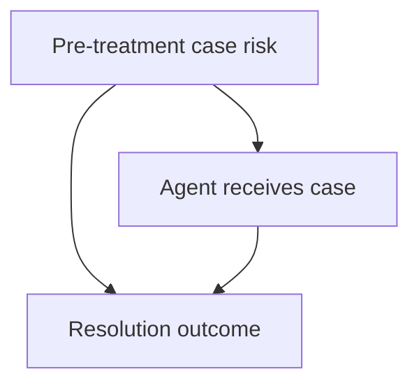

A confounder is a pre-treatment variable that influences both treatment assignment and the outcome being measured. Because it creates a noncausal association between treatment and outcome, an unadjusted comparison can misstate, erase, or reverse the treatment's actual effect. A correlation score can reveal association. Causal structure and timing determine whether a variable is a confounder.

## Which variables belong in adjustment

In a graph where risk influences both agent assignment and resolution success, the path assignment ← risk → success is a backdoor path. Conditioning on risk can block it when the risk value is observed accurately and all relevant confounding is captured. Conditioning on a variable produced after assignment can instead block part of the treatment effect or introduce collider bias.

## Example

Suppose difficult tickets are routed to an advanced agent, while easy tickets stay with a baseline. The advanced agent resolves 45% of difficult tickets and would have resolved 95% of easy ones; the baseline resolves 40% and 90%, respectively. If assignment rates differ by difficulty, the advanced agent's aggregate success can appear worse even though its within-difficulty effect is positive. Adjusting for difficulty before assignment makes the groups comparable only if no additional unmeasured common cause remains.

## Why it matters here

Offline agent evaluations, ranking changes, and release decisions often reuse observational logs. Naming the assignment mechanism and pre-treatment confounders prevents a product-selection artifact from being presented as a scientific finding.

## Related terms

- [Causal inference](glossary://causal-inference)
- [A/B testing](glossary://ab-testing)
- [Feature leakage](glossary://feature-leakage)
