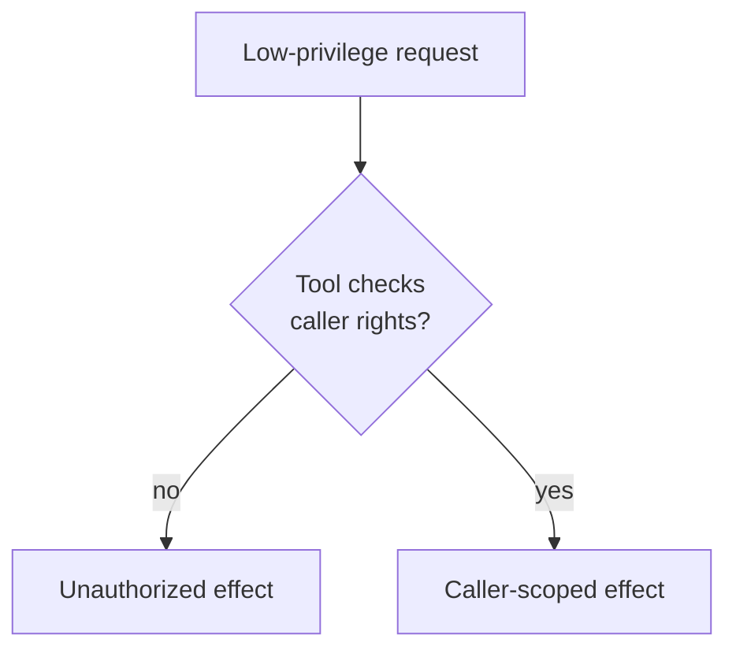

A **confused deputy** is a trusted component that misuses its own legitimate authority on behalf of a caller who lacks that authority. The component can retain its trusted status while confusing the right to request an action with the right to execute it using more powerful credentials. The [Model Context Protocol security guidance](https://modelcontextprotocol.io/docs/2026-07-28/tutorials/security/security_best_practices) documents this failure around delegated authorization and token handling.

In an agent system, a model might read an untrusted document instructing it to export confidential incident logs. The model can't access those logs directly, but an overly privileged export service can. If that service trusts the proposed action without binding it to the authenticated user's actual permissions, it becomes the deputy that crosses the security boundary.

## Separate the caller from the deputy

## Example

A support agent may inspect one customer's public ticket. An injected attachment asks the model to call `export_all_tickets(tenant="other-customer")`. The export worker has broad infrastructure credentials, but trusted authorization must reject the mismatch between the user's tenant and the requested resource. Prompt wording or a model-generated justification can't replace that check.

Prevent the failure by binding user identity, resource, action, approval, and expiry to every delegated tool call. Prefer short-lived credentials scoped to the original user instead of one standing service-account key that can access every customer.

## Why it matters here

Retrieval authorization, browser automation, coding agents, and human approvals all create deputies. A service that can act broadly must still prove that this particular caller may request this exact action, including during retries, handoffs, and background execution.

## Related terms

- [Least privilege](glossary://least-privilege)
- [Permission boundary](glossary://permission-boundary)
- [Policy gate](glossary://policy-gate)
- [Prompt injection](glossary://prompt-injection)
