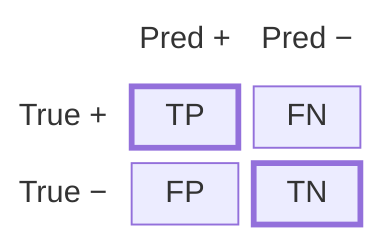

A confusion matrix is a square table of counts that cross-tabulates **true labels** (rows) against **predicted labels** (columns). Diagonal cells are correct predictions; off-diagonal cells are specific mistakes. Unlike accuracy, which collapses every outcome into one fraction correct, the matrix keeps each error type visible so you can see *who was confused with whom*.

By definition (scikit-learn convention), entry $C_{i,j}$ is the number of samples whose true class is $i$ and whose predicted class is $j$. Other libraries and plots sometimes swap axes; always check whether rows mean truth or prediction before you read a chart.

## Binary layout

For a binary problem with labels $0$ (negative) and $1$ (positive), the $2 \times 2$ matrix is:

|  | Predicted negative ($0$) | Predicted positive ($1$) |
|--|--------------------------|--------------------------|
| **True class $0$ (negative)** | TN $= C_{0,0}$ | FP $= C_{0,1}$ |
| **True class $1$ (positive)** | FN $= C_{1,0}$ | TP $= C_{1,1}$ |

- **TP (true positive):** true class positive, predicted positive
- **TN (true negative):** true class negative, predicted negative
- **FP (false positive):** true class negative, predicted positive (false alarm)
- **FN (false negative):** true class positive, predicted negative (miss)

TN, FP, FN, and TP name the *cells*, not the rows. The row is the true class; which cell you land in depends on the prediction.

## Formula

From the four cells you recover the usual operating-point metrics:

$$
\mathrm{accuracy}=\frac{\mathrm{TP}+\mathrm{TN}}{\mathrm{TP}+\mathrm{TN}+\mathrm{FP}+\mathrm{FN}}
$$

$$
\mathrm{precision}=\frac{\mathrm{TP}}{\mathrm{TP}+\mathrm{FP}},\qquad
\mathrm{recall}=\frac{\mathrm{TP}}{\mathrm{TP}+\mathrm{FN}}
$$

$$
\mathrm{FPR}=\frac{\mathrm{FP}}{\mathrm{FP}+\mathrm{TN}},\qquad
\mathrm{specificity}=\frac{\mathrm{TN}}{\mathrm{TN}+\mathrm{FP}}
$$

Accuracy mixes all four cells. With rare positives, a large TN can make accuracy look fine while FN or FP dominate product risk. The matrix is the raw accounting; precision, recall, and FPR are ratios of its cells.

## Diagram



Each sample lands in exactly one cell. Product cost is almost never uniform across cells: missing a harmful request (FN) is not the same kind of failure as blocking a safe one (FP).

## Example

A content safety classifier is evaluated on $1{,}000$ items. Fifty are truly harmful; $950$ are safe. At the shipped threshold the model flags $70$ items as harmful: $40$ true harms and $30$ safe items. That fills the matrix as:

|  | Pred safe | Pred harmful |
|--|-----------|--------------|
| **True safe** | TN $= 920$ | FP $= 30$ |
| **True harmful** | FN $= 10$ | TP $= 40$ |

Derived numbers:

- Accuracy $= (40+920)/1000 = 0.96$
- Precision $= 40/(40+30) \approx 0.57$
- Recall $= 40/(40+10) = 0.80$
- False-positive rate $= 30/(30+920) \approx 0.032$

Accuracy looks strong because safe items dominate. The matrix shows the real product shape: $10$ harmful leaks and $30$ over-blocks. If escalation cost is high and leak cost is higher, you re-tune the threshold or fix the model slice that produces those FN cases, not the headline accuracy.

```python
from sklearn.metrics import confusion_matrix

y_true = [0] * 950 + [1] * 50
# 920 TN, 30 FP among safe; 10 FN, 40 TP among harmful
y_pred = [0] * 920 + [1] * 30 + [0] * 10 + [1] * 40
# labels=[0, 1] locks row/column order: 0=safe, 1=harmful
cm = confusion_matrix(y_true, y_pred, labels=[0, 1])
# cm == [[920, 30], [10, 40]]
tn, fp, fn, tp = cm.ravel()
```

## Multi-class and normalization

With $K$ classes the matrix is $K \times K$. The diagonal is per-class correctness; an off-diagonal mass at $(i,j)$ means class $i$ is systematically predicted as $j$. Confusing two low-stakes intents is different from confusing "safe answer" with "requires escalation."

When class sizes differ, raw counts can hide rates. Common normalizations (scikit-learn `normalize`):

- **`true` (row):** divide by row sum; cell $(i,j)$ is $P(\hat{y}=j \mid y=i)$. This is a **recall view**: how true class $i$ is distributed across predictions.
- **`pred` (column):** divide by column sum; cell $(i,j)$ is $P(y=i \mid \hat{y}=j)$. This is a **precision view**: purity of predicted class $j$.
- **`all`:** divide by total $N$; each cell is a joint probability.

For class $k$ in multi-class (one-vs-rest style reading of the matrix):

$$
\mathrm{recall}_k=\frac{C_{k,k}}{\sum_j C_{k,j}},\qquad
\mathrm{precision}_k=\frac{C_{k,k}}{\sum_i C_{i,k}}
$$

Always store **support** (row sums): a class with $3$ examples can show $100\%$ recall and still be statistically empty.

## Threshold link

For scored classifiers the matrix depends on the [decision threshold](glossary://decision-threshold) that turns scores into hard labels. Raise the threshold for "positive" and you usually move mass from TP/FP into FN/TN: fewer alarms, more misses. Lower it and the reverse happens.

When you log a matrix for an eval gate or incident review, store together:

- model and feature versions
- threshold (or multi-threshold policy)
- label definition and dataset slice
- class support and evaluation window

Without those, two teams can disagree about "the" matrix while comparing different operating points. Threshold sweeps and cost-weighted selection (different costs for FP vs FN) use a family of matrices, not a single snapshot.

## Why it matters here

LeetLLM and production LLM systems rely on classifiers for safety, routing, abstention, moderation, and eval gates. Aggregate accuracy or a single F1 hides asymmetric mistakes that dominate cost. The confusion matrix is the debugging surface: which classes leak, which classes over-fire, and whether a threshold change fixed the right cell. Pair it with [precision and recall](glossary://precision-recall), per-slice support under [class imbalance](glossary://class-imbalance), and explicit FN/FP product costs before you trust a green dashboard.

## Related terms

- [Precision and recall](glossary://precision-recall)
- [Decision threshold](glossary://decision-threshold)
- [Class imbalance](glossary://class-imbalance)
- [False negative](glossary://false-negative)
- [ROC-AUC](glossary://roc-auc)
