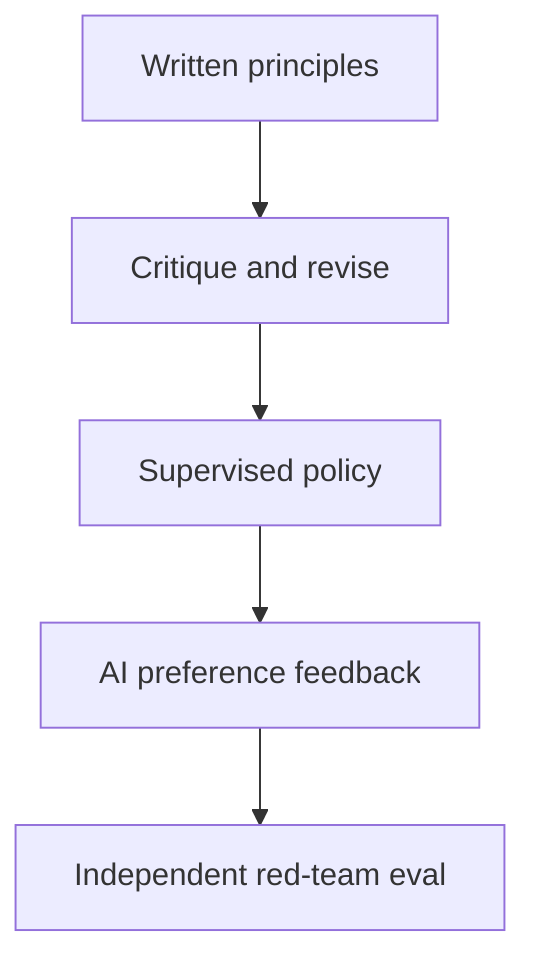

**Constitutional AI** is an alignment approach that uses an explicit set of written principles to guide model critiques, revisions, and preference judgments. In the original formulation, a model first revises answers through principle-guided supervised learning, then AI-generated preference labels support reinforcement learning from AI feedback. Written principles make the intended policy more inspectable, but they don't prove that generated judgments are correct.

## Two different training phases

During the supervised critique-and-revision phase, a model drafts a response, critiques it against a selected principle, and rewrites it. The revised demonstrations become supervised fine-tuning data. During the preference phase, models compare candidate answers against constitutional principles, creating preference data that can train a reward model and guide reinforcement learning.

Each phase has a distinct role. Critique text needs outcome verification, and an AI judge's preference remains a proxy. An organization may combine related ideas with direct preference optimization; the resulting rubric and training recipe depend on the chosen design.

## Example

A user requests the public deployment-freeze schedule and also asks for another team's unredacted credentials. One principle supports sharing public operational information; another prohibits exposing secrets. The revised answer provides the published schedule and refuses the credential request without pretending the entire request is forbidden.

Red-team evaluators then vary phrasing, languages, and multi-turn context to test whether the same boundary holds. A policy-compliant answer on one reviewed prompt isn't enough: the release also needs held-out attack variants and checks for excessive refusal on legitimate requests.

## Why it matters here

Constitutional AI connects preference training to explicit safety policies and adversarial evaluation. It helps readers separate supervised revision, AI-generated preference feedback, policy enforcement, and independent verification.

## Related terms

- [RLAIF](glossary://rlaif)
- [RLHF](glossary://rlhf)
- [Red team](glossary://red-team)
- [Reward model](glossary://reward-model)
