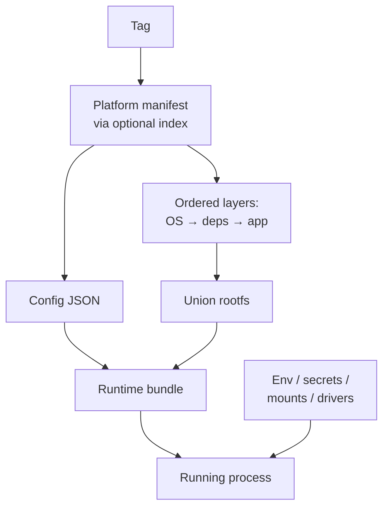

A container image is a content-addressed package of filesystem layers plus runtime config (entrypoint, env defaults, user, architecture) that a container runtime unpacks into a running process. In the [OCI Image Format](https://github.com/opencontainers/image-spec), an image is a **manifest** that points at a **config** blob and an ordered list of **layer** blobs; an optional **image index** (manifest list) points at several platform-specific manifests under one name.

Production does not run a git branch. It runs whatever bytes a registry served for a tag or digest: layered rootfs + config + startup command. That snapshot answers "what code and files started?" far better than a floating tag like `latest`, which can be retargeted to different bytes over time.

## Intuition

Think of the image as a frozen disk image plus a small "how to start me" card, not as a live machine. Layers stack bottom-up (base OS, then system packages, then language deps, then app files). Unchanged lower layers stay cacheable across builds and hosts because each layer is identified by a cryptographic digest. The config names the entrypoint, default environment, working directory, and which OS/CPU the layers target.

Production behavior also depends on inputs outside the image: mounted secrets, injected [environment variables](glossary://environment-variable), host GPU drivers, service accounts, network policy, and volume mounts. Two matching digests can behave differently when those external inputs differ.

## Example

An inference service image is built from a CUDA-capable base, pinned Python and system libraries, locked pip packages, tokenizer files, and app code. Model weights may be (a) baked into a late layer, (b) downloaded at startup from object storage, or (c) mounted from a network volume. A hypothetical planning estimate for a 7B-class stack might look like this; measure the actual compressed image and unpacked disk usage separately:

| Piece | Rough size | Update frequency |
| --- | --- | --- |
| Distroless / slim OS + CUDA userland | $1$–$4$ GB | rare |
| Python + torch / inference server | $2$–$8$ GB | weekly–monthly |
| App code, tokenizer, configs | $10$–$200$ MB | every deploy |
| Model weights (if baked) | $4$–$15$+ GB | when the model changes |

If the registry tag is `registry.example.com/infer:prod` but the deploy record stores digest `sha256:94a0…ea1a`, rollback and incident review pin the digest, not the mutable tag. Pulling by digest:

```bash
docker pull registry.example.com/infer@sha256:94a00394bc5a8ef503fb59db0a7d0ae9e1110866e8aee8ba40cd864cea69ea1a
```

pins the manifest and referenced blobs identified by that digest, even if someone re-pushes `:prod`. The digest identifies the CI-approved artifact when CI recorded that same value. Content addressing proves byte identity. Verify approval, provenance, and signatures separately. For an index digest, the runtime still selects a platform-specific manifest.

## How it works

Under OCI, a single-platform image is roughly:

1. **Layers**: ordered tar archives (often gzip or zstd compressed), each a filesystem changeset. Index $0$ is the base; later layers overlay earlier ones.
2. **Config**: JSON describing layer order, `Entrypoint`/`Cmd`, default env, user, working directory, and platform (`os` / `architecture`).
3. **Manifest**: JSON that lists digests and sizes of the config and each layer. The **image digest** people pin in deploys is typically the digest of this manifest (or of an index for multi-platform images).
4. **Image index** (optional): a "fat" manifest listing per-platform image manifests so one tag can serve `linux/amd64` and `linux/arm64` separately.

Tags are human-readable pointers in a registry (`:v3`, `:latest`). Digests are content hashes; changing one byte of any referenced blob changes the digest chain. Multi-platform tags often resolve first to an index digest, then to a platform-specific image digest. For strict reproducibility, record both when your platform uses an index.



## Weights: bake, mount, or fetch

For LLM and embedding services, where the weights live is a first-class image design choice:

- **Baked into the image**: portable, air-gap friendly, simplest cold path once the image is local. Huge layers, slow builds and registry pushes, and every weight bump is a full image rebuild and redeploy.
- **Fetched at startup**: small, fast-to-ship app image; weights versioned in object storage with their own checksums. Cold start pays download + load time unless a local cache or warm replica already holds the files.
- **Mounted volume / model cache**: update weights without rebuilding the app image; needs shared storage, careful permissioning, and explicit version pins so two replicas do not silently run different checkpoints.

Tokenizers, chat templates, and native GPU libraries belong in the image (or a tightly versioned sidecar artifact) more often than multi-gigabyte weight files do. Missing tokenizer files look like model bugs even when the weights loaded correctly.

## Debug path

When production differs from local or from a previous revision:

1. Compare **image digests** in deploy records and request traces. Tags help locate images while digests identify their contents.
2. Diff **build args**, base image digest, and lockfiles that fed the build.
3. Confirm **generated assets** (built static files, compiled extensions) are included in the image used by the runtime.
4. Check **external inputs**: env, secrets, mounts, GPU driver / CUDA compatibility with the base image.
5. For multi-platform tags, confirm both the **index** digest and the **platform-specific** digest.

Log the running digest on every boot so incidents can answer "which bytes?" without archaeology.

## Why it matters here

Container images are the handoff between code review and runtime on Cloud Run, Kubernetes, and local Docker. For AI services they also gate cold starts, GPU base compatibility, tokenizer/app parity, and whether a model update is a tiny config change or a multi-gigabyte rebuild. Pin digests in deploys; treat tags as convenience labels, not as identity.

## Related terms

- [Docker](glossary://docker)
- [Cold start](glossary://cold-start)
- [Google Cloud Run](glossary://google-cloud-run)
- [Kubernetes](glossary://kubernetes)
- [Reproducible environment](glossary://reproducible-environment)
