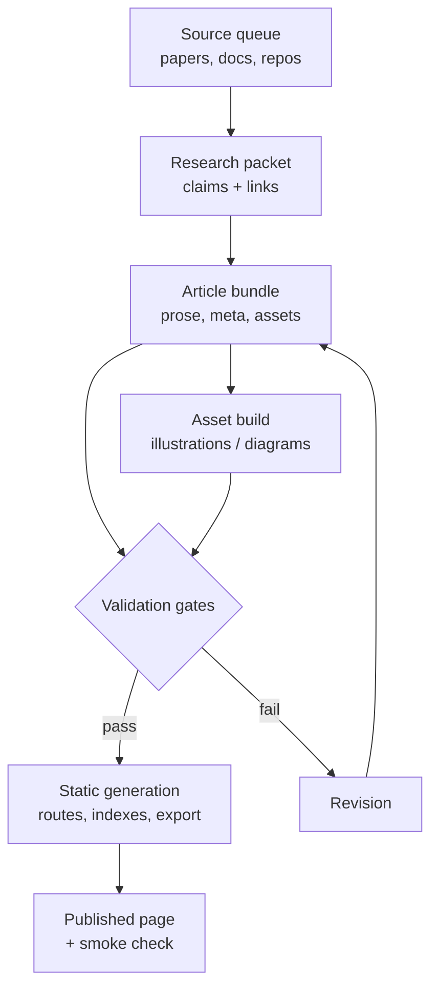

A content pipeline is the repeatable, machine-visible workflow that turns source material into reviewed, built, validated, and published learning content. A complete lesson combines Markdown with structured metadata, diagrams, illustration assets, glossary spans, citations, runnable examples, static routes, and export formats. The pipeline makes those steps explicit so defects fail in CI before reaching a reader's browser.

This applies the **docs-as-code** pattern to a curriculum: store content in Git like source, build assets like software, run validation gates before merge or deploy, and serve mostly static pages. An ML training data pipeline turns documents into training sets. A RAG ingestion pipeline turns them into vector indexes. A content pipeline turns teaching material into pages, mobile exports, and indexes that must stay coherent with each other.

## Intuition

Without a pipeline, publishing is a chain of human memory: "I updated the Markdown, so the cover image and previous/next links are probably fine." That fails as soon as one lesson has TSX illustrations, Mermaid diagrams, citation keys, glossary spans, and a route that must appear in the roadmap.

| Stage | Job | Typical failure if skipped |
|:---|:---|:---|
| Source / research | Claim inventory with dated evidence | Plausible but ungrounded prose |
| Article bundle | Prose + metadata + asset sources as one unit | Split brain between text and figures |
| Asset build | Illustrations and diagrams compile to PNGs | Stale or missing images on the page |
| Validation gates | Schema, links, refs, code, glossary, structure | Broken route ships with "good" writing |
| Static generation | Pre-render HTML and indexes | Fast CDN page with wrong content snapshot |
| Smoke / deploy | Main reader path still works | Glossary dialog or lesson route dead after deploy |

Editorial taste still decides whether the lesson teaches. The pipeline decides whether the lesson is *shippable*.

## Example

One LeetLLM article change can touch more than a single `content.md` file. A realistic path looks like this:

1. **Research packet:** claim inventory, sources, freshness dates, learner misconceptions.
2. **Article bundle:** prose, frontmatter (or legacy `metadata.json`), illustration `.tsx` sources, Mermaid blocks, research notes.
3. **Asset builds:**
   - `pnpm illustrations:build` (or `illustrations:build:article`) renders TSX to light/dark PNGs under `illustrations/_generated/`
   - `pnpm diagrams:build` renders Mermaid blocks to diagram PNGs
4. **Validation gates** (examples from the repo's content integrity suite):
   - metadata schema and cover paths
   - content structure, next-lesson callouts, and glossary ref resolution
   - reference IDs present in the shared store
   - illustration and diagram refs exist after build
   - Python examples execute or produce expected outputs
   - glossary module compile (`pnpm glossary:build`) and span audits
5. **Site build and smoke:** production build, then a quick check that a lesson route and a glossary term still render.

When Markdown ships without its related assets and references, the cover image can 404, a Mermaid diagram can stay stale, a citation key can be missing, and the iOS export can carry yesterday's glossary. Validation gates block these inconsistencies before publication.

```bash
# Conceptual local gate order (not a single script)
uv run scripts/validate-metadata.py
uv run scripts/validate-content-structure.py
uv run scripts/validate-references.py --skip-http
pnpm --dir web illustrations:build
pnpm --dir web diagrams:build
uv run scripts/validate-illustration-refs.py
uv run scripts/validate-diagram-quality.py
pnpm --dir web glossary:build
pnpm --dir web build
# then smoke: open one lesson + one glossary term on the rendered site
```

## How it works

Think of the pipeline as three layers that must agree:

1. **Canonical sources** (edit these): `content.md`, frontmatter, illustration TSX, Mermaid sources, research notes, shared reference store, glossary definitions.
2. **Generated artifacts** (rebuild, do not hand-edit as truth): `_generated` PNGs, compiled glossary modules, search/export packages, static HTML.
3. **Gates** (must pass): typed checks with actionable failures such as "citation key `x` missing in article `y`."

Ordering matters. Validating illustration refs before the illustration build produces false failures. Deploying a new app image against an old content snapshot produces "stale lesson" bugs that look like CMS problems. Treat content hash, lockfiles for render tools (Puppeteer + Chromium, package versions), and gate logs as part of the release evidence.

Human review still sits in the loop for teaching quality: weak examples, generic claims, wrong difficulty, and misleading figures. Machines catch structure; people catch whether the lesson would help a learner solve the next problem.

## Diagram



## Trade-offs

- **More automation, slower first commit:** every new gate catches a real class of bug later, but writers need clear repair paths and local commands.
- **Strict gates vs. emergency fixes:** bypasses need owner, reason, and expiry; otherwise people route around the pipeline during incidents.
- **Generated assets in Git:** convenient for deploys that skip rebuild, expensive to review and easy to hand-edit by mistake. Prefer source-of-truth + rebuild when tools are stable.
- **Editorial judgment:** a fully green pipeline can still publish a lesson that leaves learners unprepared. Gates protect coherence and shippability, while reviewers judge its teaching value.

## Why it matters here

LeetLLM is a Next.js curriculum with lessons, glossary entries, blog posts, TSX illustrations, Mermaid diagrams, and mobile export. Its content under `web/src/content/` passes through research, bundle review, asset builds, validation, static generation, and smoke checks. Roadmap order, prev/next links, glossary spans, and export packages only stay correct if the pipeline treats content as a build product. The same principle applies to internal docs and model-card sites assembled from multiple artifacts.

## Related terms

- [Article bundle](glossary://article-bundle)
- [Validation gate](glossary://validation-gate)
- [Static generation](glossary://static-generation)
- [Frontmatter](glossary://frontmatter)
- [Smoke test](glossary://smoke-test)
