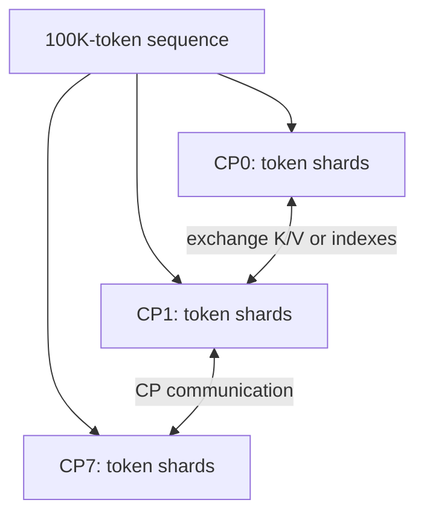

**Context parallelism (CP)** splits a long token sequence across GPU ranks. Each rank stores and computes on a sequence shard, which lowers per-rank activation memory roughly with the CP degree. Unlike Megatron sequence parallelism, CP partitions inputs and activations through the full network, including the attention path.

Attention creates the communication requirement. A query token on one shard may need keys and values from every other shard. CP implementations exchange those K/V segments through ring, point-to-point, all-gather, or hybrid communication patterns while preserving the same attention result as an unsharded sequence.

## CP versus other cuts

TP splits layer tensors, DP splits batch examples, and PP splits depth. CP splits sequence positions. Weights are generally replicated across a CP group because sequence partitioning doesn't divide parameter matrices.

## Diagram

## Example

With CP=8, a 100,000-token sample is distributed across eight context ranks, so each rank handles roughly 12,500 positions before padding and packing effects. Sparse attention selection must still remain globally correct across those shards.

## Why it matters here

The GLM-5.3 masterclass proposes CP=8 to reduce activation pressure from 100K-token agent trajectories. Measure throughput and memory for that topology on the intended workload. Custom DSA code also needs CP-aware gathering to select top-k context positions across complete shards.

## Related terms

- [Sequence parallelism](glossary://sequence-parallelism)
- [Tensor parallelism](glossary://tensor-parallelism)
- [Activation checkpointing](glossary://activation-checkpointing)
- [DeepSeek Sparse Attention](glossary://deepseek-sparse-attention)
- [NVIDIA Megatron](glossary://nvidia-megatron)
