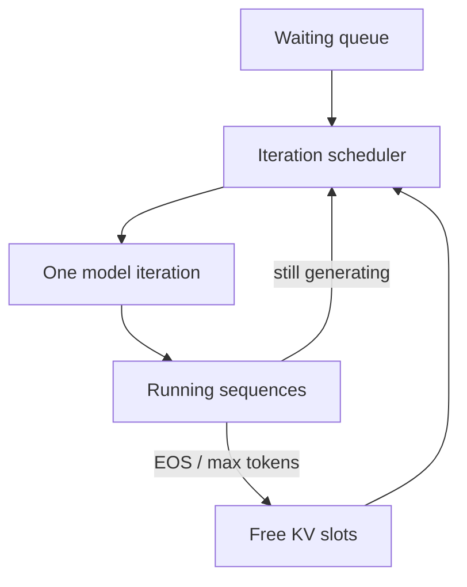

Continuous batching (also called **iteration-level scheduling** or in-flight batching) is a serving policy that can update the active batch between model iterations instead of locking a fixed set of requests until the slowest one finishes. Finished sequences leave and waiting work can enter within the engine's memory and token limits. [Orca (OSDI 2022)](https://www.usenix.org/conference/osdi22/presentation/yu) presented iteration-level scheduling and selective batching; [vLLM](https://docs.vllm.ai/en/latest/) implements continuous batching alongside paged KV management.

## Intuition

Autoregressive generation is multi-step: one forward pass yields at most one new token per sequence under the usual single-token decode path (speculative or multi-token decoding is a common exception that still schedules in iteration-level batches). Prompt lengths and answer lengths vary wildly, so a static batch wastes GPU work. Suppose four sequences share a batch and three of them hit end-of-sequence after 30 tokens while the fourth needs 400. Under **static (request-level) batching**, those three finished slots still sit in the batch until the long request completes. Under continuous batching, each finished sequence frees its slot (and its KV cache) on the next scheduling step so a queued request can enter while the long one keeps decoding.

Decode is usually memory-bandwidth bound: loading weights once and applying them to many live sequences raises arithmetic intensity. Continuous batching keeps that concurrent set as full as KV memory and policy allow, even when completions and arrivals are staggered.

## How it works

At a high level the loop looks like this:

1. **Schedule.** Look at waiting and running requests under limits: max concurrent sequences, max tokens in the step, free KV blocks, and priority rules.
2. **Execute one iteration.** Run a single model step on the chosen set (prefill work, decode work, or a mix, depending on the engine).
3. **Retire and free.** Finished sequences release their KV references. Unshared blocks can be reclaimed; prefix caching may retain reusable blocks after a request ends.
4. **Admit.** New or preempted work can enter free capacity before the next step.

Orca pairs this with **selective batching**: linear layers can still run as one big batch even when sequences have different decoded lengths, while attention often processes each sequence (or its own KV blocks) according to its true length. Later systems keep the same scheduling idea and add better memory managers (PagedAttention-style block pools) so admission and growth do not require a contiguous max-length reservation per request.

```text
# Conceptual scheduler loop (not a real API)
while True:
    batch = schedule(waiting, running, kv_free, max_seqs, max_batched_tokens)
    outputs = engine.forward_one_iteration(batch)  # one token step per live seq
    for seq, tok in outputs:
        if finished(seq, tok):
            free_kv(seq)
            running.remove(seq)
        else:
            running.update(seq, tok)
    admit_from_queue(waiting, running, kv_free)
```

## Diagram



## Example

Three chat requests compete for a scheduler capped at two concurrent sequences:

| Request | Prompt | Target output | Notes |
|---|---:|---:|---|
| A | 200 tokens | 20 tokens | Short reply |
| B | 800 tokens | 200 tokens | Long answer |
| C | 150 tokens | 40 tokens | Arrives just after A and B start |

**Static batching** (batch size 2): the engine runs A and B together until both complete. A finishes after 20 decode steps, but its slot stays reserved while B runs to 200. C waits for the entire static batch to drain.

**Continuous batching:** after A's 20th token, A leaves. On the next iteration C can prefill (or chunked-prefill) into A's freed KV capacity while B keeps decoding. Wall-clock work for short interactive traffic no longer tracks the longest co-batched generation.

[Anyscale's June 2023 comparison](https://www.anyscale.com/blog/continuous-batching-llm-inference) on OPT-13B and one A100 40GB reported roughly **8×** throughput for TGI/Ray Serve continuous-batching implementations and up to about **23×** for vLLM versus its naive static baseline. These results compare complete implementations, including their schedulers and surrounding systems. Orca reported up to **36.9×** versus FasterTransformer at matched latency in its GPT-3 175B setting. The results depend on workload, memory headroom, and baseline quality; measure current engines on the target workload.

## Worked waste calculation

Ignore prefill cost and assume every decode step costs the same GPU time unit. Four sequences need $L = (20, 40, 50, 200)$ output tokens and share one static batch:

$$
T_{\mathrm{static}} = \max(L) = 200
\quad\text{decode steps; }4T_{\mathrm{static}}=800\text{ slot-steps}
\quad
U_{\mathrm{static}} = \frac{\sum L}{4 \cdot \max(L)} = \frac{310}{800} = 0.3875
$$

With continuous batching and always-full occupancy of four slots (idealized, infinite queue of short jobs after early finishes), paid slot-steps track total tokens. Early finishes free capacity for new work, so effective utilization approaches 1 under sustained load. Real systems are constrained by KV memory, prefill spikes, and max batch tokens, so utilization sits between these extremes.

## Trade-offs

- **Throughput vs fairness.** Packing more concurrent decode work raises tokens/s, but a flood of long generations can starve short interactive requests unless you add priorities, max output caps, or separate pools.
- **Prefill vs decode.** Admitting a large prefill can delay every active streamer's next token (worse TTFT or TPOT for others). Chunked prefill and token budgets per step exist to smooth that interference.
- **Memory is the real batch limit.** Concurrent sequences are gated by KV-cache capacity more often than by FLOPs. Continuous batching only helps if freed memory can be reused quickly (paged/blocked KV helps here).
- **Latency under saturation.** When the GPU is always full, new work cannot inject immediately; continuous batching still reduces *idle* waste inside the running set, but queueing returns.
- **Complexity.** You need an iteration scheduler, careful attention kernels for ragged lengths, preemption/swap policies, and good telemetry. Static batching is simpler and can be fine when all outputs are nearly the same length (for example fixed-length classification-style generations).

## What to measure

Split metrics by request shape (short vs long prompt, short vs long output):

- Queue time and **TTFT** (admission + prefill pressure)
- **TPOT** / inter-token latency for streaming feel
- Tokens per second and concurrent batch size over time
- KV-cache utilization, fragmentation, preemptions, and OOMs
- Latency CDFs at realistic QPS, alongside peak tokens/s on synthetic bursts

High aggregate tokens/s with rising p95 for short chats usually means the scheduler is optimizing the wrong objective.

## Why it matters here

Continuous batching is the default mental model for production LLM serving: iteration-level admission, KV as the scarce resource, and mixed prefill/decode traffic. It sits next to PagedAttention, prefix caching, and decode-phase metrics in the curriculum. If you only benchmark single-request latency, you'll miss the system property that actually determines cost per token under load.

## Related terms

- [Inference scheduler](glossary://inference-scheduler)
- [Decode phase](glossary://decode-phase)
- [Prefill](glossary://prefill)
- [KV cache](glossary://kv-cache)
- [PagedAttention](glossary://pagedattention)
