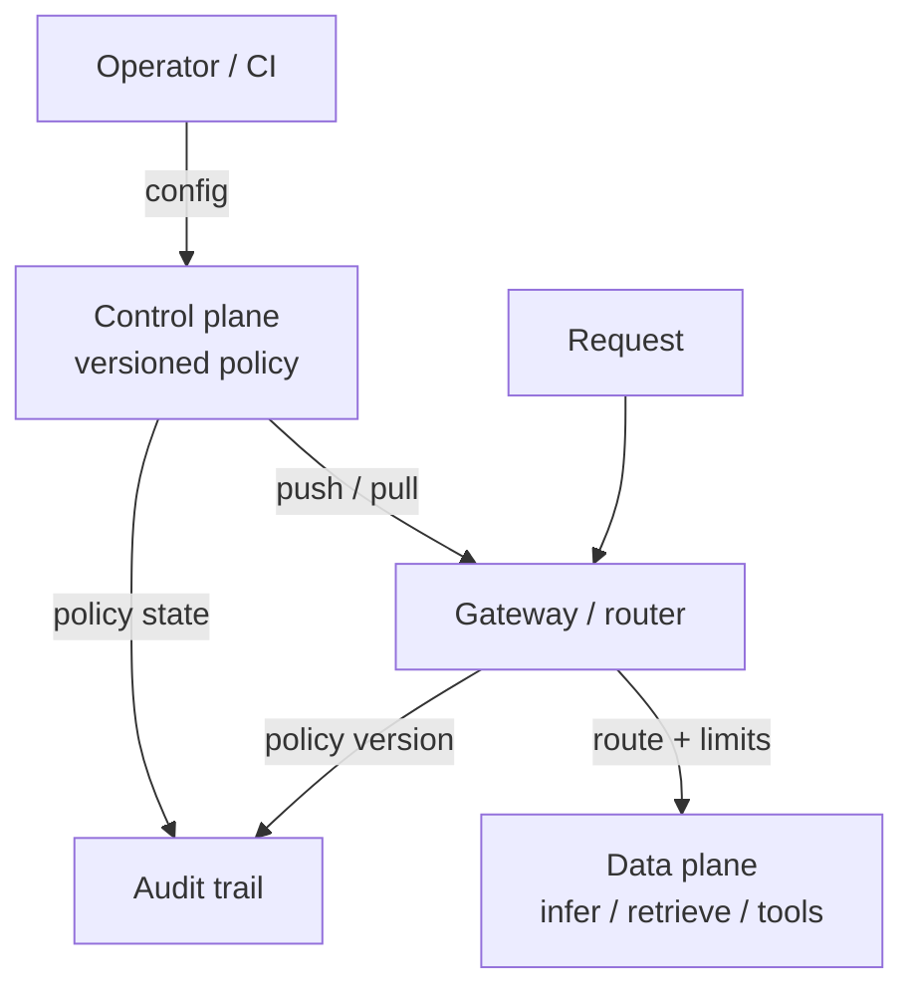

A control plane is the part of a system that decides desired behavior: configuration, policy, routing, admission, approval, and audit. A data plane is the part that does the hot-path work under those decisions: moving packets, running pods, prefilling tokens, decoding, retrieving documents, or executing tools. The control plane decides; the data plane executes.

The split comes from networking and systems design. Routing protocols and controllers build forwarding state; switches and servers apply it at line rate. Kubernetes reuses the same idea: the control plane (API server, etcd, controllers, scheduler) makes global cluster decisions, while worker nodes run the workload. In LLM products the analogy is the same. Policy about which model, provider, quota, safety threshold, tool set, or kill switch applies should live outside the token loop so you can change product behavior without rewriting prefill and decode.

## Intuition

Separate steering from work. Changing model routes, safety thresholds, tool permissions, quotas, or kill switches should not require a new binary for the serving path. When the two planes blur, every policy tweak becomes a code deploy, every outage mixes "config was wrong" with "the GPU path failed," and two replicas can disagree without anyone knowing which rule won.

Workers consume versioned desired state and apply it on requests. A route or permission change updates that state; it does not modify inference kernels. This separation lets operators audit policy revisions independently from model execution and detect replicas serving stale configuration.

## How it works

A production control plane for AI systems usually has four jobs:

1. **Authoritative state.** Versioned records for routes, flags, quotas, model aliases, allowlists, and safety thresholds, stored so updates are atomic and auditable (database, config service, or cluster API).
2. **Decision APIs.** Operators, CI, or product code write desired state: "pin tenant T to model B," "disable production deployment tools," "canary 5% of traffic to prompt v17."
3. **Propagation.** Workers, gateways, and agents load or subscribe to that state with a known freshness SLA. Stale readers can cause failures and need explicit monitoring.
4. **Version stamp on the request.** Each data-plane call records which config or policy version shaped it so "why did this user get a different model?" is a lookup, not archaeology.

The data plane still enforces hard local guards (schema checks, fail-closed tool auth, resource limits). Those guards implement control-plane policy; they should not invent competing policy from free-form prompts.

## Diagram

## Example

Hypothetical operations assistant targeting ~2,000 QPS across three regions. Control-plane objects (versioned):

| Object | Example value | Owner |
|--------|---------------|--------|
| Model alias `ops-default` | `provider-a/gpt-mid@2026-06-01` | LLM platform |
| Route weights | 90% default, 10% canary `gpt-mid-v2` | Experimentation |
| Workspace quota | 120k input tokens / day for plan `team` | Cost platform |
| Safety threshold | jailbreak classifier score $\ge 0.82$ block | Trust & safety |
| Kill switch `tools.deploy_production` | `off` | Incident command |
| Feature flag `rag.hybrid_v3` | 5% internal, sticky by `user_id` | Search |

A single request on the data plane:

1. Gateway resolves tenant and plan, loads config snapshot `policy_rev=1842`.
2. Routing policy maps intent `incident_triage` → alias `ops-default` (not the 70B coding model).
3. Quota service admits the request (remaining daily tokens: 48k).
4. Hybrid retriever runs only because `rag.hybrid_v3` is on for this user hash.
5. Prefill + decode stream tokens; tools stay on the allowlist; production deploys stay blocked by the kill switch.
6. Logs stamp `policy_rev=1842`, route id, flag set, and classifier scores.

Concrete failure: region B workers still on `policy_rev=1839` after a bad push. Same user, same prompt: one region hits the canary model, the other does not. Without the revision on every request, that looks like model nondeterminism. With it, you page on config lag, not on "the LLM is flaky."

For coding agents, the control plane is often also the human surface: editor, PR review, or agent dashboard that approves risky shell or write actions. The model proposes; the trusted plane admits or denies.

## Production placement

Keep the control plane small, highly available, and slower-changing than the data plane. Typical split:

- **Control plane:** model registry and aliases, provider health and failover rules, [routing policy](glossary://routing-policy), [feature flags](glossary://feature-flag), [kill switches](glossary://kill-switch), quotas, tool allowlists, safety thresholds, approval workflows, rollouts.
- **Data plane:** [API gateway](glossary://api-gateway) admission path under those rules, continuous batching, prefill, decode, KV cache, retrieval, tool sandboxes, token streaming.

Do not put per-token math in the control plane, and do not bury product policy inside prompt strings that cannot be versioned or audited.

## Config freshness and audit

Propagate config with explicit versions and a freshness SLA. Stamp requests with the policy snapshot, route, threshold version, and flag set. When workers disagree, compare those revisions and the decision inputs. Different quota state, tenant identity, experiment assignment, or provider health can legitimately change the decision; version skew or failed propagation can instead reveal stale configuration.

## Why it matters here

Curriculum and production systems both need behavior you can change under load: swap a provider, tighten a safety bar, freeze a tool class, or canary a prompt without redeploying the serving stack. A clear control plane keeps those knobs outside the token path, makes kill switches and flags real operations tools, and turns surprising answers into explainable decisions via an [audit trail](glossary://audit-trail). When control and data planes blur, every incident becomes both a code problem and a policy problem at once.

## Related terms

- [Routing policy](glossary://routing-policy)
- [Kill switch](glossary://kill-switch)
- [Feature flag](glossary://feature-flag)
- [Audit trail](glossary://audit-trail)
- [API gateway](glossary://api-gateway)
