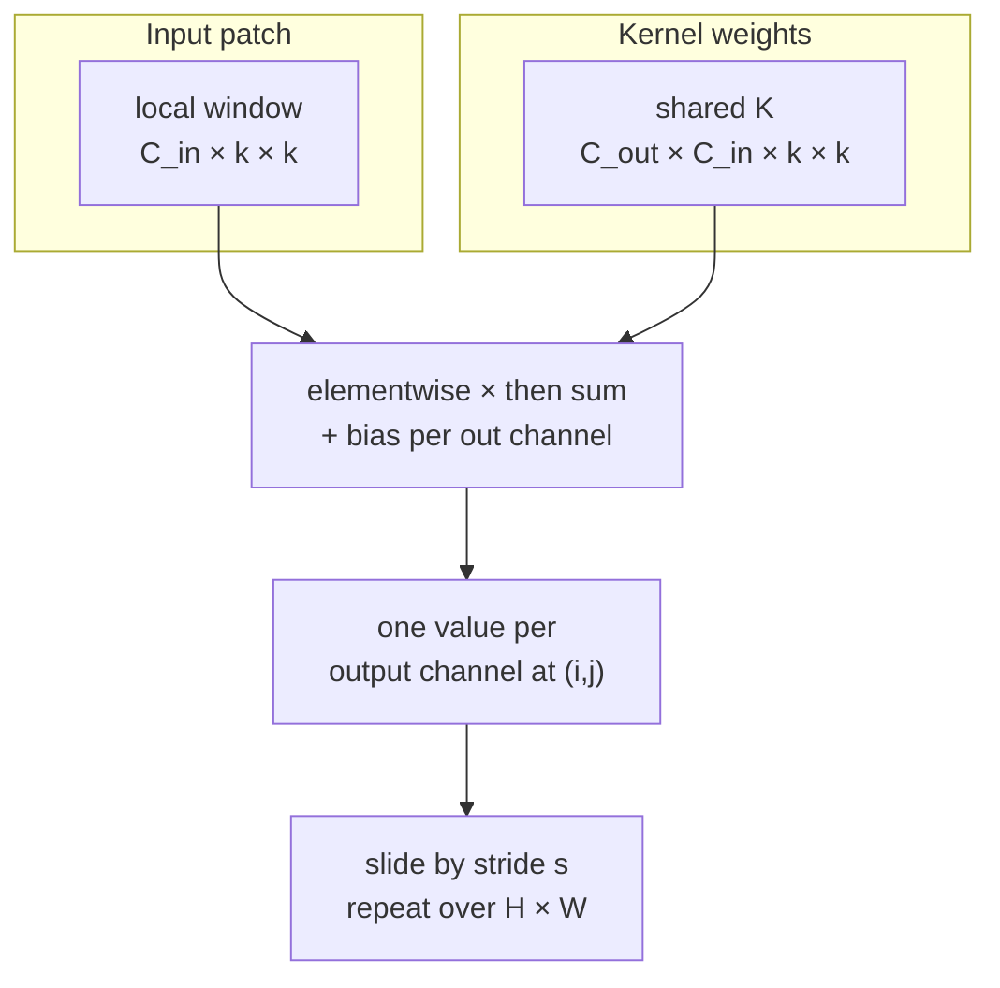

A convolution kernel (also called a filter) is a small tensor of learnable weights that slides over local neighborhoods of an input and produces one scalar response per position and per output channel. The same weights are reused at every spatial location (weight sharing), so one detector can fire wherever a matching local pattern appears.

Framework "convolution" is almost always **cross-correlation**: elementwise multiply the kernel with a patch, sum, optionally add a bias. Strict mathematical convolution flips the kernel first; for learned kernels the flip only renames the weights, so libraries skip it. PyTorch `nn.Conv2d` documents its operator as valid 2D cross-correlation.

## Intuition

A dense layer on a $H \times W \times C$ image needs a separate weight for every pixel-channel pair. A $k \times k$ kernel needs only $k^2 C_{\mathrm{in}}$ weights per output channel, shared everywhere. That buys local feature detection (edges, textures, later more abstract patterns) with far fewer parameters, and it preserves spatial structure in the output feature map.

Stacking layers grows the [receptive field](glossary://receptive-field). With dilation one and no intervening downsampling, each $3 \times 3$ stride-1 layer adds two input pixels to its diameter. After a strided layer, later kernels span a larger distance in the original input.

## Formula

For a single-channel 2D input $X$ and kernel $K$ of size $k_h \times k_w$, the cross-correlation output at position $(i,j)$ (no padding, stride 1) is

$$
Y_{i,j} = \sum_{u=0}^{k_h-1} \sum_{v=0}^{k_w-1} X_{i+u,\, j+v}\, K_{u,v}
$$

With multiple input channels, each output channel $c'$ has weights spanning all $C_{\mathrm{in}}$ channels:

$$
Y_{c',i,j} = b_{c'} + \sum_{c=0}^{C_{\mathrm{in}}-1} \sum_{u,v} X_{c,\, i+u,\, j+v}\, K_{c',c,u,v}
$$

Weight tensor shape in PyTorch `Conv2d` (groups $= 1$): $(C_{\mathrm{out}}, C_{\mathrm{in}}, k_h, k_w)$, plus optional bias of length $C_{\mathrm{out}}$.

Output spatial size (PyTorch, including dilation $d$):

$$
H_{\mathrm{out}} = \left\lfloor \frac{H_{\mathrm{in}} + 2p - d(k_h - 1) - 1}{s} \right\rfloor + 1
$$

and the same form for $W_{\mathrm{out}}$. Here $p$ is padding, $s$ is [stride](glossary://stride), $d$ is dilation (spacing between kernel taps; $d=1$ is dense).

## Example

Take the classic $3 \times 3$ patch and $2 \times 2$ kernel (Dive into Deep Learning):

$$
X = \begin{bmatrix} 0 & 1 & 2 \\ 3 & 4 & 5 \\ 6 & 7 & 8 \end{bmatrix},\quad
K = \begin{bmatrix} 0 & 1 \\ 2 & 3 \end{bmatrix}
$$

Top-left response:

$$
0\cdot 0 + 1\cdot 1 + 3\cdot 2 + 4\cdot 3 = 19
$$

Sliding one step right, then down, fills

$$
Y = \begin{bmatrix} 19 & 25 \\ 37 & 43 \end{bmatrix}
$$

Same idea with an edge detector: $K = [1,\, -1]$ on a row that goes white-to-black fires a large positive response at the boundary and near zero on flat regions. During training those kernel values are learned from loss gradients, not hand-picked.

**Multi-channel count.** Input $32 \times 32 \times 3$, $C_{\mathrm{out}} = 64$ filters of size $3 \times 3$: parameter count is $64 \times 3 \times 3 \times 3 + 64 = 1{,}792$ (weights + bias). A dense layer mapping the flattened $32 \times 32 \times 3$ input to a full $32 \times 32 \times 64$ map would need $32 \cdot 32 \cdot 3 \cdot 32 \cdot 32 \cdot 64 \approx 2.0 \times 10^8$ weights.

## Diagram



## How it works in code

```python
import torch
import torch.nn as nn

# NCHW: batch, channels, height, width
x = torch.randn(1, 3, 32, 32)
conv = nn.Conv2d(in_channels=3, out_channels=16, kernel_size=3, stride=1, padding=1)
y = conv(x)  # shape [1, 16, 32, 32] with same spatial size

# weight: [16, 3, 3, 3]; bias: [16]
assert conv.weight.shape == (16, 3, 3, 3)
```

With `padding=0` the same layer yields $30 \times 30$ spatially. With `stride=2` and `padding=1`, height and width roughly halve. Dilation $d>1$ spreads the $k \times k$ taps over a wider field without adding weights; enlarging $k$ would increase the parameter count.

## Sizing and geometry

| Knob | Effect |
|------|--------|
| Kernel size $k$ | Local support and parameter cost per channel |
| Stride $s$ | Output resolution and compute; larger $s$ downsamples |
| Padding $p$ | Whether border pixels get centered kernels; $p=(k-1)/2$ with $s=1$, $d=1$ keeps size for odd $k$ |
| Dilation $d$ | Effective span $d(k-1)+1$ without more weights |
| $C_{\mathrm{out}}$ | Number of distinct detectors (depth of the feature volume) |

Groups and depthwise convolutions restrict which input channels feed which outputs (MobileNet-style). Ungrouped $1 \times 1$ kernels mix all input channels pointwise with no spatial mixing; grouped ones connect only their assigned channels.

## Why it matters here

Convolution kernels are the reason classic vision stacks detect local structure efficiently, and they set up [receptive field](glossary://receptive-field), [stride](glossary://stride), [padding](glossary://padding), and [translation equivariance](glossary://translation-equivariance) in the curriculum. Even when a production path uses a vision transformer or a frozen vision tower inside a vision-language model, convolutional stems, patch embedders, and CNN baselines still show up in feature extractors, OCR, detection, and many multimodal pipelines. Shape bugs (off-by-one $H/W$, wrong $C_{\mathrm{in}}$, padding that kills borders) usually start with a misunderstood kernel, stride, or padding choice.

## Related terms

- [Receptive field](glossary://receptive-field)
- [Stride](glossary://stride)
- [Max pooling](glossary://max-pooling)
- [Translation equivariance](glossary://translation-equivariance)
- [Feature map](glossary://feature-map)
