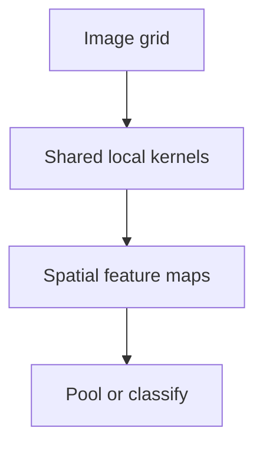

A convolutional neural network (CNN) processes grid-shaped inputs by applying shared, learnable filters to local neighborhoods. Instead of giving every image location an independent set of dense weights, it reuses each filter across spatial positions and produces a feature map recording where a pattern appears.

## Shared weights preserve local structure

An image with height $H$, width $W$, and $C$ channels contains spatial relationships that flattening can hide. A $k\times k$ [convolution kernel](glossary://convolution-kernel) spans nearby pixels and all relevant input channels. Sliding that kernel across the image detects the same local structure at different positions.

For $C_{in}=3$, $C_{out}=16$, and a $3\times3$ kernel, the layer has $16(3\cdot3\cdot3+1)=448$ trainable parameters, including one bias per output channel. The parameter count doesn't grow with image height or width, although activation size and computation do. [Padding](glossary://padding) and [stride](glossary://stride) change output geometry; pooling can reduce spatial resolution.

## Diagram

## Example

On a four-by-four grayscale crop, a three-by-three filter with stride one and no padding produces a two-by-two feature map. The same nine filter weights are reused at all four locations. A strong response in the top-left cell means the learned local pattern appeared in that crop region, not that the whole image has already been classified.

## Why it matters here

The preparation CNN lesson establishes convolution geometry before the damaged-package vision capstone adds data quality, thresholding, and human review. A useful image score still needs calibrated decision boundaries and evidence that similar images didn't leak between dataset splits.

## Related terms

- [Convolution kernel](glossary://convolution-kernel)
- [Feature map](glossary://feature-map)
- [Receptive field](glossary://receptive-field)
- [Max pooling](glossary://max-pooling)
