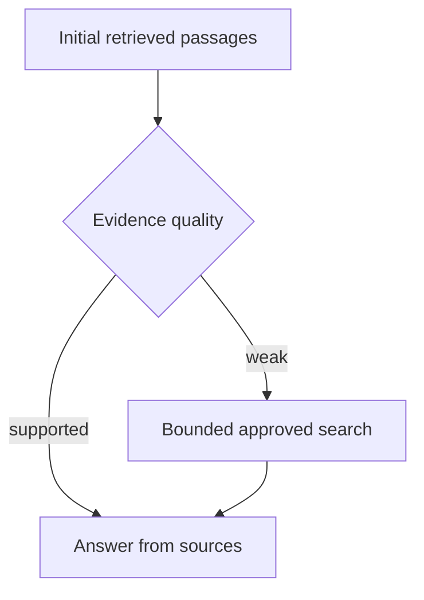

**Corrective retrieval-augmented generation (CRAG)** evaluates retrieved evidence before answering and chooses a recovery path when that evidence is weak, irrelevant, or incomplete. Yan and colleagues introduce the evaluator and recovery paths in [Corrective Retrieval Augmented Generation](https://arxiv.org/abs/2401.15884). A retrieval evaluator can accept strong internal documents, reject poor results and seek approved external evidence, or combine uncertain internal evidence with a bounded supplemental search.

A corrective system evaluates retrieved evidence and uses that assessment to choose a recovery action. Define the evaluator, confidence threshold, recovery policy, and maximum cost or request budget. Bound retries and change the query or source when the evidence remains weak.

## Route from evidence quality

## Example

An engineer asks whether a model endpoint supports a new response format. The internal index returns an outdated document, so the evaluator marks the evidence uncertain. A corrective pipeline can query an allowlisted official documentation domain, retrieve the current page, and cite that source. If no approved source confirms the claim, the system should abstain instead of inventing support.

Recovery introduces new security perimeters. External HTML, redirects, embedded instructions, and model-selected URLs are untrusted. Constrain network destinations, validate redirects, preserve lineage, and enforce tenant permissions on internal retrieval. Keep retrieved text in its evidence role and enforce tool authorization in application code; no text-stripping step reliably removes every malicious instruction.

## Why it matters here

Advanced RAG lessons compare corrective routing with query rewriting, HyDE, and Self-RAG. CRAG adds an evidence-driven recovery decision, but correctness depends on authorized sources, bounded retries, observable failures, and answers grounded in documents that actually support them.

## Related terms

- [RAG](glossary://rag)
- [Guardrail](glossary://guardrail)
- [lineage](glossary://provenance)
- [Retry backoff](glossary://retry-backoff)
