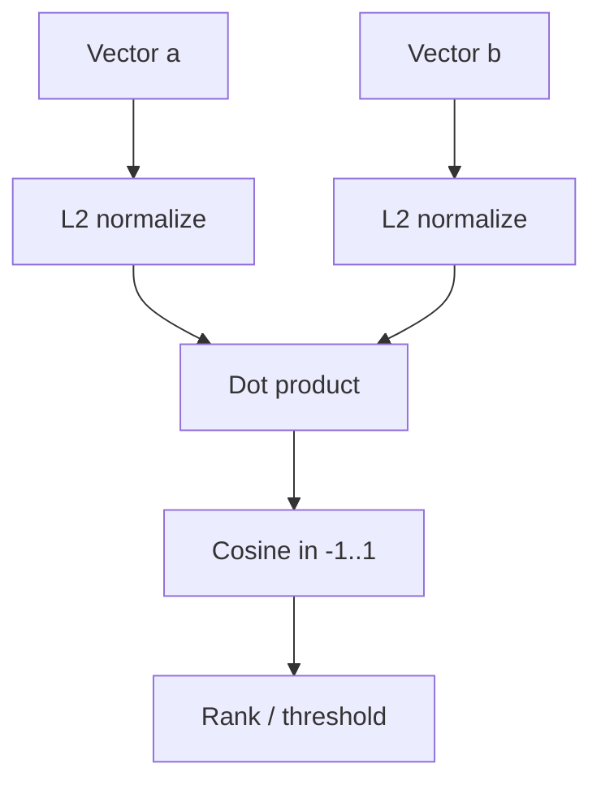

**Cosine similarity** measures how aligned two non-zero vectors are by the cosine of the angle between them. It depends only on direction, not on vector length: scale either vector by a positive constant and the score is unchanged. For real vectors the value lies in $[-1, 1]$ (same direction $= 1$, orthogonal $= 0$, opposite $= -1$). Non-negative bag-of-words and TF-IDF vectors cannot form an obtuse angle, so classical IR scores live in $[0, 1]$.

In LLM systems it is the default ranking signal for many sentence and multimodal embedding models after L2 normalization. It answers "do these two points point the same way?" not "are they the same length?" and not "does this chunk answer the query?"

## Formula

From the Euclidean dot product identity $a \cdot b = \lVert a \rVert \lVert b \rVert \cos\theta$:

$$
\cos(a,b) = \frac{a \cdot b}{\lVert a \rVert \lVert b \rVert}
= \frac{\sum_i a_i b_i}{\sqrt{\sum_i a_i^2}\,\sqrt{\sum_i b_i^2}}
$$

If both vectors are L2-normalized to unit length ($\lVert a \rVert = \lVert b \rVert = 1$), then:

$$
\cos(a,b) = a \cdot b
$$

That identity is why production indexes often normalize once at write time and at query time, then search with **inner product** (maximum inner product search) instead of dividing norms on every comparison. For unit vectors, squared Euclidean distance is a monotone transform of cosine:

$$
\lVert a - b \rVert_2^2 = 2(1 - \cos(a,b))
$$

Libraries often expose **cosine distance** as $1 - \cos(a,b)$ (range $[0, 2]$ for real vectors). That quantity is convenient for "smaller is closer" APIs but is not a true metric (it fails the triangle inequality). Angular distance $\theta = \arccos(\cos(a,b))$ is a true metric on directions.

## Intuition

Picture two arrows from the origin. Cosine cares about the angle between the arrows. A long and a short arrow that point the same way score $1$; two arrows of equal length that point different ways can score near $0$. That is why cosine was natural for document vectors: a longer page should not automatically win just because it has larger term counts, if the relative word mix (direction) matches the query.

Learned embeddings inherit the same geometry. Contrastive training (InfoNCE-style dual encoders, CLIP, and similar) often optimizes for high cosine (or normalized dot product) between matched pairs and lower scores for hard negatives. The score is still geometry, not truth: a high cosine says "nearby in this model's space," not "entailed," "safe," or "answerable."

## Diagram



## Worked numbers

Take $a = [1, 0]$, $b = [1, 1]$, $c = [-1, 0]$:

| Pair | Dot product | Norms | Cosine |
| --- | --- | --- | --- |
| $(a,a)$ | $1$ | $1 \cdot 1$ | $1$ |
| $(a,b)$ | $1$ | $1 \cdot \sqrt{2}$ | $1/\sqrt{2} \approx 0.707$ |
| $(a,c)$ | $-1$ | $1 \cdot 1$ | $-1$ |

Scale $b$ to $10b = [10, 10]$: the cosine with $a$ is still $0.707$, while the raw dot product becomes $10$. Without normalization, magnitude leaks into ranking.

Minimal NumPy-style check:

```python
import numpy as np

def cosine(a, b, eps=1e-12):
    a = np.asarray(a, dtype=np.float64)
    b = np.asarray(b, dtype=np.float64)
    na = np.linalg.norm(a)
    nb = np.linalg.norm(b)
    # eps avoids div-by-zero only; zero/near-zero embeddings have no meaningful direction.
    # Reject or special-case them in scoring paths rather than trusting a tiny-norm cosine.
    if na < eps or nb < eps:
        raise ValueError("cosine is undefined for zero-norm vectors")
    return float(a @ b / (na * nb))

a = np.array([1.0, 0.0])
b = np.array([1.0, 1.0])
# unit vectors: cosine == dot
ua = a / np.linalg.norm(a)
ub = b / np.linalg.norm(b)
assert abs(cosine(a, b) - ua @ ub) < 1e-9
```

## Example

**Semantic search / RAG candidate generation.** Query embedding for "rotate an API key" is compared with chunk embeddings. "Reset a leaked credential" can rank highly despite little lexical overlap, because the model places both near each other in direction. The same cosine ranks image and text vectors in CLIP-style dual encoders after both sides are normalized into a shared space.

**Index contract (FAISS-style).** Build an inner-product index, L2-normalize document vectors before `add`, and normalize the query before `search`. The returned scores are then cosines. Leaving document norms unequal can change ranking. With unit document vectors, failing to normalize one nonzero query scales all its scores equally, so exact ranking stays the same but cosine thresholds become invalid. Verify the store's metric contract; normalizing an already unit-length vector is mathematically idempotent. See [FAISS metric documentation](https://github.com/facebookresearch/faiss/wiki/MetricType-and-distances).

**Score bands in practice.** Many trained text embeddings for in-domain paraphrases cluster in a narrower *positive* band (for example rough neighbors around $0.6$ to $0.9$ for one model, different numbers for another). Opposite-direction scores near $-1$ are rare for typical text embedding spaces. Compare scores **within one model, one pooling recipe, one corpus, and one normalization policy**. A cutoff of $0.75$ that works for model A at dim $768$ will not transfer to model B, another language, or a different chunk size.

## Trade-offs

| Choice | Prefer when | Watch for |
| --- | --- | --- |
| Cosine / normalized IP | Embedding trained for angular similarity; length should not dominate | Must normalize both index and query consistently |
| Raw dot product | Model training used unnormalized IP / MIPS deliberately | Long-norm vectors can dominate rankings |
| Euclidean on raw vectors | Geometry was trained or calibrated in $L_2$ | Length and direction both affect distance |
| Hard cosine threshold | Dedup, near-duplicate detection, semantic cache with measured precision | Thresholds drift across models, domains, and chunking |
| Top-$k$ only | Candidate generation for rerankers | High $k$ hides threshold fragility; still log score distributions |

Cosine is a **ranking signal** for semantic neighbors, paraphrases, and near-duplicates. Verify separately whether retrieved text contains the needed evidence, using a reranker, citation check, or human evaluation. Anisotropy in embedding spaces can compress scores into a narrow band; inspect histograms before hard-coding cutoffs for cache hits or auto-routing.

## Why it matters here

Cosine similarity is the everyday bridge from embeddings to dense retrieval, ANN indexes, clustering, deduplication, semantic caching, and dual-encoder training objectives. Curriculum work on RAG, vector databases, bi-encoders, and hybrid search all assume you know when cosine equals a dot product, when normalization must run, and why a "good" score is never portable across model families without measurement.

## Related terms

- [Dot product](glossary://dot-product)
- [Embedding](glossary://embedding)
- [Dense retrieval](glossary://dense-retrieval)
- [ANN search](glossary://ann-search)
- [Bi-encoder](glossary://bi-encoder)
