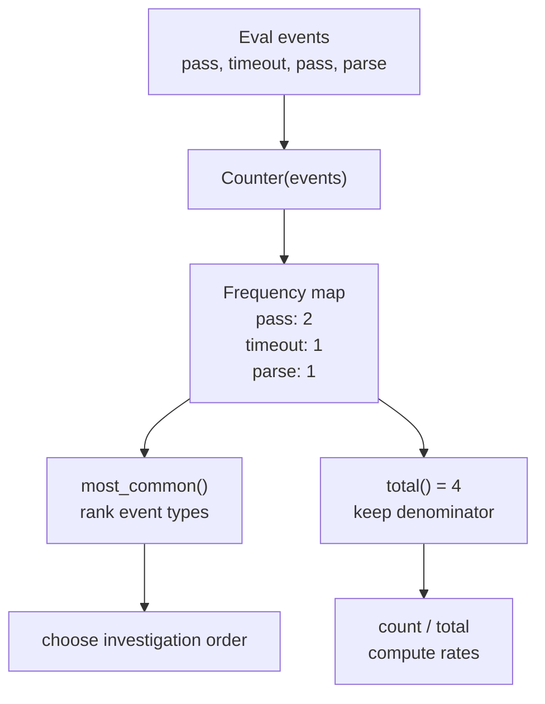

`collections.Counter` is a `dict` subclass for tallying hashable objects. Counts are usually integers, but the class doesn't restrict stored values to that type. Missing keys read as $0$. Helpers such as `most_common` and `total` support ranking and aggregation. See the [Python documentation](https://docs.python.org/3/library/collections.html#collections.Counter).

## Intuition

Before building dashboards, count. Label distributions, error codes, tool names, document ids, and token types often reveal skew, duplicates, and parse failures faster than a full metrics stack. `Counter` is the tiny tool for that first pass: one pass over events, a frequency table, then rates only after you keep the denominator next to each count.

In multiset terms, a key may appear many times. The value is the multiplicity. Python's docs model `Counter` after bags or multisets in other languages; the class is designed for positive integer tallies, while still allowing zero and negative counts for intermediate arithmetic.

## Diagram



`Counter` owns tally arithmetic, not statistical interpretation. For nonnegative counts of mutually exclusive events, `total()` supplies the event denominator. Signed residuals or overlapping tags don't automatically define a sample size. Confidence intervals, alert thresholds, time windows, tenant isolation, and durable aggregation belong to the surrounding system.

## Example

Score labels from a small eval batch, then rank and compute a pass rate with an explicit total:

```python
from collections import Counter

labels = ["pass", "fail", "pass", "timeout", "fail", "pass"]
c = Counter(labels)

print(c["pass"])           # 3
print(c["unknown"])        # 0  <- missing keys do not raise KeyError
print(c.most_common(2))    # [('pass', 3), ('fail', 2)]
print(c.total())           # 6  (Python 3.10+; else sum(c.values()))
print(c["pass"] / c.total())  # 0.5
```

After scoring $1{,}000$ generations, `Counter(labels)` might show `{"pass": 720, "fail": 200, "timeout": 80}`. That table is the start of a pass-rate CI check, not the full eval story: always report $720/1000 = 0.72$ with support per class, not "72% pass" alone.

## How it works

Construction accepts an iterable of elements, another mapping of counts, or keyword arguments:

```python
Counter("gallahad")              # from iterable: counts characters
Counter({"red": 4, "blue": 2})   # from mapping
Counter(cats=4, dogs=8)          # from kwargs
```

Behavior that matters in production code:

| Behavior | Detail |
|----------|--------|
| Missing key | `c[k]` is $0$, not `KeyError` |
| Zero vs delete | `c[k] = 0` keeps the key; use `del c[k]` to remove it |
| `update` | Adds counts from elements or a mapping; unlike `dict.update`, does not replace values |
| `subtract` | Subtracts counts; results may be zero or negative |
| `most_common(n)` | Top $n$ by count; equal counts keep first-encounter order |
| `total()` | Sum of all stored counts (3.10+); use as the rate denominator |
| `elements()` | Yields each key repeated by its count; skips non-positive counts |
| Order | Since 3.7, insertion order is preserved like other dicts |

Multiset operators (outputs drop non-positive counts for `+`, `-`, `&`, `|`):

- $c + d$: add counts elementwise
- $c - d$: subtract, keep only positive results
- $c \& d$: intersection, $\min(c[x], d[x])$
- $c \| d$: union, $\max(c[x], d[x])$
- `+c`: drop non-positive counts; `-c`: flip signs, then drop non-positive

```python
from collections import Counter

baseline = Counter(timeout=10, parse=4, auth=1)
current = Counter(timeout=25, parse=3, auth=1, rate_limit=6)
delta = current - baseline
print(delta.most_common())
# [('timeout', 15), ('rate_limit', 6)]  parse dropped (3-4 <= 0 under -)
```

Use `subtract` when you need negative residuals (for example, expected vs observed inventory of labels). Use `-` when you only care about positive growth.

## Worked numbers

Suppose an offline judge tags $500$ agent runs:

| Tag | Count | Rate |
|-----|------:|-----:|
| pass | 340 | $0.680$ |
| tool_error | 90 | $0.180$ |
| parse | 45 | $0.090$ |
| timeout | 25 | $0.050$ |

```python
from collections import Counter

# "pass" is a Python keyword, so build from a mapping (not kwargs).
tags = Counter({"pass": 340, "tool_error": 90, "parse": 45, "timeout": 25})
n = tags.total()
assert n == 500
top = tags.most_common(2)
assert top == [("pass", 340), ("tool_error", 90)]
assert abs(tags["pass"] / n - 0.68) < 1e-9
```

A CI gate might require `tags["pass"] / n >= 0.65` and flag if `tool_error` rises above $20\%$ of `n`. The `Counter` only gives frequencies; the gate policy lives in your eval harness.

## Invariant to test

Test total count, top-$k$ order, missing keys (default $0$), and tie behavior if display order matters. For equal counts, `most_common` keeps the order keys were first inserted, which can make golden string tests flaky if input order is nondeterministic. For eval summaries, always keep the denominator next to the count so readers do not confuse frequency with rate. Setting a key to $0$ still leaves it in `list(c)` until `del`.

## Why it matters here

Counting and ranking events is a frequent log-parser, monitoring, and eval-summary follow-up across the curriculum. The same pattern is the first sanity check for [class imbalance](glossary://class-imbalance), [label noise](glossary://label-noise), and repeated retrieval or tool failures when summarizing [eval rows](glossary://eval-row).

```python title="top-errors.py"
from collections import Counter

events = ["timeout", "parse", "timeout", "auth", "timeout", "parse"]
for name, count in Counter(events).most_common(2):
    print(name, count)
# timeout 3
# parse 2
```

Use `Counter` for quick histograms and unit tests. Prefer structured metrics (Prometheus counters, warehouse rollups) once counts must be multi-tenant, time-windowed, or durable across processes. The standard library type is not thread-safe for concurrent mutation without an external lock.

## Related terms

- [collections.deque](glossary://collections-deque)
- [collections.OrderedDict](glossary://ordered-dict)
- [Class imbalance](glossary://class-imbalance)
- [Eval row](glossary://eval-row)
- [Label noise](glossary://label-noise)
