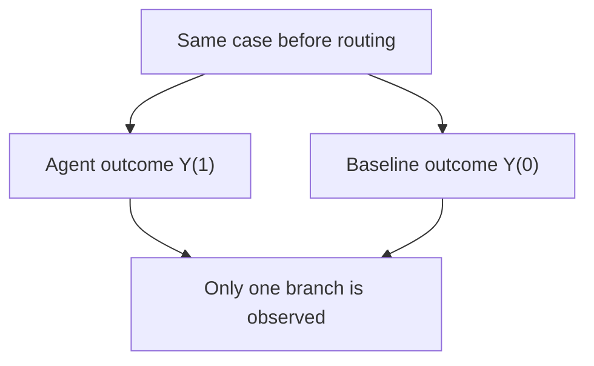

A counterfactual describes the outcome that would have occurred for a particular unit under an alternative action or condition. A case can receive either an agent-assisted response or a baseline response at a given decision point, but the researcher observes only the outcome under the action actually taken. The missing alternative is the central identification problem in causal evaluation.

## Potential outcomes are not free labels

Write $Y(1)$ for the outcome if a case receives the agent and $Y(0)$ for the outcome if it does not. The individual treatment effect is $Y(1)-Y(0)$, but a logged case reveals only one of these values. Randomization, strong adjustment assumptions, or a validated simulator can support population-level estimates; none makes the missing individual outcome directly observable.

## Example

A ticket routed to an agent resolves in six minutes. That does not prove that the agent saved four minutes merely because the current baseline average is ten minutes. The same ticket might have resolved in five minutes without assistance if it was unusually simple. A randomized experiment compares comparable groups to estimate the average difference, while a logged-policy estimator needs action probabilities and overlap to reason about actions that were rarely taken.

## Why it matters here

Researchers evaluating routing, recommendation, human review, or reinforcement-learning policies must separate observed outcomes from unobserved alternatives. Otherwise a convenient baseline average can be mistaken for the effect of an intervention.

## Related terms

- [Causal inference](glossary://causal-inference)
- [Off-policy evaluation](glossary://off-policy)
- [A/B testing](glossary://ab-testing)
