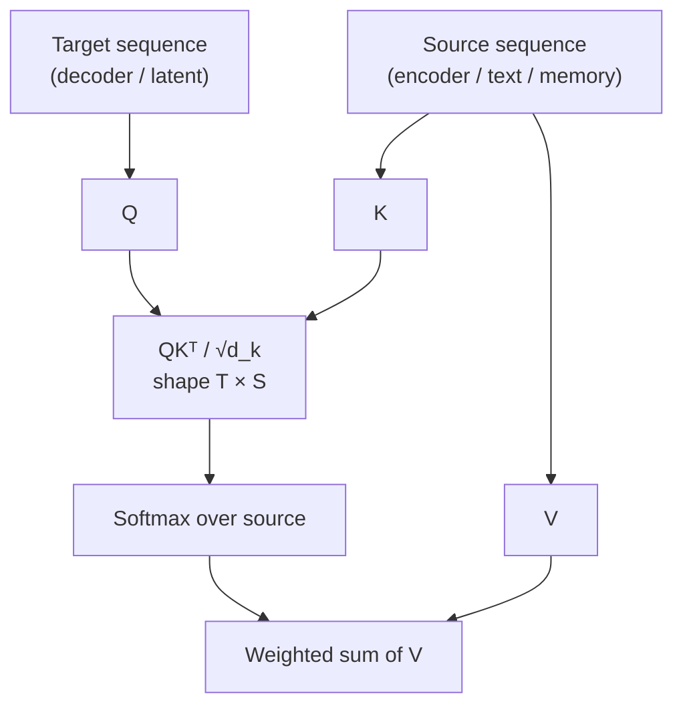

**Cross-attention** is scaled dot-product attention where queries come from one sequence and keys and values come from another. Self-attention builds $Q$, $K$, and $V$ from the same stream. Cross-attention is how a target stream *reads* an external stream: decoder states reading encoder memory, image latents reading text tokens, or a language model reading vision tokens.

## Diagram



## Intuition

Self-attention asks: "among *my* tokens, who matters?" Cross-attention asks: "given what I am trying to produce right now, which positions in *that other sequence* should I read?"

Queries are the "what do I need?" vectors from the current stream. Keys are the "what do I offer?" vectors from the source. Softmax weights over the source select values, so each target position gets a context vector that is a weighted mix of source content. This step rewrites the target residual stream; the source sequence is only read.

In the original Transformer, Vaswani et al. call this **encoder-decoder attention**: queries come from the preceding decoder sublayer, and keys and values come from the encoder stack. Every decoder position can attend over all non-padding source positions.

## Formula

The core operation is the same scaled dot-product attention used for self-attention (Vaswani et al., 2017, Eq. 1):

$$
\mathrm{Attention}(Q,K,V) = \mathrm{softmax}\!\left(\frac{QK^{\top}}{\sqrt{d_k}}\right)V
$$

What changes is *where* the matrices come from. With target hidden states $X_{\mathrm{tgt}}\in\mathbb{R}^{T\times d}$ and source hidden states $X_{\mathrm{src}}\in\mathbb{R}^{S\times d}$:

$$
Q = X_{\mathrm{tgt}} W^Q,\quad K = X_{\mathrm{src}} W^K,\quad V = X_{\mathrm{src}} W^V
$$

Score matrix shape is $T\times S$, not $T\times T$. Multi-head cross-attention applies the same pattern per head, then concatenates and multiplies by $W^O$.

**Masks.** A source padding mask excludes padded slots before softmax. In standard full-input encoder-decoder translation, source attention is not causal: the encoded source is already available. Streaming or time-aligned cross-attention can impose additional source restrictions. The decoder's self-attention remains causal during autoregressive generation.

## Example

**Encoder-decoder translation.** Source sentence length $S=4$ ("cache memory pressure now"), target so far length $T=3$ ("decode slows ___"). At the blank:

| Role | Tensor | Shape (one head, $d_k=64$) |
| --- | --- | --- |
| Queries | from decoder state | $3\times 64$ |
| Keys / values | from encoder memory | $4\times 64$ |
| Scores | $QK^{\top}/\sqrt{d_k}$ | $3\times 4$ |
| Context | weighted $V$ | $3\times 64$ |

The third decoder row can put high weight on "pressure" and "memory" while generating a word about latency. Self-attention among decoder tokens stays separate and causal.

**Text-conditioned image generation.** In latent diffusion models (Rombach et al., 2022), spatial features $\varphi(z_t)$ provide queries and a text encoder $\tau(y)$ provides keys and values:

$$
Q = W_Q\,\varphi_i(z_t),\quad K = W_K\,\tau(y),\quad V = W_V\,\tau(y)
$$

Each spatial location can bind to prompt tokens ("red", "button", "left") while denoising. That is the same math with roles flipped relative to a text decoder reading image tokens (there $Q$ is from text and $K,V$ from vision).

## Worked numbers

Two target queries, three source keys, $d_k=2$:

```python
import math

Q = [[1.0, 0.0], [0.0, 1.0]]
K = [[1.0, 0.0], [0.2, 0.8], [0.0, 1.0]]
V = [[1.0, 0.0], [0.5, 0.5], [0.0, 1.0]]

def softmax(row):
    m = max(row)
    exps = [math.exp(x - m) for x in row]
    s = sum(exps)
    return [e / s for e in exps]

scale = math.sqrt(2)
scores = [
    [sum(qi * kj for qi, kj in zip(q, k)) / scale for k in K]
    for q in Q
]
# scores ≈ [[0.707, 0.141, 0.000],
#           [0.000, 0.566, 0.707]]
weights = [softmax(row) for row in scores]
# weights ≈ [[0.485, 0.276, 0.239],
#            [0.209, 0.368, 0.423]]  # each row sums to 1.0 (T x S routing)
out = [
    [sum(w * V[j][d] for j, w in enumerate(row)) for d in range(2)]
    for row in weights
]
# out ≈ [[0.623, 0.377], [0.393, 0.607]]
```

Query 0 is aligned with source key 0, so most mass lands on the first value. Query 1 prefers the last two sources. Score cost is $O(TSd_k)$; multiplying by $V$ is $O(TSd_v)$. Long source memory ($S$ large) with long targets ($T$ large) still hurts. Cross-attention uses a rectangular $T\times S$ score grid.

## How it works in a stack

A typical decoder layer order:

1. Causal self-attention over target tokens (and residual)
2. Cross-attention into source memory for the current input (and residual)
3. Feed-forward network (and residual)

During autoregressive decode, source $K$ and $V$ are often computed once after the encoder (or vision encoder) finishes and reused every step. Only the new target query changes. That is the cross-attention analogue of a [KV cache](glossary://kv-cache) for the *memory* side. If the source changes (new document, new image, updated retrieval), recompute those $K,V$; reusing a stale memory is a common bug.

## Trade-offs

| Pattern | Streams meet | Good when | Cost pattern |
| --- | --- | --- | --- |
| Cross-attention | Target queries source | Asymmetric roles (decode conditioned on encode; U-Net conditioned on text) | $O(TS d)$ score/value work per head (scaling in $T,S$); source KV often cacheable |
| [Early fusion](glossary://early-fusion) | Concatenate then self-attend | Fine-grained joint reasoning in one stack | Longer combined sequence; one shared KV cache |
| [Late fusion](glossary://late-fusion) | Merge scores/decisions late | Independent specialists, easy ablations | Cheap, but weak token-level binding |

Decoder-only LLMs often skip a separate cross-attention block and put retrieved text or image tokens into the same causal stream (prefix fusion). That is still "conditioning," but it is self-attention over a mixed sequence, not encoder-decoder cross-attention.

## Why it matters here

Cross-attention is the bridge in classical encoder-decoder transformers (translation, T5-style models), many multimodal and vision-language designs, and text-conditioned diffusion U-Nets. Curriculum material on attention types, multimodal architecture, and image generation all assume you can name which side supplies $Q$ versus $K/V$, predict the $T\times S$ score shape, and choose when cross-attention beats early or late fusion.

## Related terms

- [Self-attention](glossary://self-attention)
- [Attention head](glossary://attention-head)
- [Softmax](glossary://softmax)
- [Early fusion](glossary://early-fusion)
- [Vision-language model](glossary://vision-language-model)
