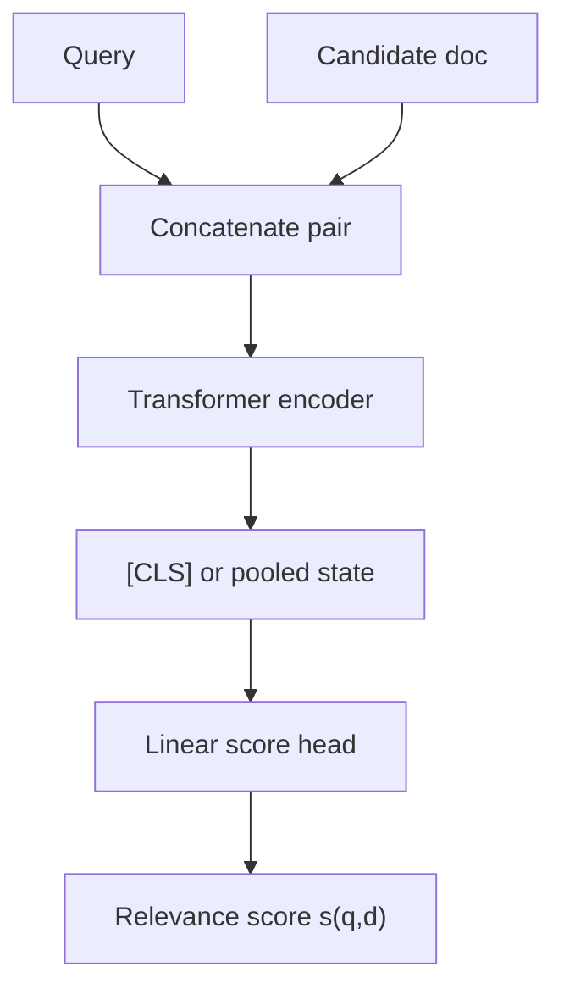

A cross-encoder jointly processes a query and candidate to produce a score. In a bidirectional encoder such as BERT, query and document tokens can attend to each other. Unlike a bi-encoder, it doesn't provide an independently reusable document embedding for scoring: each pair must be processed, although many pairs can share a batched forward pass.

That joint attention is why cross-encoders usually outrank pooled-vector similarity on hard constraints (negation, version pins, entity swaps, answerability). It is also why they cannot scan a million-passage corpus online. In production they almost always sit as a second-stage [reranker](glossary://reranker) over a shortlist from BM25, dense retrieval, or hybrid search.

## Diagram

## How it works

Input is a single sequence in the usual encoder format, for example BERT-style:

$$
[\mathrm{CLS}]\; q_1 \ldots q_m \;[\mathrm{SEP}]\; d_1 \ldots d_n \;[\mathrm{SEP}]
$$

Self-attention runs over the full concatenated sequence, so query tokens can condition on document tokens (and vice versa) in every layer. A classification head maps the final pooled state (classically the `[CLS]` hidden vector $h_{\mathrm{CLS}}$) to a scalar:

$$
s(q, d) = w^\top h_{\mathrm{CLS}} + b
$$

For binary relevance training, $s(q,d)$ is often treated as a logit and trained with binary cross-entropy against label $y \in \{0,1\}$:

$$
P(\mathrm{relevant}\mid q,d) = \sigma\bigl(s(q,d)\bigr),\qquad
\mathcal{L} = -\bigl[y\log\sigma(s) + (1-y)\log\bigl(1-\sigma(s)\bigr)\bigr]
$$

Pairwise and listwise ranking losses are also common when you have graded labels or hard negatives. Nogueira and Cho (2019) popularized this pattern by fine-tuning BERT as a passage re-ranker on MS MARCO and TREC-CAR; MS MARCO-trained checkpoints such as `cross-encoder/ms-marco-MiniLM-L6-v2` remain standard open starting points.

**Operational detail:** raw scores are model-specific. Some heads apply a sigmoid and emit values in $[0,1]$; many MS MARCO MiniLM checkpoints emit unbounded logits (e.g. $+8$ vs $-4$). Rank by score within a query and calibrate absolute thresholds on your traffic.

## Example

Support query: "how do I rotate a leaked API key?"

1. A hypothetical hybrid first stage (BM25 + bi-encoder ANN) returns $k=100$ candidates.
2. A cross-encoder scores those pairs in batches sized to available memory. Measure latency with the actual model, token lengths, hardware, and concurrent load.
3. Scores promote the exact key-rotation runbook above a near-miss password-reset page and a generic "API authentication overview" that shared topic words but not the procedure.
4. The generator receives the top $5$ passages only.

If the rotation runbook never entered the $100$, no amount of joint attention can invent it. Measure candidate [recall@k](glossary://recall-at-k) *before* rerank, then [MRR](glossary://mrr) / [NDCG](glossary://ndcg) and p95 latency *after*.

## Cost boundary

One pair equals one full encoder forward over query+doc tokens (often truncated to $512$). Attention cost is **quadratic in pair length $L$** and **linear in candidate count $k$** (full multi-layer cost scales like $O(k \cdot L_{\mathrm{layers}} \cdot L^2 \cdot d)$). There is no offline document index to amortize. Practical defaults:

| Stage | Typical $k$ | Role |
| --- | --- | --- |
| First-stage retrieval | $10^5$–$10^7$ corpus, return $50$–$200$ | Cheap recall (BM25 / bi-encoder / hybrid) |
| Cross-encoder rerank | those $50$–$200$ pairs | Fine ranking for prompt packing |
| Context packing | top $3$–$10$ | Generator evidence |

Tune $k$ as a budget: too small hurts recall into the reranker; too large burns latency for marginal quality. Batch pairs, cap document tokens, set a timeout, and fall back to first-stage order if the reranker times out.

## Trade-offs

| Concern | Bi-encoder | Late interaction (ColBERT) | Cross-encoder |
| --- | --- | --- | --- |
| Offline index | One vector per doc | Many token vectors per doc | None (query-dependent) |
| Token interaction | Compressed into pools | MaxSim at query time | Full joint self-attention |
| Query cost | 1 encode + ANN | Query encode + MaxSim | 1 encode **per candidate** |
| Typical role | First-stage retrieval | First stage or strong mid stage | Second-stage rerank |

Use a cross-encoder when first-stage recall is already high and you need precise ordering before generation. Prefer expanding candidate generation, hybrid lexical match, or late interaction when the bottleneck is missing evidence rather than wrong order among retrieved hits.

## Why it matters here

Cross-encoders teach the core retrieval stack trade-off in RAG: cheap first-stage recall, expensive fine-grained interaction only on the shortlist that actually reaches the prompt. When answers cite the wrong snippet, separate "gold never in top-$k$" from "gold was present but poorly ordered" before changing models.

## Related terms

- [Bi-encoder](glossary://bi-encoder)
- [Reranker](glossary://reranker)
- [Candidate generation](glossary://candidate-generation)
- [ColBERT](glossary://colbert)
- [Dense retrieval](glossary://dense-retrieval)
